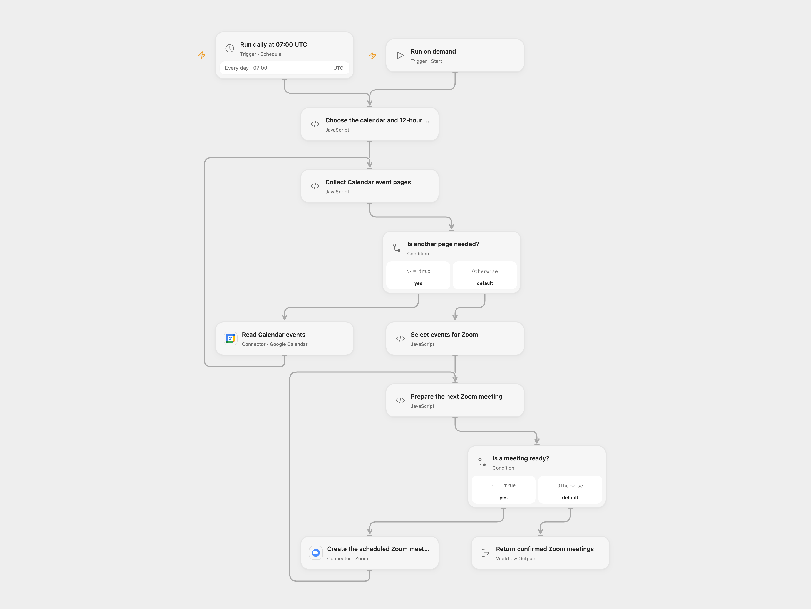

# Schedule Zoom Meetings for Calendar Events

Review the next 12 hours of Google Calendar and create Zoom meetings for eligible timed events.

<!-- template-actions:start -->
 
<!-- template-actions:end -->

<picture>
  <source media="(prefers-color-scheme: dark)" srcset="preview-dark.png">
  
</picture>

## Setup

1. Enter the Google Calendar ID in **Choose the calendar and 12-hour window**. Use `primary` for the connected account's primary calendar.
2. Select the Google Calendar connection in **Read Calendar events** and the host's Zoom connection in **Create the scheduled Zoom meeting**. Allow the connections to read the calendar and schedule Zoom meetings for that host.
3. Run on demand or publish the daily 07:00 UTC schedule. Choose the schedule's time zone to run at 07:00 local time instead.

## Behavior

The workflow reads all pages of the selected calendar for the next 12 hours and expands recurring events into individual occurrences. It selects timed events whose start falls inside the window. Transparent or cancelled events, all-day events and events without a title are skipped. Titles containing `signal`, `minute meeting` or `in person` are skipped regardless of case. The workflow stops before creating meetings if the Calendar read fails. [Google Calendar event list](https://developers.google.com/workspace/calendar/api/v3/reference/events/list)

Each selected event creates a scheduled Zoom meeting titled “Meeting with” followed by the Calendar title. The workflow uses the event’s start time, rounds the duration up to whole minutes and uses the calendar time zone when the event omits one. It returns the Calendar event ID, confirmed Zoom meeting ID and participant join link when available. Calendar events stay unchanged and attendees receive no workflow messages. [Zoom Meetings API](https://developers.zoom.us/docs/api/meetings/)

A failed or uncertain creation stops the run. Check the host’s meetings before rerunning. Overlapping runs can create a second Zoom meeting for the same Calendar event.

In n8n

Enter the Google Calendar ID in **Choose the calendar and 12-hour window** and select the Google Calendar OAuth2 and Zoom OAuth2 credentials on the two HTTP nodes. The workflow time zone is set to UTC. Change it in workflow settings if you want 07:00 in another time zone. The final loop output contains one result item for each confirmed meeting.

Inspiration &amp; credits

## Changes to the source

The template reads the full Calendar window, applies the intended `minute meeting` title filter and skips events without a usable timed start and end.

Adapted from [Google Calendar to Zoom meeting workflow](https://github.com/Zie619/n8n-workflows/blob/ae8cf6dc5b873cbb4f74587aa9180ed3a9f70682/workflows/Datetime/0348_Datetime_GoogleCalendar_Automation_Scheduled.json) in [Zie619/n8n-workflows](https://github.com/Zie619/n8n-workflows). Attribution: Zie619 / n8n-workflows.

The collection’s [MIT notice](https://github.com/Zie619/n8n-workflows/blob/94007c1445d9258a7da116646b79473e7c7c3282/LICENSE) is pinned at a later revision. This is the collection notice at that revision; it does not establish a separate original template author's license. Our changes are listed above; see [repository licensing](../../README.md#licensing).

> MIT License
>
> Copyright (c) 2025 Zie619
>
> Permission is hereby granted, free of charge, to any person obtaining a copy
> of this software and associated documentation files (the "Software"), to deal
> in the Software without restriction, including without limitation the rights
> to use, copy, modify, merge, publish, distribute, sublicense, and/or sell
> copies of the Software, and to permit persons to whom the Software is
> furnished to do so, subject to the following conditions:
>
> The above copyright notice and this permission notice shall be included in all
> copies or substantial portions of the Software.
>
> THE SOFTWARE IS PROVIDED "AS IS", WITHOUT WARRANTY OF ANY KIND, EXPRESS OR
> IMPLIED, INCLUDING BUT NOT LIMITED TO THE WARRANTIES OF MERCHANTABILITY,
> FITNESS FOR A PARTICULAR PURPOSE AND NONINFRINGEMENT. IN NO EVENT SHALL THE
> AUTHORS OR COPYRIGHT HOLDERS BE LIABLE FOR ANY CLAIM, DAMAGES OR OTHER
> LIABILITY, WHETHER IN AN ACTION OF CONTRACT, TORT OR OTHERWISE, ARISING FROM,
> OUT OF OR IN CONNECTION WITH THE SOFTWARE OR THE USE OR OTHER DEALINGS IN THE
> SOFTWARE.

