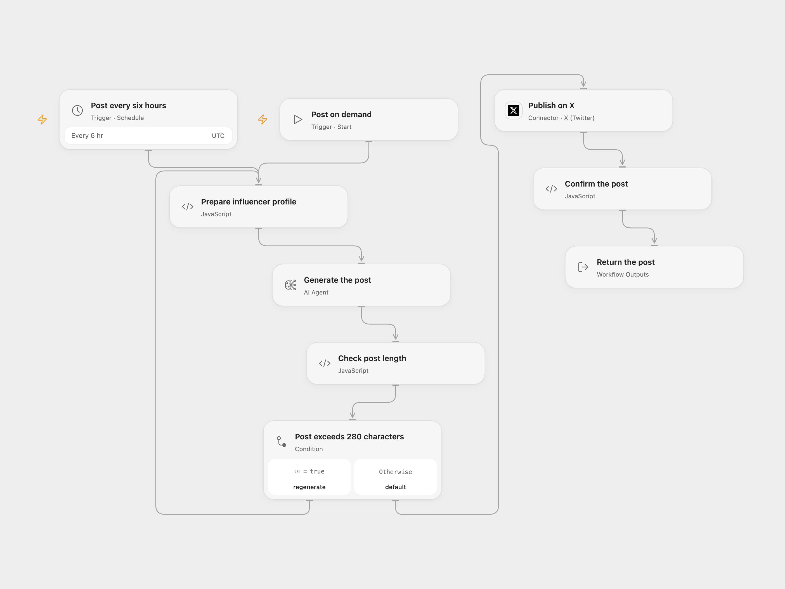

# Scheduled AI Influencer Post

Generate an X post from your chosen niche and writing profile, and publish it manually or on a schedule.

<picture>
  <source media="(prefers-color-scheme: dark)" srcset="preview-dark.png">
  
</picture>

[Open Flow JSON](templates/scheduled-ai-influencer-post.openflow.json) · [n8n JSON](templates/scheduled-ai-influencer-post.n8n.json)

## Setup and use

Connect X with permission to create posts and configure an available model in **Generate the post**. Edit the niche, style and inspiration inputs in **Prepare influencer profile**. Run manually or enable the six-hour schedule after choosing its minute and timezone. The n8n format uses its workflow timezone and chooses a random minute when the schedule is registered. Open Flow defaults to minute zero in UTC; set its schedule to your preferred minute and timezone.

The workflow asks for one post and regenerates when its JavaScript string length exceeds 280. X uses its own character-counting rules, so a post that passes this check can still be rejected. Empty or malformed model output stops Open Flow. Review the profile and account before enabling automated publication. Model text may be inaccurate, and publication does not guarantee engagement.

Open Flow checks the returned post ID and has no automatic post retry. The n8n X credential helper may refresh and resend after an authentication failure. Inspect X before replaying an uncertain post; neither format guarantees exactly-once delivery.

Inspiration &amp; credits

## Changes to the source

- Replace the source preview model with a current configurable model and explicitly request the JSON tweet field used by the source length check.
- Retain the n8n X v2 node; Open Flow confirms the returned post ID.

Adapted from [Twitter Virtual AI Influencer](https://github.com/enescingoz/awesome-n8n-templates/blob/827110332c21cbe000ab13f6d292d5adb1f1f8db/Instagram_Twitter_Social_Media/Twitter%20Virtual%20AI%20Influencer.json) in [enescingoz/awesome-n8n-templates](https://github.com/enescingoz/awesome-n8n-templates).

Source collection notice: © 2024–2026 Enes Cingoz, [CC BY 4.0](https://github.com/enescingoz/awesome-n8n-templates/blob/827110332c21cbe000ab13f6d292d5adb1f1f8db/LICENSE). The source export does not identify a separate template author or license. See [repository licensing](../../README.md#licensing) for the scope of OOMOL contributions and third-party material.

