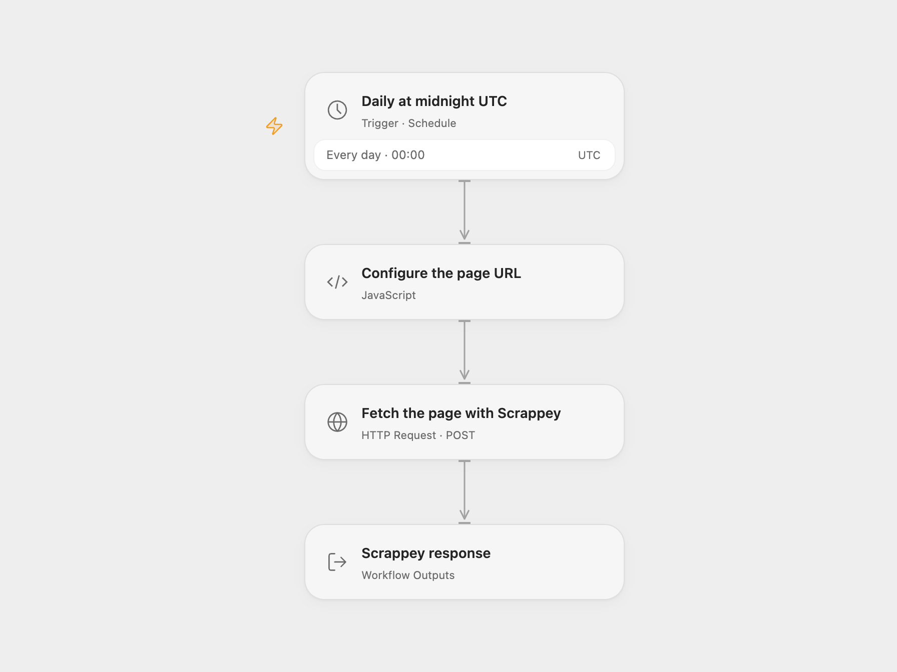

# Scheduled Scrappey Page Fetch

Fetch a configured page through Scrappey each day and return its response.

<picture>
  <source media="(prefers-color-scheme: dark)" srcset="preview-dark.png">
  
</picture>

[Open Flow JSON](templates/scheduled-scrappey-page-fetch.openflow.json) · [n8n JSON](templates/scheduled-scrappey-page-fetch.n8n.json)

## Setup

In Open Flow, set the target page URL in **Configure the page URL**, create a secret Variable with your Scrappey API key and bind it to **Auth Token** on **Fetch the page with Scrappey**. In n8n, edit the URL in **Test Data** and configure HTTP Query Auth on the request with name `key` and your API key as its value. Activate one format.

## Behavior

At midnight each day, Scrappey loads the configured page in a browser session and returns its response. Inspect the response for the page status and contents; this workflow does not save or send the result elsewhere. Use it only for pages you are authorized to access. The API key is sent in the request URL and may appear in service or proxy logs. Scrappey and the target site may also retain request data.

Both schedules start in UTC; the source used the n8n instance timezone. n8n Schedule Trigger chooses a stable second within the minute, while Open Flow starts on the minute boundary. Non-2xx HTTP responses stop the run; Scrappey may report a page or service error inside a successful HTTP response, so inspect its response. Open Flow applies a 30-second request timeout and 4 MiB response limit. A timeout may occur after the service started the request; check its result before retrying. The target URL must be HTTP or HTTPS without embedded credentials.

Inspiration &amp; credits

## Changes to the source

- Replace the example page with a configurable URL, use a secret query credential, and make the timezone explicit.
- Configure the documented JSON request body explicitly.

Adapted from [Scrape every URL on the web with Scrappey](https://github.com/Zie619/n8n-workflows/blob/ae8cf6dc5b873cbb4f74587aa9180ed3a9f70682/workflows/Http/0510_HTTP_Schedule_Automation_Webhook.json) in [Zie619/n8n-workflows](https://github.com/Zie619/n8n-workflows). The matching [n8n community listing](https://n8n.io/workflows/2299-scrape-every-url-on-the-web-without-getting-blocked-by-anti-bot-technologies-with-scrappey/) credits Bela. The original template does not state a separate license.

The collection’s [MIT notice](https://github.com/Zie619/n8n-workflows/blob/94007c1445d9258a7da116646b79473e7c7c3282/LICENSE) is pinned at a later revision. This is the collection notice at that revision; it does not establish a separate original template author's license. Our changes are listed above; see [repository licensing](../../README.md#licensing).

> MIT License
>
> Copyright (c) 2025 Zie619
>
> Permission is hereby granted, free of charge, to any person obtaining a copy
> of this software and associated documentation files (the "Software"), to deal
> in the Software without restriction, including without limitation the rights
> to use, copy, modify, merge, publish, distribute, sublicense, and/or sell
> copies of the Software, and to permit persons to whom the Software is
> furnished to do so, subject to the following conditions:
>
> The above copyright notice and this permission notice shall be included in all
> copies or substantial portions of the Software.
>
> THE SOFTWARE IS PROVIDED "AS IS", WITHOUT WARRANTY OF ANY KIND, EXPRESS OR
> IMPLIED, INCLUDING BUT NOT LIMITED TO THE WARRANTIES OF MERCHANTABILITY,
> FITNESS FOR A PARTICULAR PURPOSE AND NONINFRINGEMENT. IN NO EVENT SHALL THE
> AUTHORS OR COPYRIGHT HOLDERS BE LIABLE FOR ANY CLAIM, DAMAGES OR OTHER
> LIABILITY, WHETHER IN AN ACTION OF CONTRACT, TORT OR OTHERWISE, ARISING FROM,
> OUT OF OR IN CONNECTION WITH THE SOFTWARE OR THE USE OR OTHER DEALINGS IN THE
> SOFTWARE.

