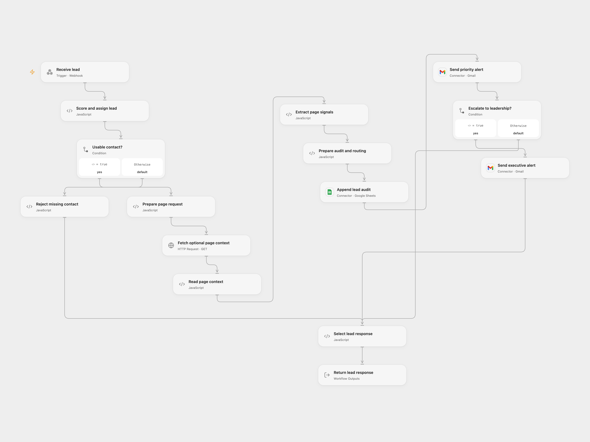

# Score and Route Demo Leads

Score inbound demo leads, record their context, and route follow-up alerts.

<!-- template-actions:start -->
 
<!-- template-actions:end -->

<picture>
  <source media="(prefers-color-scheme: dark)" srcset="preview-dark.png">
  
</picture>

## Setup

Connect Gmail and Google Sheets, set the spreadsheet ID in **Append lead audit**, and create a `Leads` sheet with columns `received_at`, `priority`, `lead_score`, `sla_minutes`, `owner_team`, `intent_tags`, `page_signal_tags`, `dedupe_key`, `email`, `company`, `message`, `name`, `phone`, `role`, `budget`, `timeline`, `page_url`, `source`, `utm_campaign`, `needs_exec_escalation`, `missing_contact`, `page_title`, and `page_description`. Set the four recipient addresses in **Prepare audit and routing**. Restrict webhook access to trusted callers.

## Behavior

Missing contact information returns an error response. A valid submission is scored and optionally enriched with its submitted page title and description; page fetch failures continue without page signals. The workflow writes an audit row and sends a priority email. Hot leads with the source's executive escalation flag also send a leadership alert. It returns priority, score, SLA, owner, and dedupe key. The key is descriptive and does not deduplicate submissions.

If an audit append or Gmail send loses its response, the write may have happened. Inspect the sheet and mailbox before retrying the same submission. Open Flow's webhook waits up to 60 seconds for its response.

In n8n

Import the n8n workflow, configure its Gmail and Sheets credentials, and enable **Lead Intake Webhook**.

Inspiration &amp; credits

Adapted from [B2B Demo Lead Rescue Desk - Enrich Score Route and Escalate](https://github.com/enescingoz/awesome-n8n-templates/blob/827110332c21cbe000ab13f6d292d5adb1f1f8db/Google_Drive_and_Google_Sheets/B2B%20Demo%20Lead%20Rescue%20Desk%20-%20Enrich%20Score%20Route%20and%20Escalate.json) in [enescingoz/awesome-n8n-templates](https://github.com/enescingoz/awesome-n8n-templates).

Source collection notice: © 2024–2026 Enes Cingoz, [CC BY 4.0](https://github.com/enescingoz/awesome-n8n-templates/blob/827110332c21cbe000ab13f6d292d5adb1f1f8db/LICENSE). The source export does not identify a separate template author or license. See [repository licensing](../../README.md#licensing) for the scope of OOMOL contributions and third-party material.

