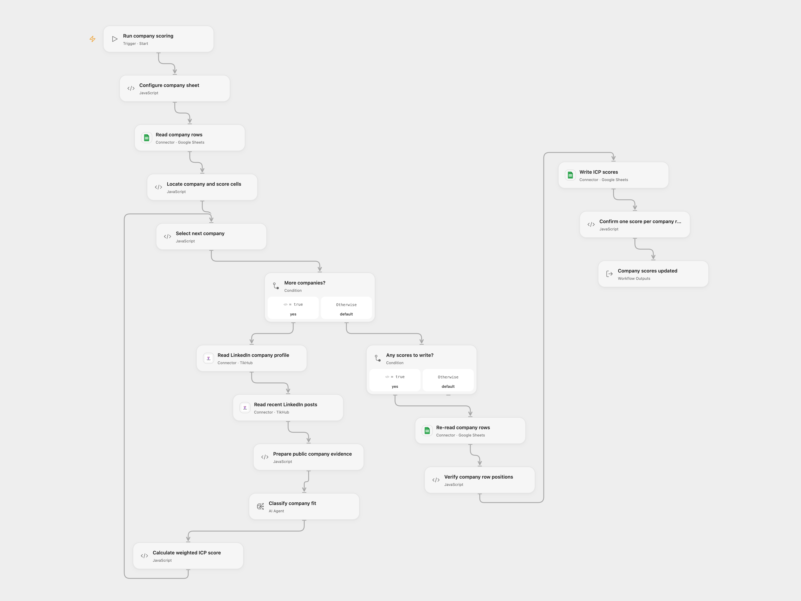

# Score LinkedIn Companies in Google Sheets

Calculate ideal customer profile scores for LinkedIn company URLs and write the scores to their original Google Sheets rows.

<!-- template-actions:start -->
 
<!-- template-actions:end -->

<picture>
  <source media="(prefers-color-scheme: dark)" srcset="preview-dark.png">
  
</picture>

## Setup

1. In Google Sheets, put `Linkedin_URL_Company` and `ICP_Score_Company` in row 1 of the same tab, with one public LinkedIn company URL per row.
2. Connect Google Sheets to an account with edit access and set the spreadsheet ID and tab name in **Configure company sheet**.
3. Connect TikHub with access to the LinkedIn Web V2 company profile and company posts endpoints. Select an AI model in **Classify company fit** that returns structured results.
4. Run the workflow manually. Keep the tab structure and company rows stable until it finishes.

## Behavior

The workflow skips blank URLs, reads each company's public profile and first page of recent posts through TikHub, and passes excerpts to the model for classification. It assigns points for AI focus (5–25), technical level (5–35), company size (5–30), automation agency status (0 or 20), and US or European headquarters (0 or 10). Employee counts of 10–150 earn 25 points and counts above 150 earn 30.

The workflow rechecks company URLs and column headers before writing only the numeric score cells, including any scores already present. A missing or ambiguous company size, invalid URL, or lookup failure stops scoring before any write. If a write fails or the result is unclear, check the score cells before running again. Use the scores as a prioritization aid and verify important classifications manually.

In n8n

Connect Google Sheets in the read and update nodes and select your own company tab in both. Set up Airtop credentials in **Calculate ICP Scoring** and execute the workflow manually. Airtop queries each company page and returns the analysis and score. n8n writes the numeric score by source row number.

Inspiration &amp; credits

## Changes to the source

- Use TikHub public profile and recent posts and calculate the weighted total in code in Open Flow.
- Recheck row identities before batch-updating score cells in Open Flow. The n8n export uses a score-only update and retains Airtop.
- The [original n8n listing](https://n8n.io/workflows/3475-linkedin-company-icp-scoring-automation-with-airtop-and-google-sheets/) credits Airtop.

Adapted from [ICP Company Scoring](https://github.com/Zie619/n8n-workflows/blob/ae8cf6dc5b873cbb4f74587aa9180ed3a9f70682/workflows/Manual/2021_Manual_GoogleSheets_Automation_Triggered.json) in [Zie619/n8n-workflows](https://github.com/Zie619/n8n-workflows). Attribution: Airtop (original template); Zie619 / n8n-workflows (collection).

The collection’s [MIT notice](https://github.com/Zie619/n8n-workflows/blob/94007c1445d9258a7da116646b79473e7c7c3282/LICENSE) is pinned at a later revision. This is the collection notice at that revision; it does not establish a separate original template author's license. Our changes are listed above; see [repository licensing](../../README.md#licensing).

> MIT License
>
> Copyright (c) 2025 Zie619
>
> Permission is hereby granted, free of charge, to any person obtaining a copy
> of this software and associated documentation files (the "Software"), to deal
> in the Software without restriction, including without limitation the rights
> to use, copy, modify, merge, publish, distribute, sublicense, and/or sell
> copies of the Software, and to permit persons to whom the Software is
> furnished to do so, subject to the following conditions:
>
> The above copyright notice and this permission notice shall be included in all
> copies or substantial portions of the Software.
>
> THE SOFTWARE IS PROVIDED "AS IS", WITHOUT WARRANTY OF ANY KIND, EXPRESS OR
> IMPLIED, INCLUDING BUT NOT LIMITED TO THE WARRANTIES OF MERCHANTABILITY,
> FITNESS FOR A PARTICULAR PURPOSE AND NONINFRINGEMENT. IN NO EVENT SHALL THE
> AUTHORS OR COPYRIGHT HOLDERS BE LIABLE FOR ANY CLAIM, DAMAGES OR OTHER
> LIABILITY, WHETHER IN AN ACTION OF CONTRACT, TORT OR OTHERWISE, ARISING FROM,
> OUT OF OR IN CONNECTION WITH THE SOFTWARE OR THE USE OR OTHER DEALINGS IN THE
> SOFTWARE.

