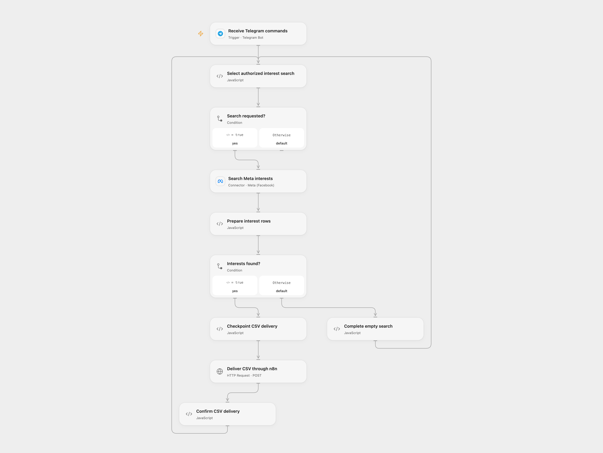

# Search Meta Interests from Telegram

Search Meta ad interests from an authorized Telegram command and return a CSV document.

<picture>
  <source media="(prefers-color-scheme: dark)" srcset="preview-dark.png">
  
</picture>

[Open Flow JSON](templates/search-meta-interests-from-telegram.openflow.json) · [n8n JSON](templates/search-meta-interests-from-telegram.n8n.json)

## Setup

Connect the Telegram bot and Meta account with permission to search ad interests. Set the allowed numeric chat ID in **Select authorized interest search**. Import the supplied n8n workflow, connect the relay Telegram node to the same bot, disable **Get interest name**, enable **CSV delivery webhook**, and enter its production URL in **Deliver CSV through n8n**. Restrict access to the relay URL. Enable persistent State and prevent overlapping runs.

For direct n8n use, enable **Get interest name**, disable the relay webhook, configure its authorized chat ID and connect the Meta and Telegram credentials. A bot supports only one active webhook; activate one format.

## Behavior

Send `#interest topic` from the configured chat. The workflow searches Meta and returns `report.csv` with names, audience bounds, paths, descriptions and topics. Empty results produce no document. Results and available fields depend on Meta access and response limits; the source requests up to 1,000,000 results.

If delivery fails or is uncertain, inspect the Telegram chat before entering that update ID in **Select authorized interest search** to acknowledge it. The command is then treated as handled and queued commands continue. Do not automatically replay an uncertain document send.

Inspiration &amp; credits

## Changes to the source

- Replace the private chat ID with configuration and retain the chat filter.
- Use Meta's current Provider API and a supplied n8n relay to turn rows into a CSV attachment; skip the source's paging metadata when building rows.

Adapted from [Search Meta ad interests from Telegram](https://github.com/Zie619/n8n-workflows/blob/ae8cf6dc5b873cbb4f74587aa9180ed3a9f70682/workflows/Telegram/0388_Telegram_Code_Create_Triggered.json) in [Zie619/n8n-workflows](https://github.com/Zie619/n8n-workflows). The source export does not identify a separate template author or license.

The collection’s [MIT notice](https://github.com/Zie619/n8n-workflows/blob/94007c1445d9258a7da116646b79473e7c7c3282/LICENSE) is pinned at a later revision. This is the collection notice at that revision; it does not establish a separate original template author's license. Our changes are listed above; see [repository licensing](../../README.md#licensing).

> MIT License
>
> Copyright (c) 2025 Zie619
>
> Permission is hereby granted, free of charge, to any person obtaining a copy
> of this software and associated documentation files (the "Software"), to deal
> in the Software without restriction, including without limitation the rights
> to use, copy, modify, merge, publish, distribute, sublicense, and/or sell
> copies of the Software, and to permit persons to whom the Software is
> furnished to do so, subject to the following conditions:
>
> The above copyright notice and this permission notice shall be included in all
> copies or substantial portions of the Software.
>
> THE SOFTWARE IS PROVIDED "AS IS", WITHOUT WARRANTY OF ANY KIND, EXPRESS OR
> IMPLIED, INCLUDING BUT NOT LIMITED TO THE WARRANTIES OF MERCHANTABILITY,
> FITNESS FOR A PARTICULAR PURPOSE AND NONINFRINGEMENT. IN NO EVENT SHALL THE
> AUTHORS OR COPYRIGHT HOLDERS BE LIABLE FOR ANY CLAIM, DAMAGES OR OTHER
> LIABILITY, WHETHER IN AN ACTION OF CONTRACT, TORT OR OTHERWISE, ARISING FROM,
> OUT OF OR IN CONNECTION WITH THE SOFTWARE OR THE USE OR OTHER DEALINGS IN THE
> SOFTWARE.

