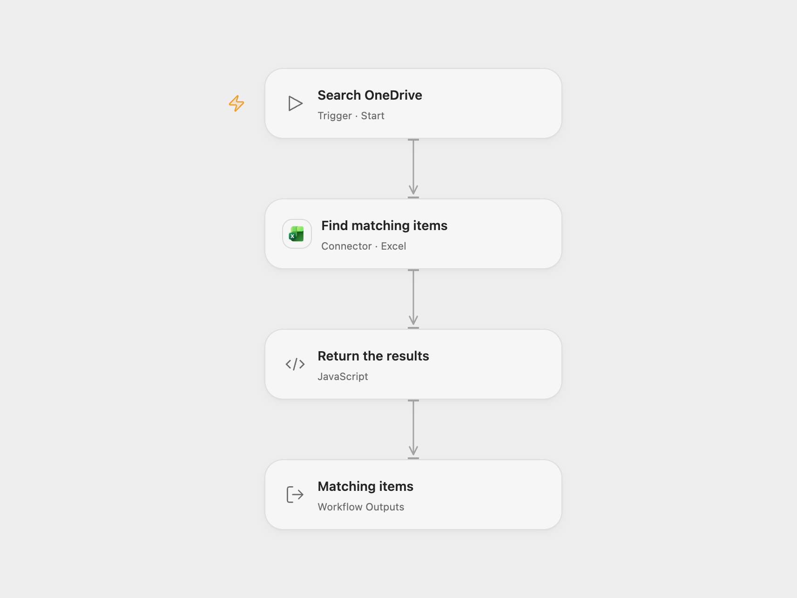

# Search OneDrive for Excel Workbooks

Search the current user’s OneDrive for the text .xlsx and return the first page of results.

<picture>
  <source media="(prefers-color-scheme: dark)" srcset="preview-dark.png">
  
</picture>

[Open Flow JSON](templates/search-onedrive-for-excel-workbooks.openflow.json) · [n8n JSON](templates/search-onedrive-for-excel-workbooks.n8n.json)

## Setup and use

Connect Microsoft Excel with OneDrive read access. In Open Flow, allow Provider API Request on the connection. In n8n, connect the Microsoft Excel OAuth credential. Run manually.

## Behavior

The workflow sends a OneDrive search for `.xlsx` with a page size of 100 and returns the first response page. It does not follow a next-page link. Search results are returned as Microsoft Graph provides them, without checking the filename extension or opening the workbook. Results can include other matching items, and the search is not a complete inventory.

Inspiration &amp; credits

## Changes to the source

- Open Flow uses the Excel Provider API Request to preserve the source search and raw result fields, returning the page as an array. n8n emits items separately.

Adapted from [Search for Excel workbooks](https://github.com/Zie619/n8n-workflows/blob/ae8cf6dc5b873cbb4f74587aa9180ed3a9f70682/workflows/Manual/1033_Manual_Microsoftexcel_Automate_Triggered.json) in [Zie619/n8n-workflows](https://github.com/Zie619/n8n-workflows). The source export does not identify a separate template author or license.

The collection’s [MIT notice](https://github.com/Zie619/n8n-workflows/blob/94007c1445d9258a7da116646b79473e7c7c3282/LICENSE) is pinned at a later revision. This is the collection notice at that revision; it does not establish a separate original template author's license. Our changes are listed above; see [repository licensing](../../README.md#licensing).

> MIT License
>
> Copyright (c) 2025 Zie619
>
> Permission is hereby granted, free of charge, to any person obtaining a copy
> of this software and associated documentation files (the "Software"), to deal
> in the Software without restriction, including without limitation the rights
> to use, copy, modify, merge, publish, distribute, sublicense, and/or sell
> copies of the Software, and to permit persons to whom the Software is
> furnished to do so, subject to the following conditions:
>
> The above copyright notice and this permission notice shall be included in all
> copies or substantial portions of the Software.
>
> THE SOFTWARE IS PROVIDED "AS IS", WITHOUT WARRANTY OF ANY KIND, EXPRESS OR
> IMPLIED, INCLUDING BUT NOT LIMITED TO THE WARRANTIES OF MERCHANTABILITY,
> FITNESS FOR A PARTICULAR PURPOSE AND NONINFRINGEMENT. IN NO EVENT SHALL THE
> AUTHORS OR COPYRIGHT HOLDERS BE LIABLE FOR ANY CLAIM, DAMAGES OR OTHER
> LIABILITY, WHETHER IN AN ACTION OF CONTRACT, TORT OR OTHERWISE, ARISING FROM,
> OUT OF OR IN CONNECTION WITH THE SOFTWARE OR THE USE OR OTHER DEALINGS IN THE
> SOFTWARE.

