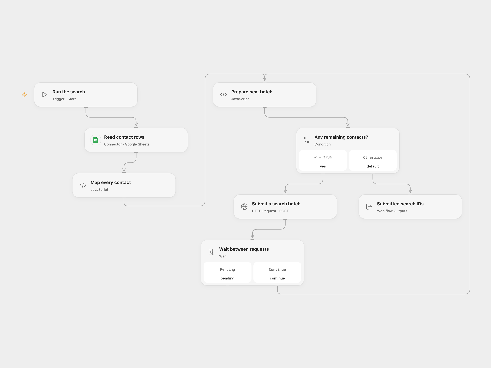

# Search Sheet Contacts with Icypeas

Submit Google Sheet contacts to Icypeas bulk email search.

<picture>
  <source media="(prefers-color-scheme: dark)" srcset="preview-dark.png">
  
</picture>

[Open Flow JSON](templates/search-sheet-contacts-with-icypeas.openflow.json) · [n8n JSON](templates/search-sheet-contacts-with-icypeas.n8n.json)

## Setup and use

Connect Google Sheets and select the spreadsheet and range. The first row must contain exact column labels `firstname`, `lastname` and `company`. Each populated row needs a first or last name and a company or domain. In Open Flow bind an Icypeas API key to the secret Variable **ICYPEAS_API_KEY** in **Submit a search batch**. In n8n configure Header Auth with the header name `Authorization` and the API key as its value. Run manually.

## Behavior

The workflow reads all rows in the configured range and submits them in order for **email-search**, under the batch name `Test`. It splits requests into at most 5,000 rows and waits one second between requests. The output contains accepted Icypeas file IDs; results are processed asynchronously and can be viewed in Icypeas. Empty sheets submit nothing. The sheet and batch data must fit the execution limits.

If a submission fails or its outcome is unknown, later batches stop, but earlier batches may already exist. Check Icypeas before retrying to avoid duplicate searches.

Inspiration &amp; credits

## Changes to the source

- Use the current API-key authentication and split large sheets into supported batches. Replace personal credentials and sheet IDs with configuration.

Adapted from [Email search with Icypeas (bulk search)](https://github.com/Zie619/n8n-workflows/blob/ae8cf6dc5b873cbb4f74587aa9180ed3a9f70682/workflows/Code/0365_Code_Manual_Send_Webhook.json) in [Zie619/n8n-workflows](https://github.com/Zie619/n8n-workflows). The matching [n8n listing](https://n8n.io/workflows/2014-perform-email-searches-with-icypeas-bulk/) credits Corentin Ribeyre. No separate original template license was identified.

The collection’s [MIT notice](https://github.com/Zie619/n8n-workflows/blob/94007c1445d9258a7da116646b79473e7c7c3282/LICENSE) is pinned at a later revision. This is the collection notice at that revision; it does not establish a separate original template author's license. Our changes are listed above; see [repository licensing](../../README.md#licensing).

> MIT License
>
> Copyright (c) 2025 Zie619
>
> Permission is hereby granted, free of charge, to any person obtaining a copy
> of this software and associated documentation files (the "Software"), to deal
> in the Software without restriction, including without limitation the rights
> to use, copy, modify, merge, publish, distribute, sublicense, and/or sell
> copies of the Software, and to permit persons to whom the Software is
> furnished to do so, subject to the following conditions:
>
> The above copyright notice and this permission notice shall be included in all
> copies or substantial portions of the Software.
>
> THE SOFTWARE IS PROVIDED "AS IS", WITHOUT WARRANTY OF ANY KIND, EXPRESS OR
> IMPLIED, INCLUDING BUT NOT LIMITED TO THE WARRANTIES OF MERCHANTABILITY,
> FITNESS FOR A PARTICULAR PURPOSE AND NONINFRINGEMENT. IN NO EVENT SHALL THE
> AUTHORS OR COPYRIGHT HOLDERS BE LIABLE FOR ANY CLAIM, DAMAGES OR OTHER
> LIABILITY, WHETHER IN AN ACTION OF CONTRACT, TORT OR OTHERWISE, ARISING FROM,
> OUT OF OR IN CONNECTION WITH THE SOFTWARE OR THE USE OR OTHER DEALINGS IN THE
> SOFTWARE.

