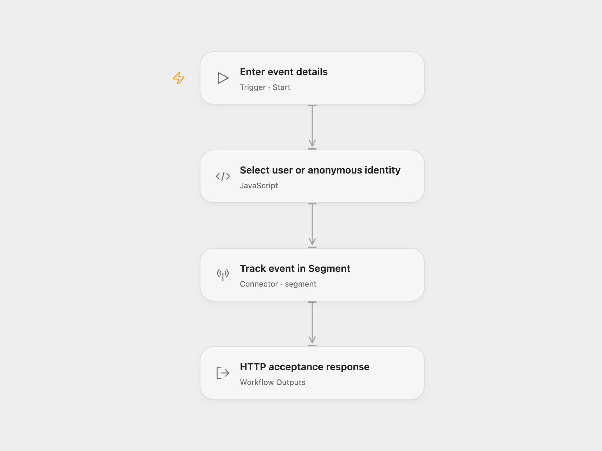

# Segment Event Tracker

Send one Track event to a Segment source. Use an existing application user ID or leave it empty to generate a new anonymous identity for the run.

<picture>
  <source media="(prefers-color-scheme: dark)" srcset="preview-dark.png">
  
</picture>

[Open Flow JSON](templates/segment-event-tracker.openflow.json) · [n8n JSON](templates/segment-event-tracker.n8n.json)

## Setup

Select your Segment write-key connection in **Track event in Segment**. Use a source in the US region; both formats send to `https://api.segment.io/v1/track`. EU sources require a different endpoint.

In Open Flow, run with an **Event** name and optional **User ID**. In n8n, select Segment credentials in **Segment**, replace `YOUR_EVENT_NAME`, and leave **User ID** empty for the source’s anonymous behavior or enter an existing application user ID. Run manually after setup.

With no user ID, each run generates one UUID and sends it as `anonymousId`. A later run gets a different identity. With a user ID, the workflow sends that exact ID and omits `anonymousId`. No traits, event properties, destination overrides or explicit timestamps are configured. Segment applies the source’s destination settings and server timestamp.

The Open Flow output reports the Action’s HTTP acceptance flag, status and raw API response; n8n returns the raw response. A successful HTTP response does not confirm downstream destination delivery. Use Segment’s Debugger to inspect received events and delivery.

Each manual run sends another event. The workflow keeps no event history and supplies no explicit message ID for retry deduplication. Errors stop the run without an automatic retry. Check Segment before retrying an uncertain request.

Inspiration &amp; credits

## Changes to the source

- Require an event name as an Open Flow run input and replace n8n’s empty event with a setup placeholder.
- Preserve the source’s fresh anonymous UUID when User ID is empty.
- Expose the HTTP acceptance result in Open Flow.

Adapted from [Track an event in Segment](https://github.com/Zie619/n8n-workflows/blob/ae8cf6dc5b873cbb4f74587aa9180ed3a9f70682/workflows/Manual/0098_Manual_Segment_Monitor_Triggered.json) in [Zie619/n8n-workflows](https://github.com/Zie619/n8n-workflows). The source export does not identify a separate template author or license.

The collection’s [MIT notice](https://github.com/Zie619/n8n-workflows/blob/94007c1445d9258a7da116646b79473e7c7c3282/LICENSE) is pinned at a later revision. This is the collection notice at that revision; it does not establish a separate original template author's license. Our changes are listed above; see [repository licensing](../../README.md#licensing).

> MIT License
>
> Copyright (c) 2025 Zie619
>
> Permission is hereby granted, free of charge, to any person obtaining a copy
> of this software and associated documentation files (the "Software"), to deal
> in the Software without restriction, including without limitation the rights
> to use, copy, modify, merge, publish, distribute, sublicense, and/or sell
> copies of the Software, and to permit persons to whom the Software is
> furnished to do so, subject to the following conditions:
>
> The above copyright notice and this permission notice shall be included in all
> copies or substantial portions of the Software.
>
> THE SOFTWARE IS PROVIDED "AS IS", WITHOUT WARRANTY OF ANY KIND, EXPRESS OR
> IMPLIED, INCLUDING BUT NOT LIMITED TO THE WARRANTIES OF MERCHANTABILITY,
> FITNESS FOR A PARTICULAR PURPOSE AND NONINFRINGEMENT. IN NO EVENT SHALL THE
> AUTHORS OR COPYRIGHT HOLDERS BE LIABLE FOR ANY CLAIM, DAMAGES OR OTHER
> LIABILITY, WHETHER IN AN ACTION OF CONTRACT, TORT OR OTHERWISE, ARISING FROM,
> OUT OF OR IN CONNECTION WITH THE SOFTWARE OR THE USE OR OTHER DEALINGS IN THE
> SOFTWARE.

