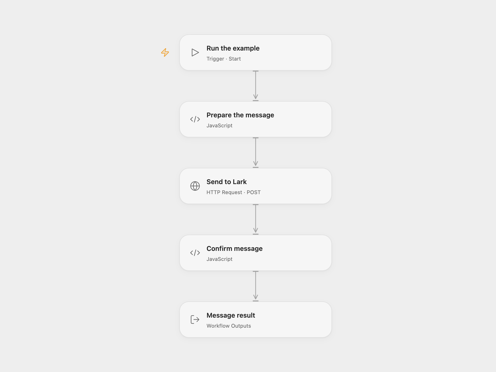

# Send a Lark Group Message

Send a configured text message to a Lark group as an app.

<picture>
  <source media="(prefers-color-scheme: dark)" srcset="preview-dark.png">
  
</picture>

[Open Flow JSON](templates/send-a-lark-group-message.openflow.json) · [n8n JSON](templates/send-a-lark-group-message.n8n.json)

## Setup and use

Create a Lark app with permission to send messages and add it to the target chat. Obtain a tenant access token and chat ID. In Open Flow set the chat ID and text in **Prepare the message**, then bind the tenant token to a secret Variable in **Send to Lark**. In n8n set the chat ID and text in **Input** and configure Header Auth with `Authorization: Bearer YOUR_TENANT_TOKEN`. Tenant access tokens expire; refresh the credential before it expires.

## Behavior

A manual run sends one text message as the app to the configured group. The example message is the source author's website URL. A successful response confirms acceptance by Lark, not that every member read it. If the result is unknown, inspect the chat before retrying to avoid a duplicate.

Inspiration &amp; credits

## Changes to the source

- Replace source account data with configuration and use Lark's current IM v1 endpoint. The source fetched a tenant token but did not connect it to the send node; both formats use an explicitly configured tenant token.
- Check Lark's response code and message ID.

Adapted from [Send Message In Larksuite](https://github.com/Zie619/n8n-workflows/blob/ae8cf6dc5b873cbb4f74587aa9180ed3a9f70682/workflows/Manual/1505_Manual_Stickynote_Send_Webhook.json) in [Zie619/n8n-workflows](https://github.com/Zie619/n8n-workflows). The source credits [hiroshidigital.com](https://hiroshidigital.com/); no separate original template license was identified.

The collection’s [MIT notice](https://github.com/Zie619/n8n-workflows/blob/94007c1445d9258a7da116646b79473e7c7c3282/LICENSE) is pinned at a later revision. This is the collection notice at that revision; it does not establish a separate original template author's license. Our changes are listed above; see [repository licensing](../../README.md#licensing).

> MIT License
>
> Copyright (c) 2025 Zie619
>
> Permission is hereby granted, free of charge, to any person obtaining a copy
> of this software and associated documentation files (the "Software"), to deal
> in the Software without restriction, including without limitation the rights
> to use, copy, modify, merge, publish, distribute, sublicense, and/or sell
> copies of the Software, and to permit persons to whom the Software is
> furnished to do so, subject to the following conditions:
>
> The above copyright notice and this permission notice shall be included in all
> copies or substantial portions of the Software.
>
> THE SOFTWARE IS PROVIDED "AS IS", WITHOUT WARRANTY OF ANY KIND, EXPRESS OR
> IMPLIED, INCLUDING BUT NOT LIMITED TO THE WARRANTIES OF MERCHANTABILITY,
> FITNESS FOR A PARTICULAR PURPOSE AND NONINFRINGEMENT. IN NO EVENT SHALL THE
> AUTHORS OR COPYRIGHT HOLDERS BE LIABLE FOR ANY CLAIM, DAMAGES OR OTHER
> LIABILITY, WHETHER IN AN ACTION OF CONTRACT, TORT OR OTHERWISE, ARISING FROM,
> OUT OF OR IN CONNECTION WITH THE SOFTWARE OR THE USE OR OTHER DEALINGS IN THE
> SOFTWARE.

