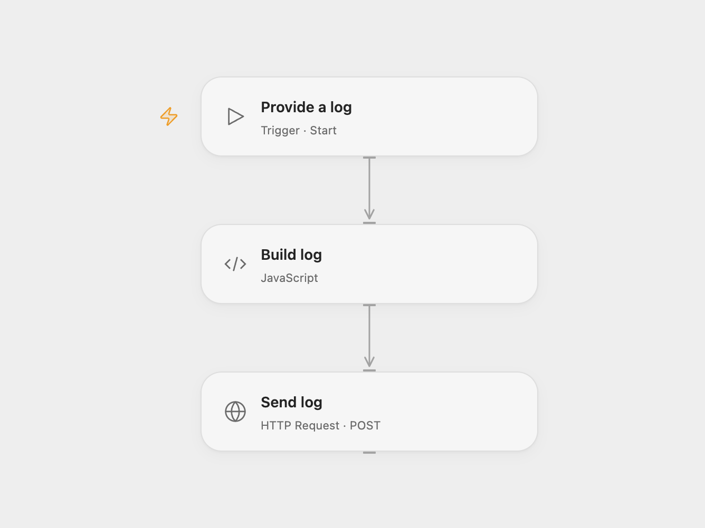

# Send a Log to Better Stack

Send a message and level to Better Stack Logs from a workflow or a manual test.

<picture>
  <source media="(prefers-color-scheme: dark)" srcset="preview-dark.png">
  
</picture>

[Open Flow JSON](templates/send-a-log-to-better-stack.openflow.json) · [n8n JSON](templates/send-a-log-to-better-stack.n8n.json)

## Setup and use

Create a Better Stack Logs source. Replace the example URL in the Open Flow HTTP node with your source's HTTPS ingesting host and bind the source token as a secret Variable. In n8n, set the HTTP node URL to the ingesting host and configure Header Auth with header name `Authorization` and value `Bearer YOUR_SOURCE_TOKEN`. See [Better Stack's ingestion documentation](https://betterstack.com/docs/logs/ingesting-data/http/logs/).

Call the workflow with string inputs `message` and `level`. To send the original example instead, run Open Flow without inputs or use the manual trigger in n8n; it sends level `error` and message `This is a test log message`.

## Behavior

Each invocation sends one JSON log with the supplied message and level. The source token identifies the destination. A successful API response confirms acceptance, not downstream processing. If the request outcome is unknown, check the destination before retrying to avoid duplicate logs. The ingest endpoint and token are configured by the user.

Inspiration &amp; credits

## Changes to the source

- Use the current Better Stack HTTP ingestion contract and build JSON from values, preserving quotes and newlines.
- Open Flow uses the original example when inputs are omitted.

Adapted from [Better Stack log subworkflow](https://github.com/Zie619/n8n-workflows/blob/ae8cf6dc5b873cbb4f74587aa9180ed3a9f70682/workflows/Http/0825_HTTP_Manual_Send_Webhook.json) in [Zie619/n8n-workflows](https://github.com/Zie619/n8n-workflows). The source credits [Audun / xqus](https://xqus.com); no separate original template license was identified.

The collection’s [MIT notice](https://github.com/Zie619/n8n-workflows/blob/94007c1445d9258a7da116646b79473e7c7c3282/LICENSE) is pinned at a later revision. This is the collection notice at that revision; it does not establish a separate original template author's license. Our changes are listed above; see [repository licensing](../../README.md#licensing).

> MIT License
>
> Copyright (c) 2025 Zie619
>
> Permission is hereby granted, free of charge, to any person obtaining a copy
> of this software and associated documentation files (the "Software"), to deal
> in the Software without restriction, including without limitation the rights
> to use, copy, modify, merge, publish, distribute, sublicense, and/or sell
> copies of the Software, and to permit persons to whom the Software is
> furnished to do so, subject to the following conditions:
>
> The above copyright notice and this permission notice shall be included in all
> copies or substantial portions of the Software.
>
> THE SOFTWARE IS PROVIDED "AS IS", WITHOUT WARRANTY OF ANY KIND, EXPRESS OR
> IMPLIED, INCLUDING BUT NOT LIMITED TO THE WARRANTIES OF MERCHANTABILITY,
> FITNESS FOR A PARTICULAR PURPOSE AND NONINFRINGEMENT. IN NO EVENT SHALL THE
> AUTHORS OR COPYRIGHT HOLDERS BE LIABLE FOR ANY CLAIM, DAMAGES OR OTHER
> LIABILITY, WHETHER IN AN ACTION OF CONTRACT, TORT OR OTHERWISE, ARISING FROM,
> OUT OF OR IN CONNECTION WITH THE SOFTWARE OR THE USE OR OTHER DEALINGS IN THE
> SOFTWARE.

