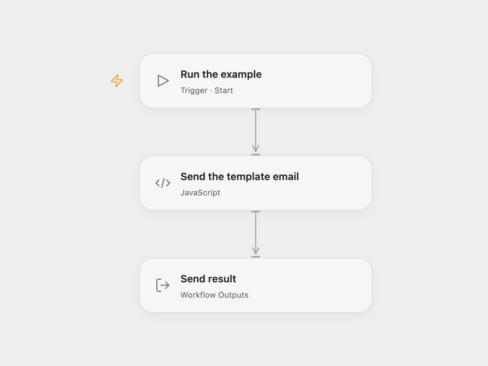

# Send a Mandrill Template Email

Send a transactional email using a Mandrill template.

<picture>
  <source media="(prefers-color-scheme: dark)" srcset="preview-dark.png">
  
</picture>

[Open Flow JSON](templates/send-a-mandrill-template-email.openflow.json) · [n8n JSON](templates/send-a-mandrill-template-email.n8n.json)

## Setup and use

Create or select a published Mailchimp Transactional template. Configure a verified sender and a recipient in **Send the template email** in Open Flow or **Mandrill** in n8n. The example template name is `welcomeemailv2`; change it to a template in your account. Bind the API key as the secret Variable **MANDRILL_API_KEY** in Open Flow or connect a Mandrill credential in n8n. Run manually.

## Behavior

Each run sends one template email. Open Flow returns the recipient and the provider's status; n8n returns the provider response. A `sent` or `queued` status does not prove inbox delivery; `rejected` and `invalid` require attention. If a request fails or its result is unknown, check the Transactional account before retrying to avoid a duplicate message. Restrict access to execution history because it contains recipient data.

Inspiration &amp; credits

## Changes to the source

- Replace example addresses with configuration and use a secret API key with the same Transactional template endpoint in Open Flow.

Adapted from [Send a Mandrill template email](https://github.com/Zie619/n8n-workflows/blob/ae8cf6dc5b873cbb4f74587aa9180ed3a9f70682/workflows/Manual/1037_Manual_Mandrill_Automate_Triggered.json) in [Zie619/n8n-workflows](https://github.com/Zie619/n8n-workflows). The source export does not identify a separate template author or license.

The collection’s [MIT notice](https://github.com/Zie619/n8n-workflows/blob/94007c1445d9258a7da116646b79473e7c7c3282/LICENSE) is pinned at a later revision. This is the collection notice at that revision; it does not establish a separate original template author's license. Our changes are listed above; see [repository licensing](../../README.md#licensing).

> MIT License
>
> Copyright (c) 2025 Zie619
>
> Permission is hereby granted, free of charge, to any person obtaining a copy
> of this software and associated documentation files (the "Software"), to deal
> in the Software without restriction, including without limitation the rights
> to use, copy, modify, merge, publish, distribute, sublicense, and/or sell
> copies of the Software, and to permit persons to whom the Software is
> furnished to do so, subject to the following conditions:
>
> The above copyright notice and this permission notice shall be included in all
> copies or substantial portions of the Software.
>
> THE SOFTWARE IS PROVIDED "AS IS", WITHOUT WARRANTY OF ANY KIND, EXPRESS OR
> IMPLIED, INCLUDING BUT NOT LIMITED TO THE WARRANTIES OF MERCHANTABILITY,
> FITNESS FOR A PARTICULAR PURPOSE AND NONINFRINGEMENT. IN NO EVENT SHALL THE
> AUTHORS OR COPYRIGHT HOLDERS BE LIABLE FOR ANY CLAIM, DAMAGES OR OTHER
> LIABILITY, WHETHER IN AN ACTION OF CONTRACT, TORT OR OTHERWISE, ARISING FROM,
> OUT OF OR IN CONNECTION WITH THE SOFTWARE OR THE USE OR OTHER DEALINGS IN THE
> SOFTWARE.

