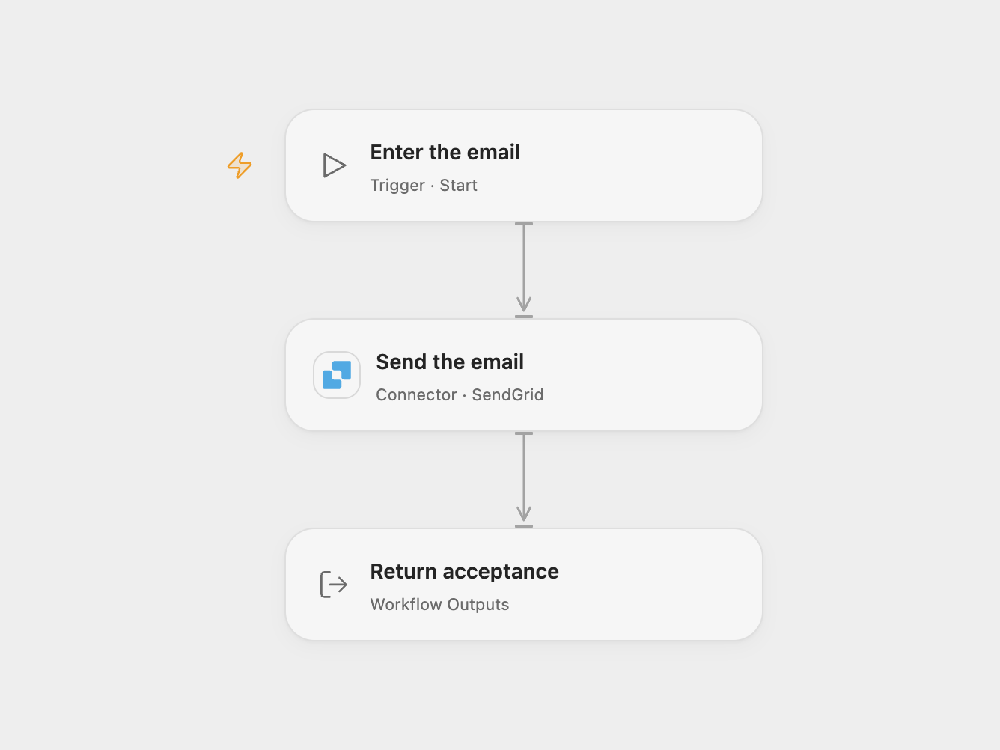

# Send a Plain-Text Email

Send a plain-text email with a subject to a recipient.

<picture>
  <source media="(prefers-color-scheme: dark)" srcset="preview-dark.png">
  
</picture>

[Open Flow JSON](templates/send-a-plain-text-email.openflow.json) · [n8n JSON](templates/send-a-plain-text-email.n8n.json)

## Setup

In Open Flow, connect SendGrid with Mail Send permission and use a verified sender. Start the workflow with `from` as an object containing `email`, `to` as an array of recipient objects containing `email`, plus `subject` and `text`. For example, use `{"email":"sender@example.com"}` and `[{"email":"recipient@example.com"}]`, replacing both addresses.

In n8n, connect an SMTP credential and set the sender, recipient, subject and text in **Send Email**. The SMTP server certificate must be valid.

## Behavior

Each run sends one plain-text email. Open Flow returns SendGrid's acceptance status and any message ID; n8n returns its SMTP send result. Acceptance does not guarantee delivery. A failed or unknown send stops the run; inspect the provider before retrying because the email may already have been accepted. Neither format automatically retries.

Inspiration &amp; credits

## Changes to the source

- Replace the example addresses with configuration. Open Flow uses SendGrid with a verified sender; n8n retains the original SMTP connection.

Adapted from [Manualtrigger Workflow](https://github.com/Zie619/n8n-workflows/blob/ae8cf6dc5b873cbb4f74587aa9180ed3a9f70682/workflows/Manual/1047_Manual_Emailsend_Send_Triggered.json) in [Zie619/n8n-workflows](https://github.com/Zie619/n8n-workflows). The source export does not identify a separate template author or license.

The collection’s [MIT notice](https://github.com/Zie619/n8n-workflows/blob/94007c1445d9258a7da116646b79473e7c7c3282/LICENSE) is pinned at a later revision. This is the collection notice at that revision; it does not establish a separate original template author's license. Our changes are listed above; see [repository licensing](../../README.md#licensing).

> MIT License
>
> Copyright (c) 2025 Zie619
>
> Permission is hereby granted, free of charge, to any person obtaining a copy
> of this software and associated documentation files (the "Software"), to deal
> in the Software without restriction, including without limitation the rights
> to use, copy, modify, merge, publish, distribute, sublicense, and/or sell
> copies of the Software, and to permit persons to whom the Software is
> furnished to do so, subject to the following conditions:
>
> The above copyright notice and this permission notice shall be included in all
> copies or substantial portions of the Software.
>
> THE SOFTWARE IS PROVIDED "AS IS", WITHOUT WARRANTY OF ANY KIND, EXPRESS OR
> IMPLIED, INCLUDING BUT NOT LIMITED TO THE WARRANTIES OF MERCHANTABILITY,
> FITNESS FOR A PARTICULAR PURPOSE AND NONINFRINGEMENT. IN NO EVENT SHALL THE
> AUTHORS OR COPYRIGHT HOLDERS BE LIABLE FOR ANY CLAIM, DAMAGES OR OTHER
> LIABILITY, WHETHER IN AN ACTION OF CONTRACT, TORT OR OTHERWISE, ARISING FROM,
> OUT OF OR IN CONNECTION WITH THE SOFTWARE OR THE USE OR OTHER DEALINGS IN THE
> SOFTWARE.

