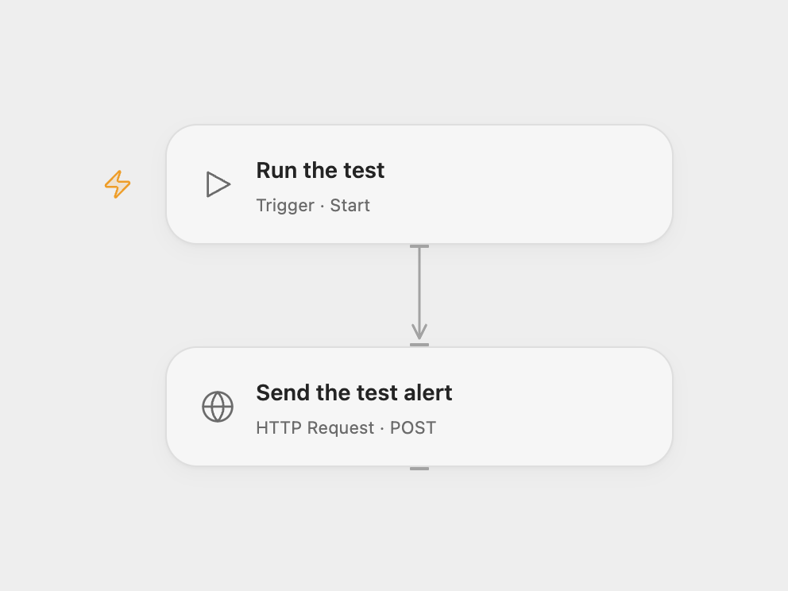

# Send a SIGNL4 Test Alert

Send a test alert to a SIGNL4 team.

<picture>
  <source media="(prefers-color-scheme: dark)" srcset="preview-dark.png">
  
</picture>

[Open Flow JSON](templates/send-a-signl4-test-alert.openflow.json) · [n8n JSON](templates/send-a-signl4-test-alert.n8n.json)

## Setup and use

In Open Flow, bind the full SIGNL4 team webhook URL to the secret Variable **SIGNL4_WEBHOOK_URL** in **Send the test alert**. In n8n, connect a SIGNL4 team credential. Edit the title and message to suit your test, then run manually. The webhook URL contains the team secret; restrict access to execution logs.

## Behavior

Each run sends one new alert with the example title “Sample Title” and message “This is a test alert sent from n8n to SIGNL4”. An accepted request does not confirm that a person received the notification. If the send result is unknown, check SIGNL4 before retrying to avoid a duplicate alert.

Inspiration &amp; credits

## Changes to the source

- Open Flow sends the equivalent JSON payload to the team webhook instead of using the n8n SIGNL4 node.

Adapted from [Send a SIGNL4 test alert](https://github.com/Zie619/n8n-workflows/blob/ae8cf6dc5b873cbb4f74587aa9180ed3a9f70682/workflows/Manual/0959_Manual_Signl4_Automate_Triggered.json) in [Zie619/n8n-workflows](https://github.com/Zie619/n8n-workflows). The source export does not identify a separate template author or license.

The collection’s [MIT notice](https://github.com/Zie619/n8n-workflows/blob/94007c1445d9258a7da116646b79473e7c7c3282/LICENSE) is pinned at a later revision. This is the collection notice at that revision; it does not establish a separate original template author's license. Our changes are listed above; see [repository licensing](../../README.md#licensing).

> MIT License
>
> Copyright (c) 2025 Zie619
>
> Permission is hereby granted, free of charge, to any person obtaining a copy
> of this software and associated documentation files (the "Software"), to deal
> in the Software without restriction, including without limitation the rights
> to use, copy, modify, merge, publish, distribute, sublicense, and/or sell
> copies of the Software, and to permit persons to whom the Software is
> furnished to do so, subject to the following conditions:
>
> The above copyright notice and this permission notice shall be included in all
> copies or substantial portions of the Software.
>
> THE SOFTWARE IS PROVIDED "AS IS", WITHOUT WARRANTY OF ANY KIND, EXPRESS OR
> IMPLIED, INCLUDING BUT NOT LIMITED TO THE WARRANTIES OF MERCHANTABILITY,
> FITNESS FOR A PARTICULAR PURPOSE AND NONINFRINGEMENT. IN NO EVENT SHALL THE
> AUTHORS OR COPYRIGHT HOLDERS BE LIABLE FOR ANY CLAIM, DAMAGES OR OTHER
> LIABILITY, WHETHER IN AN ACTION OF CONTRACT, TORT OR OTHERWISE, ARISING FROM,
> OUT OF OR IN CONNECTION WITH THE SOFTWARE OR THE USE OR OTHER DEALINGS IN THE
> SOFTWARE.

