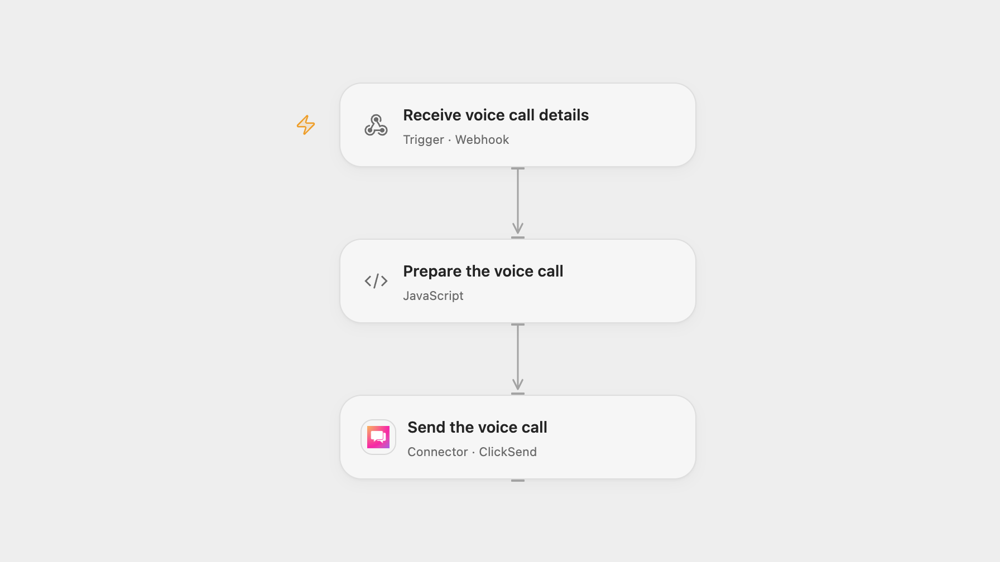

# Send a Text-to-Speech Call with ClickSend

Submit a text-to-speech voice call with a chosen language and voice.

<picture>
  <source media="(prefers-color-scheme: dark)" srcset="preview-dark.png">
  
</picture>

[Open Flow JSON](templates/send-a-text-to-speech-call-with-clicksend.openflow.json) · [n8n JSON](templates/send-a-text-to-speech-call-with-clicksend.n8n.json)

## Setup

ClickSend Voice is available only to existing customers with Voice access. In Open Flow, connect ClickSend in **Send the voice call** and configure a form or client to POST JSON to the webhook, for example {"Body":"Hello","To":"+15551234567","Voice":"female","Lang":"en-us"}. In n8n, configure a ClickSend Basic Auth credential with your username and API key in **Send the voice call**, and use the hosted form. Restrict access to the webhook or form and execution history.

## Behavior

The workflow submits one immediate text-to-speech call with answering-machine detection. Enter up to 600 characters, an E.164 phone number, male or female voice, and one of the form's language codes: en-us, it-it, en-au, en-gb, de-de, es-es, fr-fr, is-is, da-dk, nl-nl, pl-pl, pt-br or ru-ru. A form or webhook acknowledgment does not confirm that the call was placed or delivered; inspect the workflow run and ClickSend. If a submission fails or its result is uncertain, check ClickSend before retrying.

Inspiration &amp; credits

## Changes to the source

- Open Flow uses a JSON webhook in place of the n8n hosted form. Both formats validate input before sending and correct the source's trailing whitespace in en-us.
- Use structured JSON rather than interpolating text into raw JSON.

Adapted from [Send TTS (Text-to-speech) voice calls](https://github.com/Zie619/n8n-workflows/blob/ae8cf6dc5b873cbb4f74587aa9180ed3a9f70682/workflows/Http/1481_HTTP_Form_Send_Webhook.json) in [Zie619/n8n-workflows](https://github.com/Zie619/n8n-workflows). The matching [n8n community listing](https://n8n.io/workflows/3072-send-voice-calls-in-seconds-automate-text-to-speech-using-clicksend-api/) credits Davide Boizza. The original template does not state a separate license.

The collection’s [MIT notice](https://github.com/Zie619/n8n-workflows/blob/94007c1445d9258a7da116646b79473e7c7c3282/LICENSE) is pinned at a later revision. This is the collection notice at that revision; it does not establish a separate original template author's license. Our changes are listed above; see [repository licensing](../../README.md#licensing).

> MIT License
>
> Copyright (c) 2025 Zie619
>
> Permission is hereby granted, free of charge, to any person obtaining a copy
> of this software and associated documentation files (the "Software"), to deal
> in the Software without restriction, including without limitation the rights
> to use, copy, modify, merge, publish, distribute, sublicense, and/or sell
> copies of the Software, and to permit persons to whom the Software is
> furnished to do so, subject to the following conditions:
>
> The above copyright notice and this permission notice shall be included in all
> copies or substantial portions of the Software.
>
> THE SOFTWARE IS PROVIDED "AS IS", WITHOUT WARRANTY OF ANY KIND, EXPRESS OR
> IMPLIED, INCLUDING BUT NOT LIMITED TO THE WARRANTIES OF MERCHANTABILITY,
> FITNESS FOR A PARTICULAR PURPOSE AND NONINFRINGEMENT. IN NO EVENT SHALL THE
> AUTHORS OR COPYRIGHT HOLDERS BE LIABLE FOR ANY CLAIM, DAMAGES OR OTHER
> LIABILITY, WHETHER IN AN ACTION OF CONTRACT, TORT OR OTHERWISE, ARISING FROM,
> OUT OF OR IN CONNECTION WITH THE SOFTWARE OR THE USE OR OTHER DEALINGS IN THE
> SOFTWARE.

