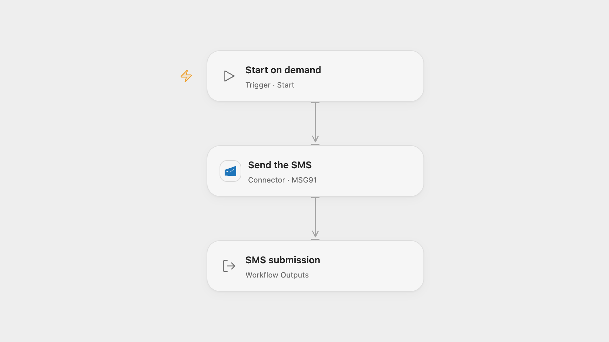

# Send an Approved SMS with MSG91

Send a configured MSG91 Flow SMS to one recipient.

<picture>
  <source media="(prefers-color-scheme: dark)" srcset="preview-dark.png">
  
</picture>

[Open Flow JSON](templates/send-an-approved-sms-with-msg91.openflow.json) · [n8n JSON](templates/send-an-approved-sms-with-msg91.n8n.json)

## Setup

Create an approved MSG91 Flow SMS template containing your intended message and configure its sender in the Flow, rather than selecting FromAPI. In Open Flow, connect MSG91, enter the template ID and recipient in **Send the SMS**. Enter the mobile number in international format with country code and no plus sign.

In n8n, configure an HTTP Header Auth credential named authkey with your MSG91 API key, and enter the same template ID and recipient in **Send the SMS**. Run one format.

## Behavior

A manual run submits the configured template to MSG91 for the recipient. The response indicates whether MSG91 accepted the request; acceptance does not confirm handset delivery. If the send fails or its outcome is uncertain, inspect MSG91 before retrying.

Inspiration &amp; credits

## Changes to the source

- Use the current MSG91 Flow API and an approved template with its sender configured. The source sent a free-form message and sender through the legacy SMS node.

Adapted from [Send an SMS using MSG91](https://github.com/Zie619/n8n-workflows/blob/ae8cf6dc5b873cbb4f74587aa9180ed3a9f70682/workflows/Manual/0986_Manual_Msg91_Send_Triggered.json) in [Zie619/n8n-workflows](https://github.com/Zie619/n8n-workflows). The matching [n8n community listing](https://n8n.io/workflows/511-send-an-sms-using-msg91/) credits Max Tkacz. The original template does not state a separate license.

The collection’s [MIT notice](https://github.com/Zie619/n8n-workflows/blob/94007c1445d9258a7da116646b79473e7c7c3282/LICENSE) is pinned at a later revision. This is the collection notice at that revision; it does not establish a separate original template author's license. Our changes are listed above; see [repository licensing](../../README.md#licensing).

> MIT License
>
> Copyright (c) 2025 Zie619
>
> Permission is hereby granted, free of charge, to any person obtaining a copy
> of this software and associated documentation files (the "Software"), to deal
> in the Software without restriction, including without limitation the rights
> to use, copy, modify, merge, publish, distribute, sublicense, and/or sell
> copies of the Software, and to permit persons to whom the Software is
> furnished to do so, subject to the following conditions:
>
> The above copyright notice and this permission notice shall be included in all
> copies or substantial portions of the Software.
>
> THE SOFTWARE IS PROVIDED "AS IS", WITHOUT WARRANTY OF ANY KIND, EXPRESS OR
> IMPLIED, INCLUDING BUT NOT LIMITED TO THE WARRANTIES OF MERCHANTABILITY,
> FITNESS FOR A PARTICULAR PURPOSE AND NONINFRINGEMENT. IN NO EVENT SHALL THE
> AUTHORS OR COPYRIGHT HOLDERS BE LIABLE FOR ANY CLAIM, DAMAGES OR OTHER
> LIABILITY, WHETHER IN AN ACTION OF CONTRACT, TORT OR OTHERWISE, ARISING FROM,
> OUT OF OR IN CONNECTION WITH THE SOFTWARE OR THE USE OR OTHER DEALINGS IN THE
> SOFTWARE.

