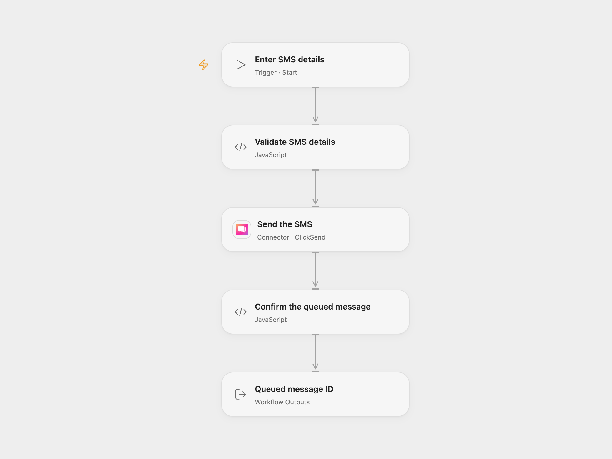

# Send a ClickSend SMS

Send one SMS to a phone number through ClickSend.

<picture>
  <source media="(prefers-color-scheme: dark)" srcset="preview-dark.png">
  
</picture>

[Open Flow JSON](templates/send-clicksend-sms.openflow.json) · [n8n JSON](templates/send-clicksend-sms.n8n.json)

## Setup

Connect ClickSend with its API username and API key. Run the Open Flow workflow with a recipient in E.164 format, such as `+12025550123`, and the message text. In n8n, set these values in **Set SMS data** and configure HTTP Basic Auth on **Send SMS** using the same API username and API key. Run one format at a time.

## Behavior

The workflow submits one SMS and returns its ClickSend message ID after the service reports that message was queued. Queued does not mean delivered; consult ClickSend delivery receipts for the final outcome. A request-level or per-message error stops the run, including errors returned with HTTP 200.

A failed or uncertain request may already have queued the message. Check ClickSend before retrying; there is no automatic retry or deduplication. The destination and message are sent to ClickSend.

## Changes to the source

- Replace the sample recipient and text with configurable values and validate them before sending.
- Check the individual message status and ID instead of treating a successful HTTP response as proof that the message was queued.

Source and license

Adapted from [The Easiest Way to Send SMS Worldwide](https://github.com/Zie619/n8n-workflows/blob/ae8cf6dc5b873cbb4f74587aa9180ed3a9f70682/workflows/Manual/1616_Manual_Stickynote_Send_Webhook.json) in [Zie619/n8n-workflows](https://github.com/Zie619/n8n-workflows). The matching [n8n listing](https://n8n.io/workflows/3084-send-sms-via-clicksend-api-worldwide-without-a-phone-number/) credits Davide Boizza. The original template does not state a separate license.

The collection’s [MIT notice](https://github.com/Zie619/n8n-workflows/blob/94007c1445d9258a7da116646b79473e7c7c3282/LICENSE) is pinned at a later revision. This is the collection notice at that revision; it does not establish a separate original template author's license. Our changes are listed above; see [repository licensing](../../README.md#licensing).

> MIT License
>
> Copyright (c) 2025 Zie619
>
> Permission is hereby granted, free of charge, to any person obtaining a copy
> of this software and associated documentation files (the "Software"), to deal
> in the Software without restriction, including without limitation the rights
> to use, copy, modify, merge, publish, distribute, sublicense, and/or sell
> copies of the Software, and to permit persons to whom the Software is
> furnished to do so, subject to the following conditions:
>
> The above copyright notice and this permission notice shall be included in all
> copies or substantial portions of the Software.
>
> THE SOFTWARE IS PROVIDED "AS IS", WITHOUT WARRANTY OF ANY KIND, EXPRESS OR
> IMPLIED, INCLUDING BUT NOT LIMITED TO THE WARRANTIES OF MERCHANTABILITY,
> FITNESS FOR A PARTICULAR PURPOSE AND NONINFRINGEMENT. IN NO EVENT SHALL THE
> AUTHORS OR COPYRIGHT HOLDERS BE LIABLE FOR ANY CLAIM, DAMAGES OR OTHER
> LIABILITY, WHETHER IN AN ACTION OF CONTRACT, TORT OR OTHERWISE, ARISING FROM,
> OUT OF OR IN CONNECTION WITH THE SOFTWARE OR THE USE OR OTHER DEALINGS IN THE
> SOFTWARE.

