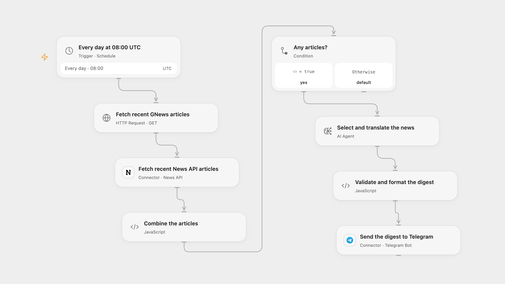

# Send a Daily AI News Digest to Telegram

Collect recent AI articles from GNews and News API, summarize them in Traditional Chinese and send a Telegram digest.

<picture>
  <source media="(prefers-color-scheme: dark)" srcset="preview-dark.png">
  
</picture>

[Open Flow JSON](templates/send-daily-ai-news-digest-to-telegram.openflow.json) · [n8n JSON](templates/send-daily-ai-news-digest-to-telegram.n8n.json)

## Setup

Create a secret Variable **GNEWS_API_KEY** and bind it in **Fetch recent GNews articles**. Connect News API in **Fetch recent News API articles** and Telegram in **Send the digest to Telegram**; set the Telegram chat ID. Configure the AI model. In n8n connect separate Header Auth credentials with the header name X-Api-Key for GNews and News API, select the AI model and Telegram bot, and configure the chat ID. Activate one format.

## Behavior

Every day at 08:00 UTC, the workflow searches English articles for AI: the first 10 GNews results and the first 20 News API results. Duplicate URLs are combined. An Agent selects up to 15 articles, writes Traditional Chinese titles and concise summaries and includes their original URLs. The opening date uses UTC. If no articles are returned, no message is sent. Review the digest: AI can misinterpret or omit context, and source links or articles can change.

The digest must fit Telegram's message limit; oversized or invalid model output or invalid source data stops before sending rather than being truncated. A failed or uncertain Telegram send may already have succeeded; check the chat before retrying. No automatic write retry or cross-run deduplication is added. n8n runs at a fixed second within the scheduled minute; Open Flow runs at the minute boundary. Restrict access to the API keys and execution history.

## Changes to the source

- Configure both API keys as request headers and replace the private Telegram destination. Set UTC explicitly.
- Combine both source lists before one Agent call, deduplicate URLs and verify selections against the fetched articles; the source Merge passes the lists as separate items. n8n HTML-escapes the digest for Telegram so article text and URLs are not parsed as Markdown.

Source and license

Adapted from [Daily AI News Translation & Summary with GPT-4 and Telegram Delivery](https://github.com/Zie619/n8n-workflows/blob/ae8cf6dc5b873cbb4f74587aa9180ed3a9f70682/workflows/Http/0970_HTTP_Schedule_Create_Webhook.json) in [Zie619/n8n-workflows](https://github.com/Zie619/n8n-workflows). The matching [n8n community listing](https://n8n.io/workflows/3596-daily-ai-news-translation-and-summary-with-gpt-4-and-telegram-delivery/) credits SamirLiu. The original template does not state a separate license.

The collection’s [MIT notice](https://github.com/Zie619/n8n-workflows/blob/94007c1445d9258a7da116646b79473e7c7c3282/LICENSE) is pinned at a later revision. This is the collection notice at that revision; it does not establish a separate original template author's license. Our changes are listed above; see [repository licensing](../../README.md#licensing).

> MIT License
>
> Copyright (c) 2025 Zie619
>
> Permission is hereby granted, free of charge, to any person obtaining a copy
> of this software and associated documentation files (the "Software"), to deal
> in the Software without restriction, including without limitation the rights
> to use, copy, modify, merge, publish, distribute, sublicense, and/or sell
> copies of the Software, and to permit persons to whom the Software is
> furnished to do so, subject to the following conditions:
>
> The above copyright notice and this permission notice shall be included in all
> copies or substantial portions of the Software.
>
> THE SOFTWARE IS PROVIDED "AS IS", WITHOUT WARRANTY OF ANY KIND, EXPRESS OR
> IMPLIED, INCLUDING BUT NOT LIMITED TO THE WARRANTIES OF MERCHANTABILITY,
> FITNESS FOR A PARTICULAR PURPOSE AND NONINFRINGEMENT. IN NO EVENT SHALL THE
> AUTHORS OR COPYRIGHT HOLDERS BE LIABLE FOR ANY CLAIM, DAMAGES OR OTHER
> LIABILITY, WHETHER IN AN ACTION OF CONTRACT, TORT OR OTHERWISE, ARISING FROM,
> OUT OF OR IN CONNECTION WITH THE SOFTWARE OR THE USE OR OTHER DEALINGS IN THE
> SOFTWARE.

