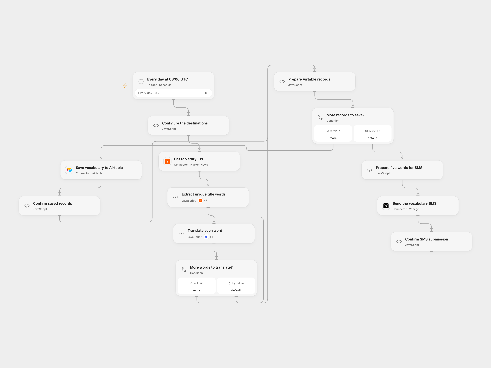

# Send Daily German Vocabulary

Translate words from top Hacker News stories into German, save them in Airtable and send five by SMS.

<picture>
  <source media="(prefers-color-scheme: dark)" srcset="preview-dark.png">
  
</picture>

[Open Flow JSON](templates/send-daily-german-vocabulary.openflow.json) · [n8n JSON](templates/send-daily-german-vocabulary.n8n.json)

## Setup

Connect Lingvanex Translation API, Airtable and Vonage. In **Configure the destinations**, set the Airtable base ID and table name or ID, an allowed Vonage sender and a destination in international digits without a leading plus. The table must have text fields named **English word** and **Translated word**. In n8n, set the same four values in **Configure the destinations** and connect Airtable, Vonage and Lingvanex. Activate one format. Both schedules use 08:00 UTC as a starting point; choose your time zone. Open Flow runs on the minute boundary and n8n uses a fixed second within the minute.

## Behavior

Each day the workflow collects unique nonnumeric words from three Hacker News titles, translates all words into German (with automatic source-language detection), saves each pair in Airtable and sends the first five pairs by SMS. Fewer than five words or an invalid translation stops before saving. Unicode SMS may require multiple segments. Open Flow uses Lingvanex’s api-gl endpoint and sends its API key as a URL query parameter; upstream or proxy logs may record it. n8n uses the older api-b2b endpoint and a bearer credential, so check account access to the endpoint used by your format.

Airtable saves occur before SMS. A later failure does not undo earlier records, and a lost Airtable or SMS response may still mean a write or message succeeded. Inspect the destination before replaying; no automatic write retry is added. The collected data must fit the host execution limits.

Inspiration &amp; credits

## Changes to the source

- Open Flow uses Hacker News top-story IDs and item reads, because the search Action requires a nonempty query. The n8n format retains the source's Algolia front-page search. Ranking can differ between the two sources.
- Remove personal destinations, avoid the source's stateful digit-regex error, verify five words and translated results before writes, and use Unicode SMS. Both formats save before sending.

Adapted from [Daily Language Learning](https://github.com/Zie619/n8n-workflows/blob/ae8cf6dc5b873cbb4f74587aa9180ed3a9f70682/workflows/Airtable/1138_Airtable_Vonage_Automation_Scheduled.json) in [Zie619/n8n-workflows](https://github.com/Zie619/n8n-workflows). The matching [n8n community listing](https://n8n.io/workflows/888-get-data-from-hacker-news-and-send-to-airtable-or-via-sms/) credits isa024787bel. The original template does not state a separate license.

The collection’s [MIT notice](https://github.com/Zie619/n8n-workflows/blob/94007c1445d9258a7da116646b79473e7c7c3282/LICENSE) is pinned at a later revision. This is the collection notice at that revision; it does not establish a separate original template author's license. Our changes are listed above; see [repository licensing](../../README.md#licensing).

> MIT License
>
> Copyright (c) 2025 Zie619
>
> Permission is hereby granted, free of charge, to any person obtaining a copy
> of this software and associated documentation files (the "Software"), to deal
> in the Software without restriction, including without limitation the rights
> to use, copy, modify, merge, publish, distribute, sublicense, and/or sell
> copies of the Software, and to permit persons to whom the Software is
> furnished to do so, subject to the following conditions:
>
> The above copyright notice and this permission notice shall be included in all
> copies or substantial portions of the Software.
>
> THE SOFTWARE IS PROVIDED "AS IS", WITHOUT WARRANTY OF ANY KIND, EXPRESS OR
> IMPLIED, INCLUDING BUT NOT LIMITED TO THE WARRANTIES OF MERCHANTABILITY,
> FITNESS FOR A PARTICULAR PURPOSE AND NONINFRINGEMENT. IN NO EVENT SHALL THE
> AUTHORS OR COPYRIGHT HOLDERS BE LIABLE FOR ANY CLAIM, DAMAGES OR OTHER
> LIABILITY, WHETHER IN AN ACTION OF CONTRACT, TORT OR OTHERWISE, ARISING FROM,
> OUT OF OR IN CONNECTION WITH THE SOFTWARE OR THE USE OR OTHER DEALINGS IN THE
> SOFTWARE.

