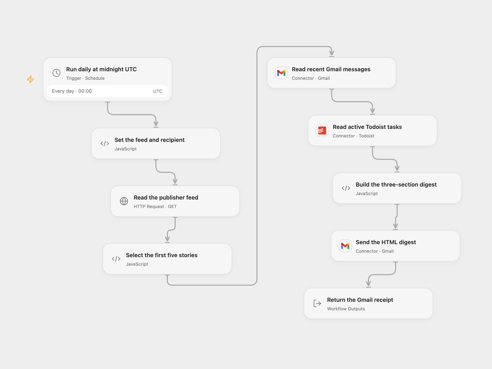

# Send a Daily News, Email, and Task Digest

Send one Gmail message with the top stories, recent Gmail messages, and active Todoist tasks each day.

<!-- template-actions:start -->
 
<!-- template-actions:end -->

<picture>
  <source media="(prefers-color-scheme: dark)" srcset="preview-dark.png">
  
</picture>

## Setup

1. In **Set the feed and recipient**, enter one recipient email address. Keep the example Times of India RSS URL or use one direct public HTTPS RSS or Atom feed. Enter a comma-separated list of approved feed and article hostnames. Use publisher feeds you are allowed to read.
2. Connect the same Gmail account in **Read recent Gmail messages** and **Send the HTML digest**. Connect your Todoist account and grant Provider API access in **Read active Todoist tasks**. Send the digest only to an address authorized to receive the Gmail snippets and task names.
3. Publish the daily schedule. It defaults to midnight UTC. Change the time and time zone in **Run daily at midnight UTC** if needed.

## Behavior

The digest includes the first five feed entries, the five most recent messages returned by Gmail outside Spam and Trash, and up to five active Todoist tasks in the order Todoist returns them. It shows news titles and approved links, Gmail subjects and snippets, and task titles and due dates when present. Unapproved news and task links are displayed as text.

The workflow sends exactly one HTML email after all three sources return successfully. A valid empty list shows “No items.” A failed read stops the run before sending. If the Gmail result is uncertain, check Sent before running again.

In n8n

Set the same values in **Set the feed and recipient**. Use the same Gmail OAuth2 credential for Gmail reading and sending, and select your Todoist API credential in **Read active Todoist tasks**. Change the time zone in workflow settings if needed.

Inspiration &amp; credits

## Changes to the source

Keep the three lists separate and render the digest only after the three reads complete. Escape feed, email and task text in the HTML. Use an explicit midnight UTC schedule and a configurable publisher feed.

Adapted from [Daily Gmail digest of RSS and Todoist](https://github.com/Zie619/n8n-workflows/blob/ae8cf6dc5b873cbb4f74587aa9180ed3a9f70682/workflows/Code/1478_Code_Todoist_Automate_Scheduled.json) in [Zie619/n8n-workflows](https://github.com/Zie619/n8n-workflows). Attribution: Zie619 / n8n-workflows.

The collection’s [MIT notice](https://github.com/Zie619/n8n-workflows/blob/94007c1445d9258a7da116646b79473e7c7c3282/LICENSE) is pinned at a later revision. This is the collection notice at that revision; it does not establish a separate original template author's license. Our changes are listed above; see [repository licensing](../../README.md#licensing).

> MIT License
>
> Copyright (c) 2025 Zie619
>
> Permission is hereby granted, free of charge, to any person obtaining a copy
> of this software and associated documentation files (the "Software"), to deal
> in the Software without restriction, including without limitation the rights
> to use, copy, modify, merge, publish, distribute, sublicense, and/or sell
> copies of the Software, and to permit persons to whom the Software is
> furnished to do so, subject to the following conditions:
>
> The above copyright notice and this permission notice shall be included in all
> copies or substantial portions of the Software.
>
> THE SOFTWARE IS PROVIDED "AS IS", WITHOUT WARRANTY OF ANY KIND, EXPRESS OR
> IMPLIED, INCLUDING BUT NOT LIMITED TO THE WARRANTIES OF MERCHANTABILITY,
> FITNESS FOR A PARTICULAR PURPOSE AND NONINFRINGEMENT. IN NO EVENT SHALL THE
> AUTHORS OR COPYRIGHT HOLDERS BE LIABLE FOR ANY CLAIM, DAMAGES OR OTHER
> LIABILITY, WHETHER IN AN ACTION OF CONTRACT, TORT OR OTHERWISE, ARISING FROM,
> OUT OF OR IN CONNECTION WITH THE SOFTWARE OR THE USE OR OTHER DEALINGS IN THE
> SOFTWARE.

