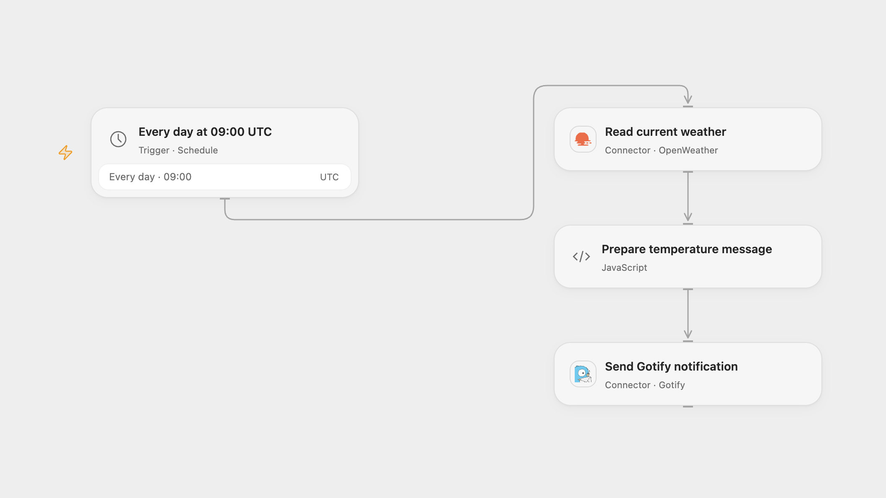

# Send Daily Weather to Gotify

Send the current temperature for a chosen city to a Gotify application each morning.

<picture>
  <source media="(prefers-color-scheme: dark)" srcset="preview-dark.png">
  
</picture>

[Open Flow JSON](templates/send-daily-weather-to-gotify.openflow.json) · [n8n JSON](templates/send-daily-weather-to-gotify.n8n.json)

## Setup

Connect OpenWeather in **Read current weather** and set the city query, for example Berlin,DE. Connect a Gotify application in **Send Gotify notification** using its server URL and application token. Open Flow requires a publicly reachable Gotify server. In n8n configure OpenWeatherMap and Gotify credentials and choose the same city. Activate one format and adjust the schedule and timezone as needed.

## Behavior

Each day at 09:00 UTC the workflow reads the city's current temperature in Celsius and sends a Gotify notification titled Today's Weather Update. The source's city-name lookup remains available in OpenWeather, although OpenWeather recommends geocoding for new integrations. A failed weather lookup stops before sending. An uncertain notification may already have been accepted; inspect Gotify before retrying. No automatic write retry or deduplication is added. Open Flow runs at the minute boundary; n8n uses a fixed second within the scheduled minute.

Inspiration &amp; credits

## Changes to the source

- Set UTC explicitly and make the city and connections editable. Both formats request metric units.
- Open Flow validates the returned temperature before sending.

Adapted from [Send daily weather updates via a message using the Gotify node](https://github.com/Zie619/n8n-workflows/blob/ae8cf6dc5b873cbb4f74587aa9180ed3a9f70682/workflows/Openweathermap/0072_Openweathermap_Cron_Update_Scheduled.json) in [Zie619/n8n-workflows](https://github.com/Zie619/n8n-workflows). The matching [n8n listing](https://n8n.io/workflows/774-send-daily-weather-updates-via-a-message-using-the-gotify-node/) credits Harshil Agrawal. The original template does not state a separate license.

The collection’s [MIT notice](https://github.com/Zie619/n8n-workflows/blob/94007c1445d9258a7da116646b79473e7c7c3282/LICENSE) is pinned at a later revision. This is the collection notice at that revision; it does not establish a separate original template author's license. Our changes are listed above; see [repository licensing](../../README.md#licensing).

> MIT License
>
> Copyright (c) 2025 Zie619
>
> Permission is hereby granted, free of charge, to any person obtaining a copy
> of this software and associated documentation files (the "Software"), to deal
> in the Software without restriction, including without limitation the rights
> to use, copy, modify, merge, publish, distribute, sublicense, and/or sell
> copies of the Software, and to permit persons to whom the Software is
> furnished to do so, subject to the following conditions:
>
> The above copyright notice and this permission notice shall be included in all
> copies or substantial portions of the Software.
>
> THE SOFTWARE IS PROVIDED "AS IS", WITHOUT WARRANTY OF ANY KIND, EXPRESS OR
> IMPLIED, INCLUDING BUT NOT LIMITED TO THE WARRANTIES OF MERCHANTABILITY,
> FITNESS FOR A PARTICULAR PURPOSE AND NONINFRINGEMENT. IN NO EVENT SHALL THE
> AUTHORS OR COPYRIGHT HOLDERS BE LIABLE FOR ANY CLAIM, DAMAGES OR OTHER
> LIABILITY, WHETHER IN AN ACTION OF CONTRACT, TORT OR OTHERWISE, ARISING FROM,
> OUT OF OR IN CONNECTION WITH THE SOFTWARE OR THE USE OR OTHER DEALINGS IN THE
> SOFTWARE.

