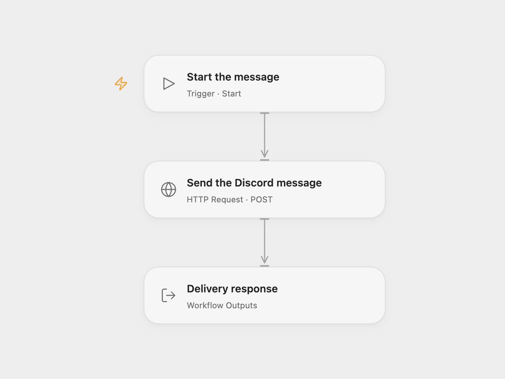

# Send a Discord Webhook Message

Send a message to a Discord channel using an incoming webhook.

<picture>
  <source media="(prefers-color-scheme: dark)" srcset="preview-dark.png">
  
</picture>

[Open Flow JSON](templates/send-discord-webhook-message.openflow.json) · [n8n JSON](templates/send-discord-webhook-message.n8n.json)

## Setup

Create an incoming webhook for the destination Discord channel. In Open Flow create a secret Variable holding the full webhook URL and bind it to the URL input of **Send the Discord message**. Edit that node's JSON body to change the message. In n8n enter the webhook URL and message in **Discord**. Keep the webhook URL private: anyone with it can post to the channel. Use one format per message.

## Behavior

A manual run posts the configured message once. Open Flow returns the HTTP status; n8n returns a success flag. Discord may reject a request when rate limited. n8n retries rate-limit responses up to five times; Open Flow stops on an error. If delivery is uncertain, check the channel before retrying to avoid a duplicate.

Inspiration &amp; credits

## Changes to the source

- Open Flow uses an HTTP request and a secret Variable for the webhook URL.

Adapted from [Discord Intro](https://github.com/Zie619/n8n-workflows/blob/ae8cf6dc5b873cbb4f74587aa9180ed3a9f70682/workflows/Manual/0746_Manual_Discord_Automation_Triggered.json) in [Zie619/n8n-workflows](https://github.com/Zie619/n8n-workflows). The source export does not identify a separate template author or license.

The collection’s [MIT notice](https://github.com/Zie619/n8n-workflows/blob/94007c1445d9258a7da116646b79473e7c7c3282/LICENSE) is pinned at a later revision. This is the collection notice at that revision; it does not establish a separate original template author's license. Our changes are listed above; see [repository licensing](../../README.md#licensing).

> MIT License
>
> Copyright (c) 2025 Zie619
>
> Permission is hereby granted, free of charge, to any person obtaining a copy
> of this software and associated documentation files (the "Software"), to deal
> in the Software without restriction, including without limitation the rights
> to use, copy, modify, merge, publish, distribute, sublicense, and/or sell
> copies of the Software, and to permit persons to whom the Software is
> furnished to do so, subject to the following conditions:
>
> The above copyright notice and this permission notice shall be included in all
> copies or substantial portions of the Software.
>
> THE SOFTWARE IS PROVIDED "AS IS", WITHOUT WARRANTY OF ANY KIND, EXPRESS OR
> IMPLIED, INCLUDING BUT NOT LIMITED TO THE WARRANTIES OF MERCHANTABILITY,
> FITNESS FOR A PARTICULAR PURPOSE AND NONINFRINGEMENT. IN NO EVENT SHALL THE
> AUTHORS OR COPYRIGHT HOLDERS BE LIABLE FOR ANY CLAIM, DAMAGES OR OTHER
> LIABILITY, WHETHER IN AN ACTION OF CONTRACT, TORT OR OTHERWISE, ARISING FROM,
> OUT OF OR IN CONNECTION WITH THE SOFTWARE OR THE USE OR OTHER DEALINGS IN THE
> SOFTWARE.

