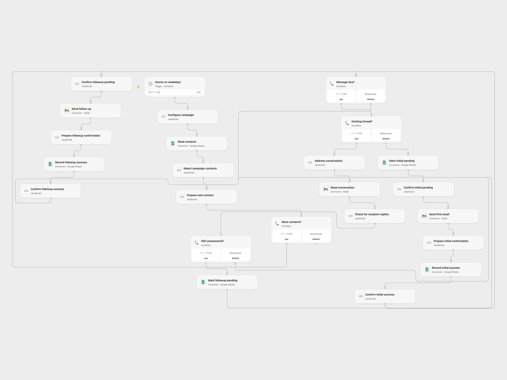

# Send Follow-up Campaigns from Google Sheets

Send a configurable email sequence to contacts and stop follow-ups after a reply.

<picture>
  <source media="(prefers-color-scheme: dark)" srcset="preview-dark.png">
  
</picture>

[Open Flow JSON](templates/send-follow-up-campaigns-from-google-sheets.openflow.json) · [n8n JSON](templates/send-follow-up-campaigns-from-google-sheets.n8n.json)

## Setup

Connect Gmail and Google Sheets. Enable Provider API Request access for the Gmail conversation reader. In Configure campaign set the spreadsheet, sheet, subject and message templates. Use columns email, name, company, first_emailed, thread_id, sequence, pending in that exact order, followed by any additional columns used as {placeholders}. Leave the last four state columns blank for new contacts. Choose one format and ensure only one run uses this sheet at a time.

## Behavior

On weekdays each hour at minute 12 UTC, send the first email to each new contact; send follow-ups after the configured number of days from the first send only if the Gmail conversation contains no received message. The defaults are days 0, 3 and 8. Email placeholders are HTML escaped. Keep the Gmail thread and the row state intact.

Each send first writes pending to the row. If the send or its confirmation fails, inspect Gmail and the row before changing pending. If the message was sent, set first_emailed to the first send time in ISO 8601, set thread_id to its Gmail thread ID, set sequence to the number of messages already sent, then clear pending. If it was not sent, clear pending to retry. Pending rows are skipped until resolved. Avoid editing or reordering rows during execution.

Inspiration &amp; credits

## Changes to the source

- Store thread IDs and sequence state in the sheet and use a pending marker before each send. The schedule uses UTC.

Adapted from [Automated email follow-up sequence](https://github.com/Zie619/n8n-workflows/blob/ae8cf6dc5b873cbb4f74587aa9180ed3a9f70682/workflows/Code/0437_Code_Filter_Create_Scheduled.json) in [Zie619/n8n-workflows](https://github.com/Zie619/n8n-workflows). The source export does not identify a separate template author or license.

The collection’s [MIT notice](https://github.com/Zie619/n8n-workflows/blob/94007c1445d9258a7da116646b79473e7c7c3282/LICENSE) is pinned at a later revision. This is the collection notice at that revision; it does not establish a separate original template author's license. Our changes are listed above; see [repository licensing](../../README.md#licensing).

> MIT License
>
> Copyright (c) 2025 Zie619
>
> Permission is hereby granted, free of charge, to any person obtaining a copy
> of this software and associated documentation files (the "Software"), to deal
> in the Software without restriction, including without limitation the rights
> to use, copy, modify, merge, publish, distribute, sublicense, and/or sell
> copies of the Software, and to permit persons to whom the Software is
> furnished to do so, subject to the following conditions:
>
> The above copyright notice and this permission notice shall be included in all
> copies or substantial portions of the Software.
>
> THE SOFTWARE IS PROVIDED "AS IS", WITHOUT WARRANTY OF ANY KIND, EXPRESS OR
> IMPLIED, INCLUDING BUT NOT LIMITED TO THE WARRANTIES OF MERCHANTABILITY,
> FITNESS FOR A PARTICULAR PURPOSE AND NONINFRINGEMENT. IN NO EVENT SHALL THE
> AUTHORS OR COPYRIGHT HOLDERS BE LIABLE FOR ANY CLAIM, DAMAGES OR OTHER
> LIABILITY, WHETHER IN AN ACTION OF CONTRACT, TORT OR OTHERWISE, ARISING FROM,
> OUT OF OR IN CONNECTION WITH THE SOFTWARE OR THE USE OR OTHER DEALINGS IN THE
> SOFTWARE.

