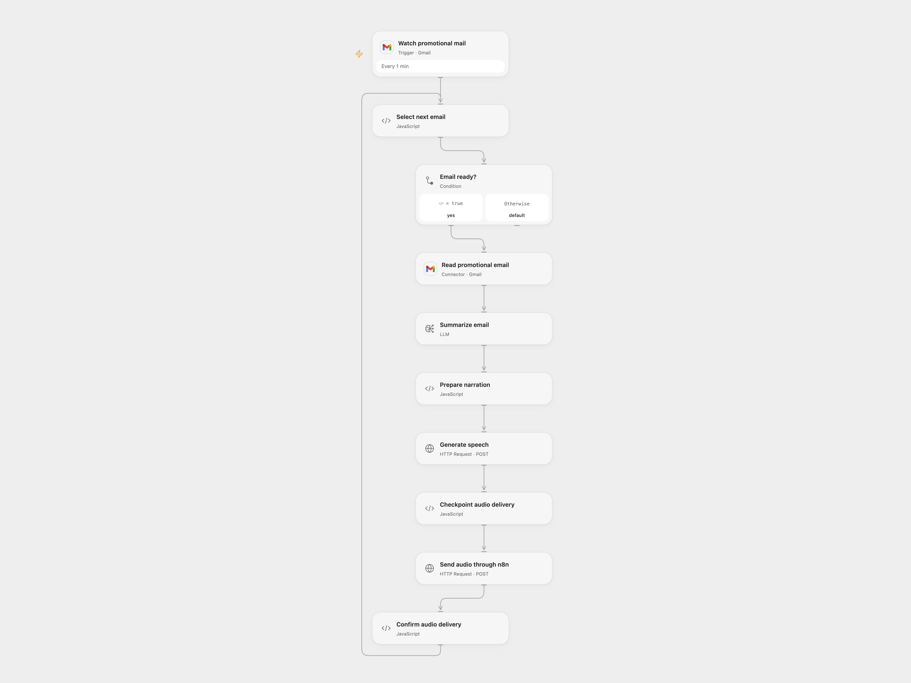

# Send Gmail Promotions as Telegram Audio

Summarize new promotional emails and send the summary as Telegram audio.

<picture>
  <source media="(prefers-color-scheme: dark)" srcset="preview-dark.png">
  
</picture>

[Open Flow JSON](templates/send-gmail-promotions-as-telegram-audio.openflow.json) · [n8n JSON](templates/send-gmail-promotions-as-telegram-audio.n8n.json)

## Setup

Connect Gmail and an AI model. Set the Telegram chat ID in **Checkpoint audio delivery** and enable persistent State. Import the supplied n8n workflow, connect its relay Telegram node to your bot, disable **Gmail trigger**, enable **Audio relay webhook**, and set its production URL in **Send audio through n8n**. Restrict access to the relay URL. Prevent overlapping Open Flow runs.

For direct n8n use, enable **Gmail trigger**, disable **Audio relay webhook**, set the Telegram chat ID, and connect Gmail, OpenAI and Telegram credentials. Activate one format.

## Behavior

Every minute, new messages in Gmail's Promotions category are summarized and sent to the source text-to-speech service. The generated audio and a short summary caption go to Telegram. Email text is sent to the selected AI model and the summary to the external speech service; review output for errors. The source service URL redirects to the configured current endpoint.

If audio delivery fails or is uncertain, inspect Telegram before entering the Gmail message ID in **Select next email** to acknowledge it. The message is treated as handled and queued emails continue. Do not automatically replay uncertain sends.

Inspiration &amp; credits

## Changes to the source

- Use the current redirected speech endpoint and validate TLS.
- Replace the private chat ID and provide an n8n binary audio relay for Open Flow.

Adapted from [Convert Gmail promotions into Telegram audio](https://github.com/Zie619/n8n-workflows/blob/ae8cf6dc5b873cbb4f74587aa9180ed3a9f70682/workflows/Telegram/0481_Telegram_Code_Automation_Webhook.json) in [Zie619/n8n-workflows](https://github.com/Zie619/n8n-workflows). The source export does not identify a separate template author or license.

The collection’s [MIT notice](https://github.com/Zie619/n8n-workflows/blob/94007c1445d9258a7da116646b79473e7c7c3282/LICENSE) is pinned at a later revision. This is the collection notice at that revision; it does not establish a separate original template author's license. Our changes are listed above; see [repository licensing](../../README.md#licensing).

> MIT License
>
> Copyright (c) 2025 Zie619
>
> Permission is hereby granted, free of charge, to any person obtaining a copy
> of this software and associated documentation files (the "Software"), to deal
> in the Software without restriction, including without limitation the rights
> to use, copy, modify, merge, publish, distribute, sublicense, and/or sell
> copies of the Software, and to permit persons to whom the Software is
> furnished to do so, subject to the following conditions:
>
> The above copyright notice and this permission notice shall be included in all
> copies or substantial portions of the Software.
>
> THE SOFTWARE IS PROVIDED "AS IS", WITHOUT WARRANTY OF ANY KIND, EXPRESS OR
> IMPLIED, INCLUDING BUT NOT LIMITED TO THE WARRANTIES OF MERCHANTABILITY,
> FITNESS FOR A PARTICULAR PURPOSE AND NONINFRINGEMENT. IN NO EVENT SHALL THE
> AUTHORS OR COPYRIGHT HOLDERS BE LIABLE FOR ANY CLAIM, DAMAGES OR OTHER
> LIABILITY, WHETHER IN AN ACTION OF CONTRACT, TORT OR OTHERWISE, ARISING FROM,
> OUT OF OR IN CONNECTION WITH THE SOFTWARE OR THE USE OR OTHER DEALINGS IN THE
> SOFTWARE.

