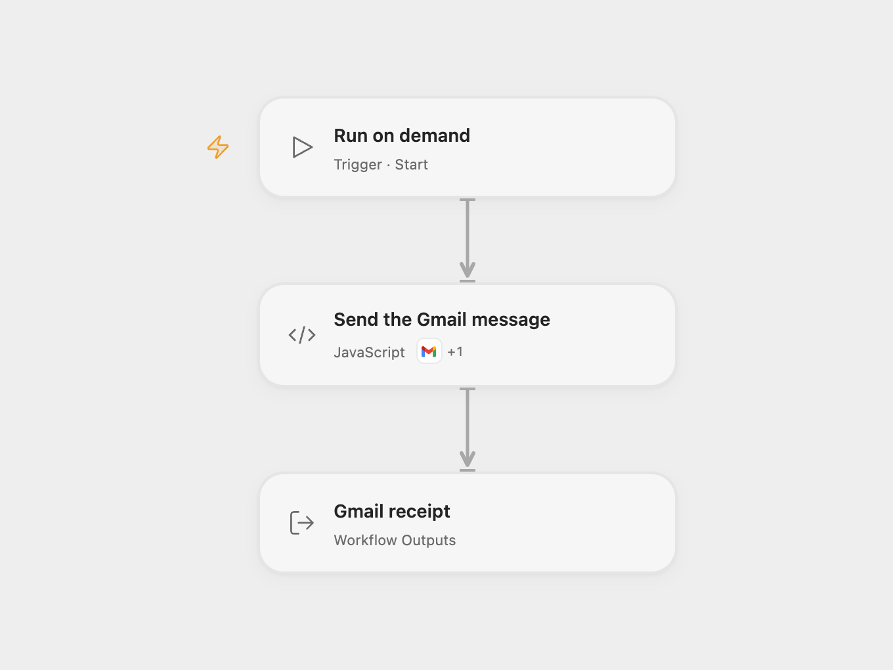

# Send a Gmail Message With an Inline Image

Send an HTML email in Gmail with a cloud-hosted image embedded in the message body.

<!-- template-actions:start -->
 
<!-- template-actions:end -->

<picture>
  <source media="(prefers-color-scheme: dark)" srcset="preview-dark.png">
  
</picture>

## Setup

1. In **Send the Gmail message**, enter the sender and recipient email addresses, subject, and HTML. Keep `src="cid:image1"` on the image tag.
2. Enter a public HTTPS image URL and its exact MIME type, such as `image/jpeg` or `image/png`. Use a URL that serves the image itself.
3. In **Send the Gmail message → Connector Actions**, connect Gmail to **Send Email**. Use the Gmail account address or a verified send-as address as the sender. Run the workflow when the message is ready.

## Behavior

The workflow fetches the image at the configured URL and sends a single HTML message with the image embedded inline. The workflow returns the Gmail message ID and the thread ID when Gmail supplies one. The image can be up to 25 MB, subject to Gmail's 35 MB limit for the complete MIME message.

If the image fetch fails, the send stops. If Gmail's response is missing or the send times out, check Sent before starting another run.

In n8n

Set the same values in **Message settings** and select a **Gmail OAuth2 API** credential in **Send the Gmail message**. Run manually. The workflow downloads the file, checks the file's media type against your setting, and submits an inline MIME message to Gmail.

Inspiration &amp; credits

Adapted from [Send a Gmail message with an embedded image](https://github.com/Zie619/n8n-workflows/blob/ae8cf6dc5b873cbb4f74587aa9180ed3a9f70682/workflows/Manual/0501_Manual_Extractfromfile_Send_Webhook.json) in [Zie619/n8n-workflows](https://github.com/Zie619/n8n-workflows). Attribution: Zie619 / n8n-workflows.

The collection’s [MIT notice](https://github.com/Zie619/n8n-workflows/blob/94007c1445d9258a7da116646b79473e7c7c3282/LICENSE) is pinned at a later revision. This is the collection notice at that revision; it does not establish a separate original template author's license. Our changes are listed above; see [repository licensing](../../README.md#licensing).

> MIT License
>
> Copyright (c) 2025 Zie619
>
> Permission is hereby granted, free of charge, to any person obtaining a copy
> of this software and associated documentation files (the "Software"), to deal
> in the Software without restriction, including without limitation the rights
> to use, copy, modify, merge, publish, distribute, sublicense, and/or sell
> copies of the Software, and to permit persons to whom the Software is
> furnished to do so, subject to the following conditions:
>
> The above copyright notice and this permission notice shall be included in all
> copies or substantial portions of the Software.
>
> THE SOFTWARE IS PROVIDED "AS IS", WITHOUT WARRANTY OF ANY KIND, EXPRESS OR
> IMPLIED, INCLUDING BUT NOT LIMITED TO THE WARRANTIES OF MERCHANTABILITY,
> FITNESS FOR A PARTICULAR PURPOSE AND NONINFRINGEMENT. IN NO EVENT SHALL THE
> AUTHORS OR COPYRIGHT HOLDERS BE LIABLE FOR ANY CLAIM, DAMAGES OR OTHER
> LIABILITY, WHETHER IN AN ACTION OF CONTRACT, TORT OR OTHERWISE, ARISING FROM,
> OUT OF OR IN CONNECTION WITH THE SOFTWARE OR THE USE OR OTHER DEALINGS IN THE
> SOFTWARE.

