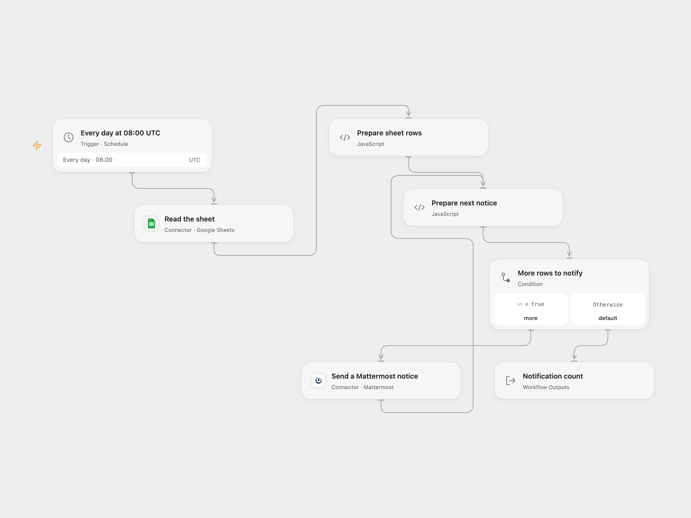

# Send Instagram Sheet Metrics to Mattermost

Send a daily Mattermost message for each Instagram metrics row in a Google Sheet.

<picture>
  <source media="(prefers-color-scheme: dark)" srcset="preview-dark.png">
  
</picture>

[Open Flow JSON](templates/send-instagram-sheet-metrics-to-mattermost.openflow.json) · [n8n JSON](templates/send-instagram-sheet-metrics-to-mattermost.n8n.json)

## Setup

Connect Google Sheets and Mattermost. Set the spreadsheet ID and an entire range including unique headers Compte, Followers and Posts in **Read the sheet**. Set the destination channel ID in **Prepare sheet rows**. In n8n configure the sheet, range and channel in the respective nodes. Activate only one format.

## Behavior

At 08:00 UTC every day, read the sheet and send one French message per data row, in sheet order, with account, followers, posts and the current date and weekday. Header-only or empty sheets send nothing. A failed post stops later messages; an uncertain post may already have been delivered. Check the channel before retrying. Sheet contents and messages must fit execution limits.

## Changes to the source

- Replace the sample sheet and channel with configuration. Use UTC explicitly in both formats; the source depended on the instance timezone.
- Open Flow checks unique headers before posting; n8n follows its sheet-node mapping.

Source and license

Adapted from [StatsInstagram](https://github.com/Zie619/n8n-workflows/blob/ae8cf6dc5b873cbb4f74587aa9180ed3a9f70682/workflows/Mattermost/0941_Mattermost_GoogleSheets_Automation_Scheduled.json) in [Zie619/n8n-workflows](https://github.com/Zie619/n8n-workflows). The source export does not identify a separate template author or license.

The collection’s [MIT notice](https://github.com/Zie619/n8n-workflows/blob/94007c1445d9258a7da116646b79473e7c7c3282/LICENSE) is pinned at a later revision. This is the collection notice at that revision; it does not establish a separate original template author's license. Our changes are listed above; see [repository licensing](../../README.md#licensing).

> MIT License
>
> Copyright (c) 2025 Zie619
>
> Permission is hereby granted, free of charge, to any person obtaining a copy
> of this software and associated documentation files (the "Software"), to deal
> in the Software without restriction, including without limitation the rights
> to use, copy, modify, merge, publish, distribute, sublicense, and/or sell
> copies of the Software, and to permit persons to whom the Software is
> furnished to do so, subject to the following conditions:
>
> The above copyright notice and this permission notice shall be included in all
> copies or substantial portions of the Software.
>
> THE SOFTWARE IS PROVIDED "AS IS", WITHOUT WARRANTY OF ANY KIND, EXPRESS OR
> IMPLIED, INCLUDING BUT NOT LIMITED TO THE WARRANTIES OF MERCHANTABILITY,
> FITNESS FOR A PARTICULAR PURPOSE AND NONINFRINGEMENT. IN NO EVENT SHALL THE
> AUTHORS OR COPYRIGHT HOLDERS BE LIABLE FOR ANY CLAIM, DAMAGES OR OTHER
> LIABILITY, WHETHER IN AN ACTION OF CONTRACT, TORT OR OTHERWISE, ARISING FROM,
> OUT OF OR IN CONNECTION WITH THE SOFTWARE OR THE USE OR OTHER DEALINGS IN THE
> SOFTWARE.

