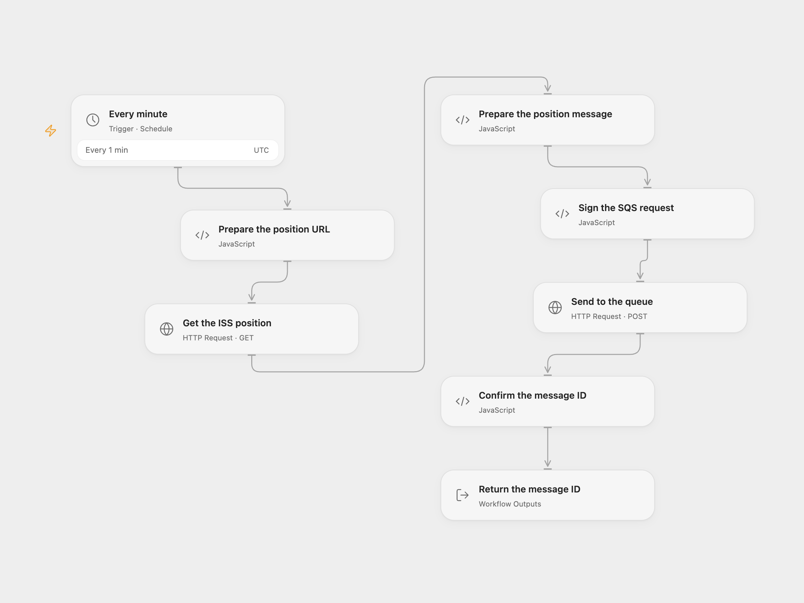

# Send ISS Position to Amazon SQS

Send the current ISS position as a JSON message to an Amazon SQS queue every minute.

<picture>
  <source media="(prefers-color-scheme: dark)" srcset="preview-dark.png">
  
</picture>

[Open Flow JSON](templates/send-iss-position-to-sqs.openflow.json) · [n8n JSON](templates/send-iss-position-to-sqs.n8n.json)

## Setup and use

In Open Flow, set a standard SQS queue URL in **Sign the SQS request**, and bind AWS access key ID and secret access key to secret Variables. For temporary credentials, bind the same session token Variable to both **Sign the SQS request** and **Send to the queue** → **X-Amz-Security-Token**. Leave both unset for long-lived credentials. The identity needs sqs:SendMessage permission for that queue. In n8n, connect AWS credentials and select the standard queue. Activate one format.

## Behavior

Every minute retrieve the ISS position and send a JSON message with Name, Latitude, Longitude and Timestamp. Open Flow runs on the minute boundary; n8n Cron V1 uses a fixed second within the minute. A failed or uncertain send stops without automatic replay; check the queue before retrying. FIFO queues require a message group and are not covered.

Inspiration &amp; credits

## Changes to the source

- Correct the API timestamp from milliseconds to seconds and configure the queue. Open Flow signs an SQS HTTPS request; n8n retains its native AWS SQS node.

Adapted from [Send ISS position to an SQS queue](https://github.com/Zie619/n8n-workflows/blob/ae8cf6dc5b873cbb4f74587aa9180ed3a9f70682/workflows/Http/0021_HTTP_Awssqs_Automation_Scheduled.json) in [Zie619/n8n-workflows](https://github.com/Zie619/n8n-workflows). The source export does not identify a separate template author or license.

The collection’s [MIT notice](https://github.com/Zie619/n8n-workflows/blob/94007c1445d9258a7da116646b79473e7c7c3282/LICENSE) is pinned at a later revision. This is the collection notice at that revision; it does not establish a separate original template author's license. Our changes are listed above; see [repository licensing](../../README.md#licensing).

> MIT License
>
> Copyright (c) 2025 Zie619
>
> Permission is hereby granted, free of charge, to any person obtaining a copy
> of this software and associated documentation files (the "Software"), to deal
> in the Software without restriction, including without limitation the rights
> to use, copy, modify, merge, publish, distribute, sublicense, and/or sell
> copies of the Software, and to permit persons to whom the Software is
> furnished to do so, subject to the following conditions:
>
> The above copyright notice and this permission notice shall be included in all
> copies or substantial portions of the Software.
>
> THE SOFTWARE IS PROVIDED "AS IS", WITHOUT WARRANTY OF ANY KIND, EXPRESS OR
> IMPLIED, INCLUDING BUT NOT LIMITED TO THE WARRANTIES OF MERCHANTABILITY,
> FITNESS FOR A PARTICULAR PURPOSE AND NONINFRINGEMENT. IN NO EVENT SHALL THE
> AUTHORS OR COPYRIGHT HOLDERS BE LIABLE FOR ANY CLAIM, DAMAGES OR OTHER
> LIABILITY, WHETHER IN AN ACTION OF CONTRACT, TORT OR OTHERWISE, ARISING FROM,
> OUT OF OR IN CONNECTION WITH THE SOFTWARE OR THE USE OR OTHER DEALINGS IN THE
> SOFTWARE.

