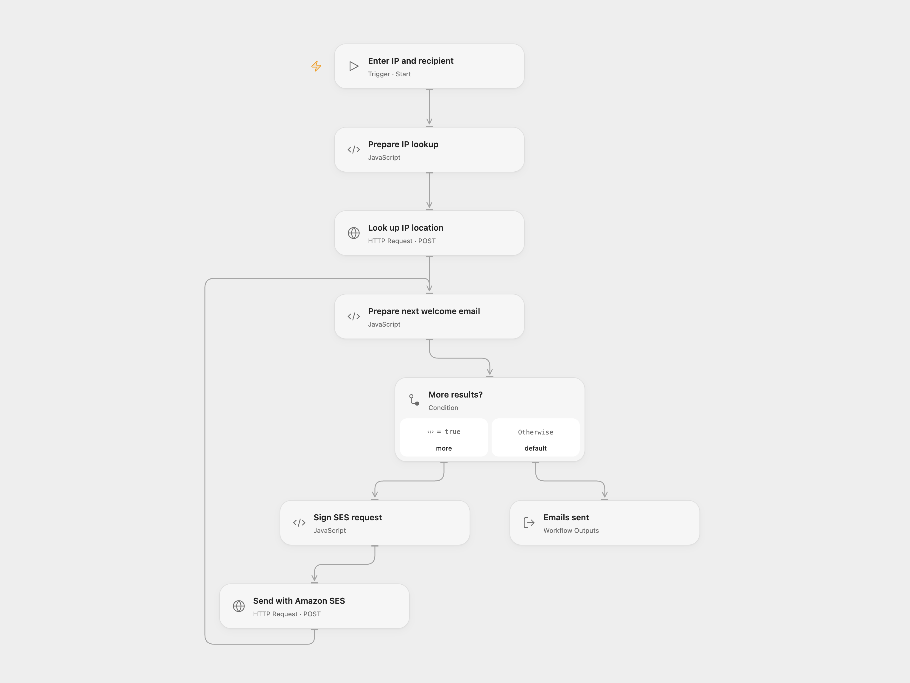

# Send a Localized Welcome Email by IP

Look up an IP address and send a localized welcome email through Amazon SES.

<picture>
  <source media="(prefers-color-scheme: dark)" srcset="preview-dark.png">
  
</picture>

[Open Flow JSON](templates/send-localized-welcome-email-by-ip.openflow.json) · [n8n JSON](templates/send-localized-welcome-email-by-ip.n8n.json)

## Setup

In Open Flow, bind secret Uproc account email and legacy v2 API key Variables to **Look up IP location**. In **Prepare next welcome email**, configure a verified SES sender. In **Sign SES request**, set the AWS region and bind secret Variables for access key ID and secret access key; for temporary credentials, bind the same session token Variable to **Sign SES request** and **Send with Amazon SES** → **X-Amz-Security-Token**. Leave both unset for long-lived credentials. Run with an IP address and recipient email.

In n8n, configure Uproc and AWS credentials, the IP and recipient in **Create IP and Email Item**, and the verified sender in both SES nodes. Use one format per welcome email. Restrict access to execution data because signed requests and email addresses appear in runs.

## Behavior

Uproc returns location data. For each result, country code exactly `ES` sends the Spanish welcome; all other values send the English welcome, matching the source condition. Each message is plain text and retains the source subject and body. No email is sent for an empty result array. Both formats process the Spanish branch first, then the English branch, preserving the order within each branch. Open Flow sends each result sequentially. One email can be sent per returned result.

An uncertain SES request may already have sent an email. Check delivery before retrying; earlier sends are not rolled back. Open Flow returns the accepted SES responses and count. A successful SES response indicates acceptance, not delivery. The AWS account must permit sending to the configured recipient and sender in the selected region. Open Flow applies execution-size and HTTP limits.

Inspiration &amp; credits

## Changes to the source

- Open Flow accepts IP and recipient as run inputs and uses the SES v2 send API with signed requests.
- Replace private examples and fix n8n recipient expressions to use the single source item when the lookup returns multiple results.

Adapted from [location_by_ip](https://github.com/Zie619/n8n-workflows/blob/ae8cf6dc5b873cbb4f74587aa9180ed3a9f70682/workflows/Manual/0025_Manual_Uproc_Automation_Triggered.json) in [Zie619/n8n-workflows](https://github.com/Zie619/n8n-workflows). The matching [n8n community listing](https://n8n.io/workflows/851-detect-web-visitors-country-by-ip-address-with-uproc/) credits Miquel Colomer. The original template does not state a separate license.

The collection’s [MIT notice](https://github.com/Zie619/n8n-workflows/blob/94007c1445d9258a7da116646b79473e7c7c3282/LICENSE) is pinned at a later revision. This is the collection notice at that revision; it does not establish a separate original template author's license. Our changes are listed above; see [repository licensing](../../README.md#licensing).

> MIT License
>
> Copyright (c) 2025 Zie619
>
> Permission is hereby granted, free of charge, to any person obtaining a copy
> of this software and associated documentation files (the "Software"), to deal
> in the Software without restriction, including without limitation the rights
> to use, copy, modify, merge, publish, distribute, sublicense, and/or sell
> copies of the Software, and to permit persons to whom the Software is
> furnished to do so, subject to the following conditions:
>
> The above copyright notice and this permission notice shall be included in all
> copies or substantial portions of the Software.
>
> THE SOFTWARE IS PROVIDED "AS IS", WITHOUT WARRANTY OF ANY KIND, EXPRESS OR
> IMPLIED, INCLUDING BUT NOT LIMITED TO THE WARRANTIES OF MERCHANTABILITY,
> FITNESS FOR A PARTICULAR PURPOSE AND NONINFRINGEMENT. IN NO EVENT SHALL THE
> AUTHORS OR COPYRIGHT HOLDERS BE LIABLE FOR ANY CLAIM, DAMAGES OR OTHER
> LIABILITY, WHETHER IN AN ACTION OF CONTRACT, TORT OR OTHERWISE, ARISING FROM,
> OUT OF OR IN CONNECTION WITH THE SOFTWARE OR THE USE OR OTHER DEALINGS IN THE
> SOFTWARE.

