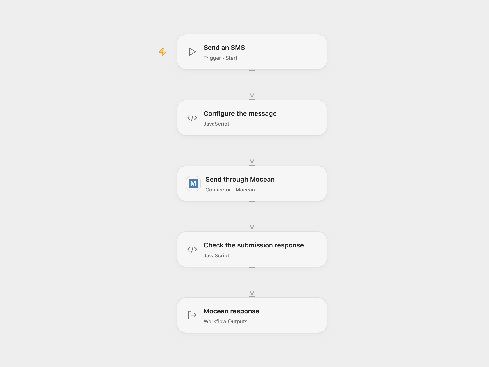

# Send an SMS with Mocean

Send one SMS message to a configured recipient through Mocean.

<picture>
  <source media="(prefers-color-scheme: dark)" srcset="preview-dark.png">
  
</picture>

[Open Flow JSON](templates/send-mocean-sms.openflow.json) · [n8n JSON](templates/send-mocean-sms.n8n.json)

## Setup

Connect Mocean in **Send through Mocean** using an API token. In **Configure the message**, enter your approved sender ID, recipient number including country code, and message. Sending may consume account credits.

In n8n, select Mocean API key and secret credentials and enter the same sender, recipient and message in **Mocean**. Run one format for each intended message.

## Behavior

Run manually to submit one SMS request. Open Flow returns Mocean’s per-recipient status and message ID when provided; n8n returns the native message result. Check the provider status: submission is not proof of delivery. If a request fails or its result is uncertain, check Mocean before repeating, because a message may already have been sent.

## Changes to the source

- Replace the three empty source fields with explicit setup. Open Flow rejects blank or placeholder values before sending and requires a per-recipient result.
- Open Flow uses a Mocean API token; n8n uses the source API key and secret credential.

Source and license

Adapted from [Send an SMS using the Mocean node](https://github.com/Zie619/n8n-workflows/blob/ae8cf6dc5b873cbb4f74587aa9180ed3a9f70682/workflows/Manual/1057_Manual_Mocean_Send_Triggered.json) in [Zie619/n8n-workflows](https://github.com/Zie619/n8n-workflows). The source export does not identify a separate template author or license.

The collection’s [MIT notice](https://github.com/Zie619/n8n-workflows/blob/94007c1445d9258a7da116646b79473e7c7c3282/LICENSE) is pinned at a later revision. This is the collection notice at that revision; it does not establish a separate original template author's license. Our changes are listed above; see [repository licensing](../../README.md#licensing).

> MIT License
>
> Copyright (c) 2025 Zie619
>
> Permission is hereby granted, free of charge, to any person obtaining a copy
> of this software and associated documentation files (the "Software"), to deal
> in the Software without restriction, including without limitation the rights
> to use, copy, modify, merge, publish, distribute, sublicense, and/or sell
> copies of the Software, and to permit persons to whom the Software is
> furnished to do so, subject to the following conditions:
>
> The above copyright notice and this permission notice shall be included in all
> copies or substantial portions of the Software.
>
> THE SOFTWARE IS PROVIDED "AS IS", WITHOUT WARRANTY OF ANY KIND, EXPRESS OR
> IMPLIED, INCLUDING BUT NOT LIMITED TO THE WARRANTIES OF MERCHANTABILITY,
> FITNESS FOR A PARTICULAR PURPOSE AND NONINFRINGEMENT. IN NO EVENT SHALL THE
> AUTHORS OR COPYRIGHT HOLDERS BE LIABLE FOR ANY CLAIM, DAMAGES OR OTHER
> LIABILITY, WHETHER IN AN ACTION OF CONTRACT, TORT OR OTHERWISE, ARISING FROM,
> OUT OF OR IN CONNECTION WITH THE SOFTWARE OR THE USE OR OTHER DEALINGS IN THE
> SOFTWARE.

