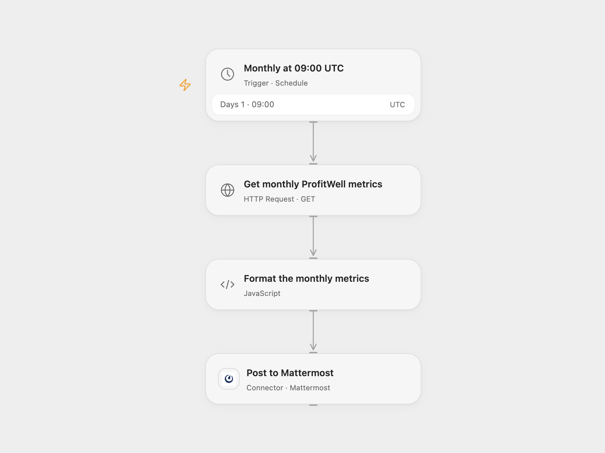

# Send Monthly ProfitWell Metrics to Mattermost

Post monthly ProfitWell customer and recurring revenue metrics to a Mattermost channel.

<picture>
  <source media="(prefers-color-scheme: dark)" srcset="preview-dark.png">
  
</picture>

[Open Flow JSON](templates/send-monthly-profitwell-metrics-to-mattermost.openflow.json) · [n8n JSON](templates/send-monthly-profitwell-metrics-to-mattermost.n8n.json)

## Setup

Create a ProfitWell Metrics API token. In Open Flow store it as a secret Variable named PROFITWELL_API_TOKEN and bind it to **Get monthly ProfitWell metrics**. Connect Mattermost and set the channel ID in **Format the monthly metrics**. In n8n connect ProfitWell and Mattermost credentials and set the Mattermost channel ID. Activate one format.

Both formats run on the first day of each month during 09:00 UTC. Open Flow runs at the minute boundary; n8n selects a fixed second within that minute. Check that UTC matches your reporting needs. The workflow reads the last value in each returned series for active customers, active trialing customers, new customers, growth rate and recurring revenue, and posts one message. It preserves the source label “Trailing Customers” for the active trialing customer metric. Metric history and timing depend on ProfitWell. Open Flow stops before posting if a required metric is missing or malformed; a null value is displayed as null.

The API token grants whatever permissions your ProfitWell account assigns it; protect the secret and restrict access to run history containing financial metrics. If the Mattermost request fails or its outcome is uncertain, check the channel before retrying because the message may already have been posted.

## Changes to the source

- Replace the private channel with configuration and explicitly set UTC in both formats; the source used the n8n instance timezone.
- Open Flow uses the ProfitWell HTTP API and validates the five fields before posting.

Source and license

Adapted from [Send ProfitWell metrics to Mattermost](https://github.com/Zie619/n8n-workflows/blob/ae8cf6dc5b873cbb4f74587aa9180ed3a9f70682/workflows/Mattermost/0169_Mattermost_Profitwell_Send_Scheduled.json) in [Zie619/n8n-workflows](https://github.com/Zie619/n8n-workflows). The source export does not identify a separate template author or license.

The collection’s [MIT notice](https://github.com/Zie619/n8n-workflows/blob/94007c1445d9258a7da116646b79473e7c7c3282/LICENSE) is pinned at a later revision. This is the collection notice at that revision; it does not establish a separate original template author's license. Our changes are listed above; see [repository licensing](../../README.md#licensing).

> MIT License
>
> Copyright (c) 2025 Zie619
>
> Permission is hereby granted, free of charge, to any person obtaining a copy
> of this software and associated documentation files (the "Software"), to deal
> in the Software without restriction, including without limitation the rights
> to use, copy, modify, merge, publish, distribute, sublicense, and/or sell
> copies of the Software, and to permit persons to whom the Software is
> furnished to do so, subject to the following conditions:
>
> The above copyright notice and this permission notice shall be included in all
> copies or substantial portions of the Software.
>
> THE SOFTWARE IS PROVIDED "AS IS", WITHOUT WARRANTY OF ANY KIND, EXPRESS OR
> IMPLIED, INCLUDING BUT NOT LIMITED TO THE WARRANTIES OF MERCHANTABILITY,
> FITNESS FOR A PARTICULAR PURPOSE AND NONINFRINGEMENT. IN NO EVENT SHALL THE
> AUTHORS OR COPYRIGHT HOLDERS BE LIABLE FOR ANY CLAIM, DAMAGES OR OTHER
> LIABILITY, WHETHER IN AN ACTION OF CONTRACT, TORT OR OTHERWISE, ARISING FROM,
> OUT OF OR IN CONNECTION WITH THE SOFTWARE OR THE USE OR OTHER DEALINGS IN THE
> SOFTWARE.

