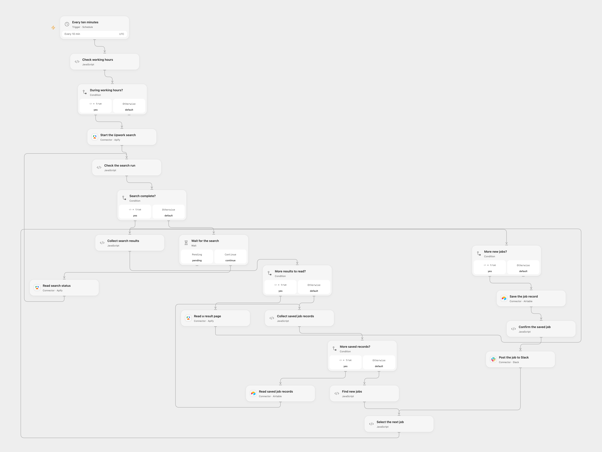

# Send New Upwork Jobs to Slack

Check configured Upwork searches during working hours and post newly observed jobs to Slack.

<picture>
  <source media="(prefers-color-scheme: dark)" srcset="preview-dark.png">
  
</picture>

[Open Flow JSON](templates/send-new-upwork-jobs-to-slack.openflow.json) · [n8n JSON](templates/send-new-upwork-jobs-to-slack.n8n.json)

## Setup

Connect Apify, Airtable and Slack. Set the same Airtable base ID and table name in **Read saved job records** and **Save the job record**. Create text fields named title, link, paymentType, budget, projectLength, shortBio, skills, publishedDate, normalizedDate, searchUrl and Raw job JSON. In **Start the Upwork search**, configure the search URLs and proxy country for the actor. Set the destination channel ID in **Post the job to Slack**. Prevent overlapping runs. In n8n configure the Apify query-auth credential, MongoDB connection and collection, and Slack connection and channel. The n8n Apify credential is sent in the URL query; upstream or proxy logs can record that URL. Enable one format.

## Behavior

Every ten minutes from 03:00 through 14:59 UTC, the workflow runs the configured searches and posts each new job with its title, publication date, link, payment type, budget, skills and description. Jobs are considered duplicates when title and budget match. Missing budgets are treated as empty when matching the same title. Open Flow starts on the minute boundary; n8n uses a fixed second in the scheduled minute.

Open Flow waits up to five minutes for the search, reads its dataset and saved records in pages, then saves each new job in Airtable before posting it. The text columns are searchable; Raw job JSON retains the original data types and fields. A failed or uncertain Airtable or Slack write may already have succeeded; inspect both services before retrying. Dataset and record history must fit platform execution limits. n8n stores records in MongoDB. The two formats do not share their histories.

Inspiration &amp; credits

## Changes to the source

- Use UTC for the original working-hours filter and replace example credentials and destinations with connections. In n8n, allow an empty MongoDB lookup to continue and select unmatched job inputs so an empty history can produce the first alerts.
- Open Flow uses the Apify run, status and dataset Actions and saves complete job records in Airtable before posting. The source used a synchronous Apify request, MongoDB and separate save/send branches; n8n retains those services and branches.

Adapted from [Find new Upwork jobs and post them to Slack](https://github.com/Zie619/n8n-workflows/blob/ae8cf6dc5b873cbb4f74587aa9180ed3a9f70682/workflows/Schedule/0711_Schedule_Slack_Create_Scheduled.json) in [Zie619/n8n-workflows](https://github.com/Zie619/n8n-workflows). The source export does not identify a separate template author or license.

The collection’s [MIT notice](https://github.com/Zie619/n8n-workflows/blob/94007c1445d9258a7da116646b79473e7c7c3282/LICENSE) is pinned at a later revision. This is the collection notice at that revision; it does not establish a separate original template author's license. Our changes are listed above; see [repository licensing](../../README.md#licensing).

> MIT License
>
> Copyright (c) 2025 Zie619
>
> Permission is hereby granted, free of charge, to any person obtaining a copy
> of this software and associated documentation files (the "Software"), to deal
> in the Software without restriction, including without limitation the rights
> to use, copy, modify, merge, publish, distribute, sublicense, and/or sell
> copies of the Software, and to permit persons to whom the Software is
> furnished to do so, subject to the following conditions:
>
> The above copyright notice and this permission notice shall be included in all
> copies or substantial portions of the Software.
>
> THE SOFTWARE IS PROVIDED "AS IS", WITHOUT WARRANTY OF ANY KIND, EXPRESS OR
> IMPLIED, INCLUDING BUT NOT LIMITED TO THE WARRANTIES OF MERCHANTABILITY,
> FITNESS FOR A PARTICULAR PURPOSE AND NONINFRINGEMENT. IN NO EVENT SHALL THE
> AUTHORS OR COPYRIGHT HOLDERS BE LIABLE FOR ANY CLAIM, DAMAGES OR OTHER
> LIABILITY, WHETHER IN AN ACTION OF CONTRACT, TORT OR OTHERWISE, ARISING FROM,
> OUT OF OR IN CONNECTION WITH THE SOFTWARE OR THE USE OR OTHER DEALINGS IN THE
> SOFTWARE.

