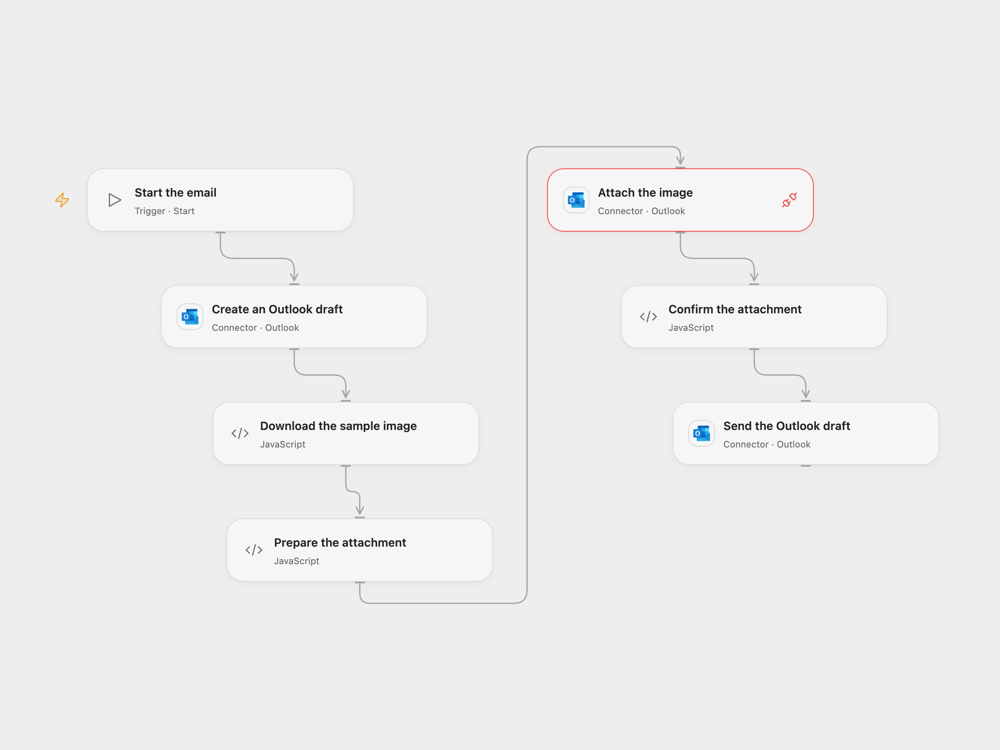

# Send an Outlook Draft with an Attachment

Create an Outlook draft, add a downloaded image and send the message.

<picture>
  <source media="(prefers-color-scheme: dark)" srcset="preview-dark.png">
  
</picture>

[Open Flow JSON](templates/send-outlook-draft-with-attachment.openflow.json) · [n8n JSON](templates/send-outlook-draft-with-attachment.n8n.json)

## Setup

Connect the same Outlook account to **Create an Outlook draft**, **Attach the image** and **Send the Outlook draft**, with Mail.ReadWrite and Mail.Send permissions. Set a real recipient, subject and body in **Create an Outlook draft**. Allow the download from n8n.io. In n8n connect Outlook and set a recipient in **Microsoft Outlook2**. Run one format.

## Behavior

A manual run creates a draft, downloads the sample n8n logo, attaches it as n8n.png and sends the draft. Open Flow accepts files that fit its 1 MiB fetch and Code input/output limits; oversized data stops rather than being truncated. Restrict access to run data containing email content and attachment bytes.

Open Flow adds the recipient when creating the draft; n8n adds it just before sending. A failure may leave a draft or an attachment. An uncertain send may already have completed; inspect Outlook before retrying. Send acceptance does not guarantee delivery.

Inspiration &amp; credits

## Changes to the source

- Replace the example recipient with configuration. Open Flow uses the formal Outlook draft/send Actions and the Outlook API request capability for attachment upload.

Adapted from [Create, add an attachment, and send a draft using the Microsoft Outlook node](https://github.com/Zie619/n8n-workflows/blob/ae8cf6dc5b873cbb4f74587aa9180ed3a9f70682/workflows/Manual/0312_Manual_HTTP_Create_Webhook.json) in [Zie619/n8n-workflows](https://github.com/Zie619/n8n-workflows). The source export does not identify a separate template author or license.

The collection’s [MIT notice](https://github.com/Zie619/n8n-workflows/blob/94007c1445d9258a7da116646b79473e7c7c3282/LICENSE) is pinned at a later revision. This is the collection notice at that revision; it does not establish a separate original template author's license. Our changes are listed above; see [repository licensing](../../README.md#licensing).

> MIT License
>
> Copyright (c) 2025 Zie619
>
> Permission is hereby granted, free of charge, to any person obtaining a copy
> of this software and associated documentation files (the "Software"), to deal
> in the Software without restriction, including without limitation the rights
> to use, copy, modify, merge, publish, distribute, sublicense, and/or sell
> copies of the Software, and to permit persons to whom the Software is
> furnished to do so, subject to the following conditions:
>
> The above copyright notice and this permission notice shall be included in all
> copies or substantial portions of the Software.
>
> THE SOFTWARE IS PROVIDED "AS IS", WITHOUT WARRANTY OF ANY KIND, EXPRESS OR
> IMPLIED, INCLUDING BUT NOT LIMITED TO THE WARRANTIES OF MERCHANTABILITY,
> FITNESS FOR A PARTICULAR PURPOSE AND NONINFRINGEMENT. IN NO EVENT SHALL THE
> AUTHORS OR COPYRIGHT HOLDERS BE LIABLE FOR ANY CLAIM, DAMAGES OR OTHER
> LIABILITY, WHETHER IN AN ACTION OF CONTRACT, TORT OR OTHERWISE, ARISING FROM,
> OUT OF OR IN CONNECTION WITH THE SOFTWARE OR THE USE OR OTHER DEALINGS IN THE
> SOFTWARE.

