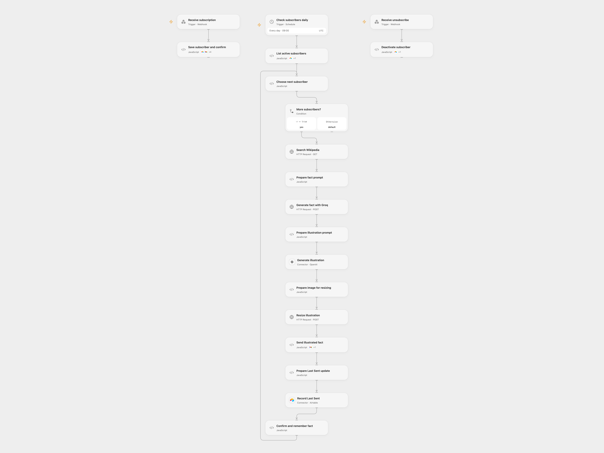

# Send Personalized Factoid Emails

Manage subscribers and send illustrated facts about their chosen topics.

<picture>
  <source media="(prefers-color-scheme: dark)" srcset="preview-dark.png">
  
</picture>

[Open Flow JSON](templates/send-personalized-factoid-emails.openflow.json) · [n8n JSON](templates/send-personalized-factoid-emails.n8n.json)

## Setup

Create an Airtable table with Email, Topic, Status, Interval, Start Day and Last Sent fields. Status uses active and inactive; Interval uses daily, weekly and surprise. Connect Airtable, Gmail and OpenAI. Set the Airtable base and table IDs in **Save subscriber and confirm**, **Deactivate subscriber**, **List active subscribers** and **Record Last Sent**. Bind Secret Variable GROQ_API_KEY to **Generate fact with Groq**. Enable persistent State and prevent overlapping executions.

Import the bundled n8n workflow. Configure **Subscribe Form** and **Unsubscribe Form**, and set each **Choose ... mode** node to relay and its corresponding **Forward ...** URL to the matching Open Flow webhook. Enable **Image resize relay**, set its production URL on **Resize illustration**, and set the unsubscribe form URL on **Send illustrated fact**. The n8n instance needs GraphicsMagick for Edit Image. Restrict access to the form and resize relay endpoints.

For n8n-only operation, set both form modes to direct, disable the image resize relay, connect Airtable, Gmail, Groq and OpenAI, and configure every Airtable node. Select the same Data Table on all checkpoint nodes with text columns item_key and status. Set N8N_CONCURRENCY_PRODUCTION_LIMIT=1 on the n8n instance and avoid concurrent manual executions. Use one format. In Open Flow, ensure scheduled and form-triggered runs do not overlap.

## Behavior

A subscription saves the email, topic and requested daily, weekly or surprise schedule and sends a confirmation. Unsubscribe marks the given record inactive. Each day at 09:00 UTC the workflow checks active subscriptions. Daily subscribers are selected daily, weekly subscribers when no prior send exists or seven days have elapsed, and surprise subscribers with a one-in-ten chance each day. It searches Wikipedia, asks Groq for a fact avoiding the last five facts for that subscriber, creates an illustration, resizes it to 480×360 and emails both. A successful send is followed by an Airtable Last Sent update.

If a write result is unknown, inspect the relevant Airtable record or Gmail message before clearing the pending State entry or resolving the pending Data Table row. Earlier writes may have succeeded. The source uses publicly reachable forms without authentication; restrict access to trusted callers. Workflow state and execution history can contain subscriber information.

Inspiration &amp; credits

## Changes to the source

- Correct the surprise interval, use the actual send time and remove the original copied recipient and private Airtable IDs.
- Add per-write checkpoints and an optional n8n form and image resize relay.

Adapted from [Learn something every day](https://github.com/Zie619/n8n-workflows/blob/ae8cf6dc5b873cbb4f74587aa9180ed3a9f70682/workflows/Code/0658_Code_Schedule_Create_Scheduled.json) in [Zie619/n8n-workflows](https://github.com/Zie619/n8n-workflows). The source export does not identify a separate template author or license.

The collection’s [MIT notice](https://github.com/Zie619/n8n-workflows/blob/94007c1445d9258a7da116646b79473e7c7c3282/LICENSE) is pinned at a later revision. This is the collection notice at that revision; it does not establish a separate original template author's license. Our changes are listed above; see [repository licensing](../../README.md#licensing).

> MIT License
>
> Copyright (c) 2025 Zie619
>
> Permission is hereby granted, free of charge, to any person obtaining a copy
> of this software and associated documentation files (the "Software"), to deal
> in the Software without restriction, including without limitation the rights
> to use, copy, modify, merge, publish, distribute, sublicense, and/or sell
> copies of the Software, and to permit persons to whom the Software is
> furnished to do so, subject to the following conditions:
>
> The above copyright notice and this permission notice shall be included in all
> copies or substantial portions of the Software.
>
> THE SOFTWARE IS PROVIDED "AS IS", WITHOUT WARRANTY OF ANY KIND, EXPRESS OR
> IMPLIED, INCLUDING BUT NOT LIMITED TO THE WARRANTIES OF MERCHANTABILITY,
> FITNESS FOR A PARTICULAR PURPOSE AND NONINFRINGEMENT. IN NO EVENT SHALL THE
> AUTHORS OR COPYRIGHT HOLDERS BE LIABLE FOR ANY CLAIM, DAMAGES OR OTHER
> LIABILITY, WHETHER IN AN ACTION OF CONTRACT, TORT OR OTHERWISE, ARISING FROM,
> OUT OF OR IN CONNECTION WITH THE SOFTWARE OR THE USE OR OTHER DEALINGS IN THE
> SOFTWARE.

