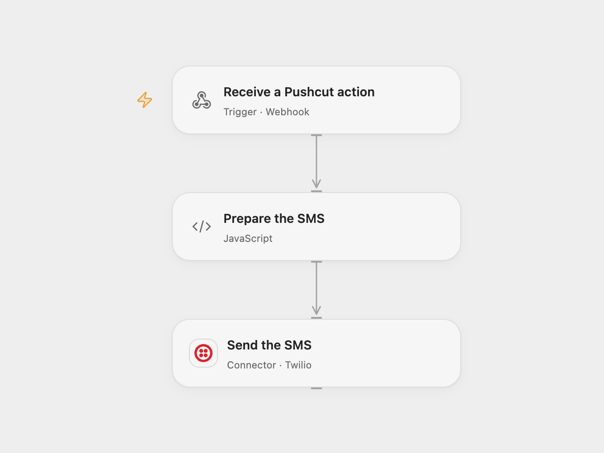

# Send Pushcut Action Input by SMS

Send the input of a Pushcut online action as an SMS through Twilio.

<picture>
  <source media="(prefers-color-scheme: dark)" srcset="preview-dark.png">
  
</picture>

[Open Flow JSON](templates/send-pushcut-action-input-by-sms.openflow.json) · [n8n JSON](templates/send-pushcut-action-input-by-sms.n8n.json)

## Setup

In Open Flow, connect Twilio, set the sender and recipient in **Send the SMS**, publish the workflow and copy its webhook URL. Register that URL with Pushcut as an online action by sending a POST to `https://api.pushcut.io/v1/subscriptions` with your `API-Key` header and JSON body `{"actionName":"Leaving Home","url":"YOUR_WEBHOOK_URL"}`. Save the returned subscription ID; delete it through Pushcut when no longer needed. Configure a Pushcut notification or automation to run that online action with an input.

In n8n, connect Pushcut and Twilio, enter the sender and recipient, and activate the workflow. The Pushcut Trigger registers its subscription automatically. Use one format for each action.

The callback URL is unauthenticated. Anyone with it can send SMS through the connected account; keep it private and restrict Twilio permissions. Pushcut does not sign this callback.

## Behavior

When the online action runs, the workflow sends one SMS containing “I'm ” followed by its input. The input is provided by Pushcut and can contain personal information. If no input is supplied, Open Flow sends `undefined`; n8n sends an empty value. A failed or uncertain send may already have delivered an SMS; inspect Twilio before retrying. Open Flow acknowledges the webhook before the SMS outcome is known.

Inspiration &amp; credits

## Changes to the source

- Open Flow uses a native webhook and requires manual Pushcut subscription management. Replace the example phone numbers with configured sender and recipient values.

Adapted from [Send an SMS to a number whenever you go out](https://github.com/Zie619/n8n-workflows/blob/ae8cf6dc5b873cbb4f74587aa9180ed3a9f70682/workflows/Twilio/1198_Twilio_Pushcut_Send_Triggered.json) in [Zie619/n8n-workflows](https://github.com/Zie619/n8n-workflows). The matching [n8n community listing](https://n8n.io/workflows/870-send-an-sms-to-a-number-whenever-you-go-out/) credits Harshil Agrawal. The original template does not state a separate license.

The collection’s [MIT notice](https://github.com/Zie619/n8n-workflows/blob/94007c1445d9258a7da116646b79473e7c7c3282/LICENSE) is pinned at a later revision. This is the collection notice at that revision; it does not establish a separate original template author's license. Our changes are listed above; see [repository licensing](../../README.md#licensing).

> MIT License
>
> Copyright (c) 2025 Zie619
>
> Permission is hereby granted, free of charge, to any person obtaining a copy
> of this software and associated documentation files (the "Software"), to deal
> in the Software without restriction, including without limitation the rights
> to use, copy, modify, merge, publish, distribute, sublicense, and/or sell
> copies of the Software, and to permit persons to whom the Software is
> furnished to do so, subject to the following conditions:
>
> The above copyright notice and this permission notice shall be included in all
> copies or substantial portions of the Software.
>
> THE SOFTWARE IS PROVIDED "AS IS", WITHOUT WARRANTY OF ANY KIND, EXPRESS OR
> IMPLIED, INCLUDING BUT NOT LIMITED TO THE WARRANTIES OF MERCHANTABILITY,
> FITNESS FOR A PARTICULAR PURPOSE AND NONINFRINGEMENT. IN NO EVENT SHALL THE
> AUTHORS OR COPYRIGHT HOLDERS BE LIABLE FOR ANY CLAIM, DAMAGES OR OTHER
> LIABILITY, WHETHER IN AN ACTION OF CONTRACT, TORT OR OTHERWISE, ARISING FROM,
> OUT OF OR IN CONNECTION WITH THE SOFTWARE OR THE USE OR OTHER DEALINGS IN THE
> SOFTWARE.

