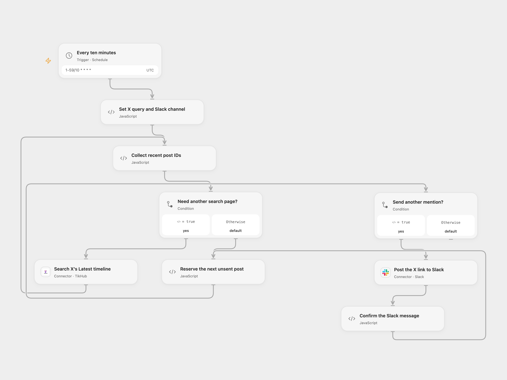

# Send Recent X Mentions to Slack

Find recent public X mentions and send a separate link to Slack for each matching post.

<!-- template-actions:start -->
 
<!-- template-actions:end -->

<picture>
  <source media="(prefers-color-scheme: dark)" srcset="preview-dark.png">
  
</picture>

## Setup

1. Connect TikHub in **Search X’s Latest timeline**. For a personal API token, grant access to `/api/v1/twitter/web_v2/fetch_search_timeline`.
2. In **Set X query and Slack channel**, enter your search query, such as your `@company` handle, and the Slack channel ID. Connect Slack in **Post the X link to Slack**. The Slack connection needs permission to post in that channel.
3. Enable persistent State and publish the schedule.

## Behavior

The workflow runs every ten minutes at minute 01, 11, 21, 31, 41, or 51 UTC. It checks the ten-minute window ending at the previous ten-minute mark, allowing one minute for search indexing. A post at the start of the window is excluded. A post at the end is included. Each run sends at most 50 distinct posts from the Latest search results.

Each Slack message contains a link to open the original post on X. Link and media previews are disabled. If a search page fails, the workflow sends no messages for that run. An unconfirmed Slack send stops the run. Check the channel before replaying. Pending and confirmed post IDs in the two most recent hours suppress repeat sends for the same window and channel. The workflow removes older markers as the schedule advances.

In n8n

Set the search query and Slack channel ID at the top of **Set X query and Slack channel**. Add a **Header Auth** credential on **Search recent public posts** with the header name `Authorization` and the value `Bearer YOUR_X_APP_BEARER_TOKEN`. Use an app-only bearer token with X Recent Search access. Connect your Slack credential in **Post the X link to Slack**. Publish with the UTC schedule.

The workflow checks a single batch of up to 50 recent results. It removes duplicate IDs within the batch and uses non-overlapping schedule windows. Check the channel before manually rerunning the same window, because a replay can send links again.

Inspiration &amp; credits

Adapted from [Scrape Twitter for mentions of company](https://github.com/Zie619/n8n-workflows/blob/ae8cf6dc5b873cbb4f74587aa9180ed3a9f70682/workflows/Twitter/1212_Twitter_Slack_Automation_Scheduled.json) in [Zie619/n8n-workflows](https://github.com/Zie619/n8n-workflows). Attribution: Jonathan (jon-n8n, original workflow) / Zie619 (collection). See the [n8n gallery entry](https://n8n.io/workflows/1464-find-and-share-mentions-from-twitter-and-slack/).

## Changes to the source

The Slack message uses the original X post link in place of a copy of its text. See the [X Developer Policy](https://docs.x.com/developer-terms/policy#content-redistribution).

The collection’s [MIT notice](https://github.com/Zie619/n8n-workflows/blob/94007c1445d9258a7da116646b79473e7c7c3282/LICENSE) is pinned at a later revision. This is the collection notice at that revision; it does not establish a separate original template author's license. Our changes are listed above; see [repository licensing](../../README.md#licensing).

> MIT License
>
> Copyright (c) 2025 Zie619
>
> Permission is hereby granted, free of charge, to any person obtaining a copy
> of this software and associated documentation files (the "Software"), to deal
> in the Software without restriction, including without limitation the rights
> to use, copy, modify, merge, publish, distribute, sublicense, and/or sell
> copies of the Software, and to permit persons to whom the Software is
> furnished to do so, subject to the following conditions:
>
> The above copyright notice and this permission notice shall be included in all
> copies or substantial portions of the Software.
>
> THE SOFTWARE IS PROVIDED "AS IS", WITHOUT WARRANTY OF ANY KIND, EXPRESS OR
> IMPLIED, INCLUDING BUT NOT LIMITED TO THE WARRANTIES OF MERCHANTABILITY,
> FITNESS FOR A PARTICULAR PURPOSE AND NONINFRINGEMENT. IN NO EVENT SHALL THE
> AUTHORS OR COPYRIGHT HOLDERS BE LIABLE FOR ANY CLAIM, DAMAGES OR OTHER
> LIABILITY, WHETHER IN AN ACTION OF CONTRACT, TORT OR OTHERWISE, ARISING FROM,
> OUT OF OR IN CONNECTION WITH THE SOFTWARE OR THE USE OR OTHER DEALINGS IN THE
> SOFTWARE.

