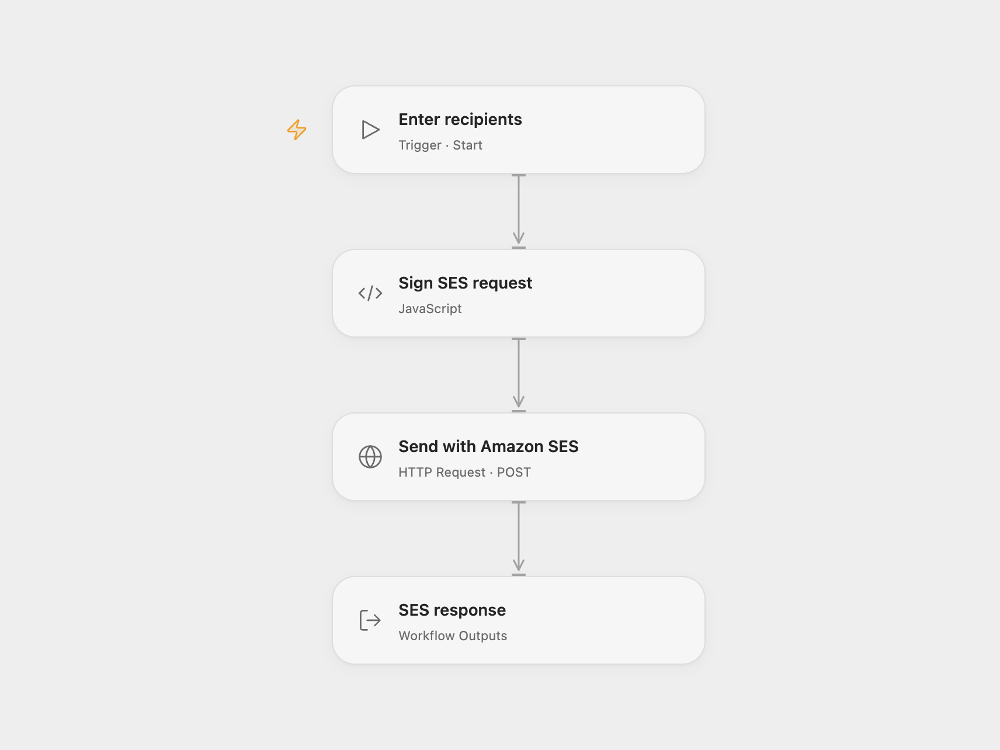

# Send a Sample Email to Two Recipients

Send one sample email to two recipients using Amazon SES.

<picture>
  <source media="(prefers-color-scheme: dark)" srcset="preview-dark.png">
  
</picture>

[Open Flow JSON](templates/send-sample-email-to-two-recipients.openflow.json) · [n8n JSON](templates/send-sample-email-to-two-recipients.n8n.json)

## Setup

Verify the sender in Amazon SES and check that your SES account can send to the selected recipients. In Open Flow, configure the SES region and bind access key ID and secret access key as secret Variables in **Sign SES request**. For temporary credentials, bind the same session token Variable to **Sign SES request** and **Send with Amazon SES** → **X-Amz-Security-Token**. Leave both unset for long-lived credentials. Run with the verified sender address and a list of recipient addresses. In n8n, configure the sender and both recipients in **AWS SES** and connect AWS credentials. Run one format at a time.

## Behavior

The workflow sends one plain-text message with subject `n8n Rocks` and the source sample body. The source example has two recipients; Open Flow accepts a recipient list. Each run sends a new email. If the send result is uncertain, inspect SES before retrying because the message may already have been accepted.

Inspiration &amp; credits

## Changes to the source

- Replace the source sender and example recipients with user configuration. Open Flow uses a signed SESv2 request; n8n uses its AWS SES node.

Adapted from [Send an email with Amazon SES](https://github.com/Zie619/n8n-workflows/blob/ae8cf6dc5b873cbb4f74587aa9180ed3a9f70682/workflows/Manual/0983_Manual_Awsses_Automate_Triggered.json) in [Zie619/n8n-workflows](https://github.com/Zie619/n8n-workflows). The source export does not identify a separate template author or license.

The collection’s [MIT notice](https://github.com/Zie619/n8n-workflows/blob/94007c1445d9258a7da116646b79473e7c7c3282/LICENSE) is pinned at a later revision. This is the collection notice at that revision; it does not establish a separate original template author's license. Our changes are listed above; see [repository licensing](../../README.md#licensing).

> MIT License
>
> Copyright (c) 2025 Zie619
>
> Permission is hereby granted, free of charge, to any person obtaining a copy
> of this software and associated documentation files (the "Software"), to deal
> in the Software without restriction, including without limitation the rights
> to use, copy, modify, merge, publish, distribute, sublicense, and/or sell
> copies of the Software, and to permit persons to whom the Software is
> furnished to do so, subject to the following conditions:
>
> The above copyright notice and this permission notice shall be included in all
> copies or substantial portions of the Software.
>
> THE SOFTWARE IS PROVIDED "AS IS", WITHOUT WARRANTY OF ANY KIND, EXPRESS OR
> IMPLIED, INCLUDING BUT NOT LIMITED TO THE WARRANTIES OF MERCHANTABILITY,
> FITNESS FOR A PARTICULAR PURPOSE AND NONINFRINGEMENT. IN NO EVENT SHALL THE
> AUTHORS OR COPYRIGHT HOLDERS BE LIABLE FOR ANY CLAIM, DAMAGES OR OTHER
> LIABILITY, WHETHER IN AN ACTION OF CONTRACT, TORT OR OTHERWISE, ARISING FROM,
> OUT OF OR IN CONNECTION WITH THE SOFTWARE OR THE USE OR OTHER DEALINGS IN THE
> SOFTWARE.

