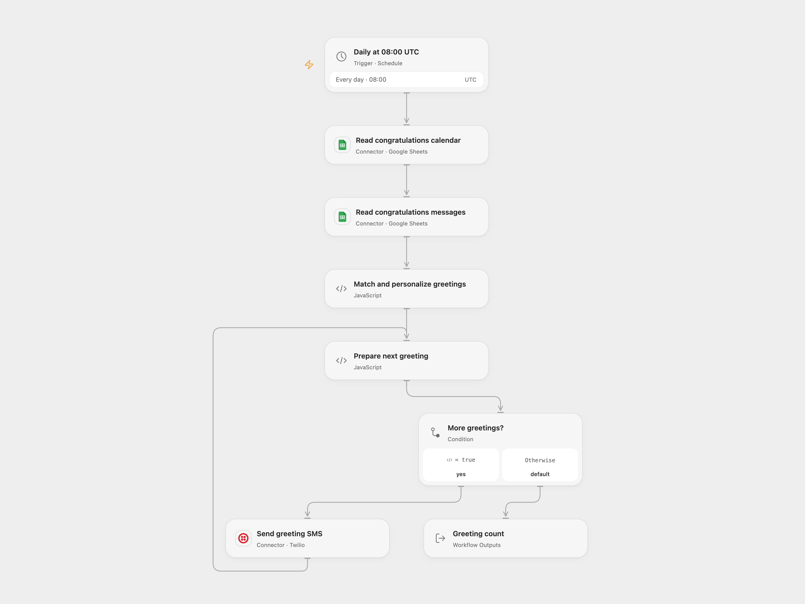

# Send Scheduled Congratulations from Sheets

Send personalized SMS greetings for events listed in Google Sheets.

<picture>
  <source media="(prefers-color-scheme: dark)" srcset="preview-dark.png">
  
</picture>

[Open Flow JSON](templates/send-scheduled-congratulations-from-sheets.openflow.json) · [n8n JSON](templates/send-scheduled-congratulations-from-sheets.n8n.json)

## Setup

Connect Google Sheets and Twilio. Set the spreadsheet ID in both read nodes, select the appropriate sheet ranges and set the Twilio sender in **Send greeting SMS**. The calendar header needs unique `Date`, `Event Name`, `First Name`, and `Phone Number` columns; the messages header needs unique `Event Name` and `Congratulations` columns. Use phone numbers in E.164 format and dates formatted as day/month without leading zeroes, for example `5/3`. The message text before its first comma becomes the greeting; the first name is inserted before that comma.

In n8n, connect Google Sheets and Twilio, configure the spreadsheet ID and both ranges and the Twilio sender. Activate only one format.

## Behavior

Each day at 08:00 UTC, match today's calendar rows against greeting templates by event name and send each matched person a personalized SMS. Unmatched rows produce no message. When greeting names repeat, the last matching template is used. Open Flow sends sequentially and stops on failure; a failed or uncertain send may already have been delivered, so check before retrying. A rerun may send duplicates. Open Flow runs at the minute boundary; n8n's cron can run at a fixed second within that minute.

Inspiration &amp; credits

## Changes to the source

- Connect the greeting table read to the schedule; the source leaves it disconnected. Skip unmatched rows instead of failing when a greeting is missing. Use UTC and configurable spreadsheet and sender settings.

Adapted from [Send scheduled congratulations from Google Sheets](https://github.com/Zie619/n8n-workflows/blob/ae8cf6dc5b873cbb4f74587aa9180ed3a9f70682/workflows/Noop/0610_Noop_Twilio_Automate_Scheduled.json) in [Zie619/n8n-workflows](https://github.com/Zie619/n8n-workflows). The source export does not identify a separate template author or license.

The collection’s [MIT notice](https://github.com/Zie619/n8n-workflows/blob/94007c1445d9258a7da116646b79473e7c7c3282/LICENSE) is pinned at a later revision. This is the collection notice at that revision; it does not establish a separate original template author's license. Our changes are listed above; see [repository licensing](../../README.md#licensing).

> MIT License
>
> Copyright (c) 2025 Zie619
>
> Permission is hereby granted, free of charge, to any person obtaining a copy
> of this software and associated documentation files (the "Software"), to deal
> in the Software without restriction, including without limitation the rights
> to use, copy, modify, merge, publish, distribute, sublicense, and/or sell
> copies of the Software, and to permit persons to whom the Software is
> furnished to do so, subject to the following conditions:
>
> The above copyright notice and this permission notice shall be included in all
> copies or substantial portions of the Software.
>
> THE SOFTWARE IS PROVIDED "AS IS", WITHOUT WARRANTY OF ANY KIND, EXPRESS OR
> IMPLIED, INCLUDING BUT NOT LIMITED TO THE WARRANTIES OF MERCHANTABILITY,
> FITNESS FOR A PARTICULAR PURPOSE AND NONINFRINGEMENT. IN NO EVENT SHALL THE
> AUTHORS OR COPYRIGHT HOLDERS BE LIABLE FOR ANY CLAIM, DAMAGES OR OTHER
> LIABILITY, WHETHER IN AN ACTION OF CONTRACT, TORT OR OTHERWISE, ARISING FROM,
> OUT OF OR IN CONNECTION WITH THE SOFTWARE OR THE USE OR OTHER DEALINGS IN THE
> SOFTWARE.

