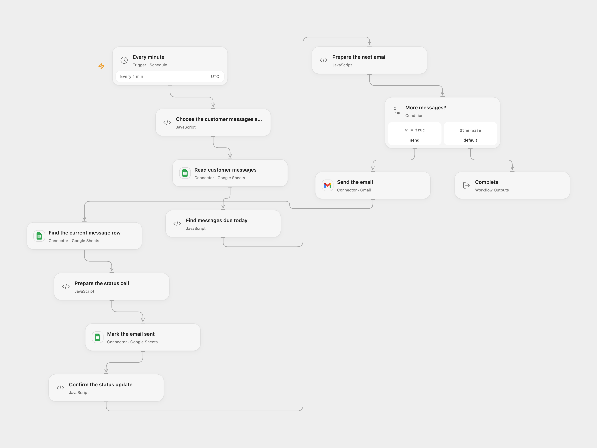

# Send Scheduled Customer Emails from Sheets

Send today’s queued customer emails and mark each successful send in Google Sheets.

<picture>
  <source media="(prefers-color-scheme: dark)" srcset="preview-dark.png">
  
</picture>

[Open Flow JSON](templates/send-scheduled-customer-emails-from-sheets.openflow.json) · [n8n JSON](templates/send-scheduled-customer-emails-from-sheets.n8n.json)

## Setup

Connect Google Sheets and Gmail to the same accounts in the chosen format. Set the spreadsheet ID and worksheet name in **Choose the customer messages sheet**. In n8n, select the same Google Sheets OAuth credential on the read, refresh and update nodes, and connect Gmail. Enable one format and prevent overlapping runs or concurrent edits to the worksheet while this workflow runs.

The first row must contain exactly one each of ID, Name, Email, Date, Status, Title and Subject. Give each message a unique nonempty ID. Format dates as text in yyyy/MM/dd. Title is the email subject and Subject is its plain-text body. Set Status to Waiting for sending to queue a message.

## Behavior

Every minute, the workflow selects rows dated today in UTC with status Waiting for sending and populated Name, Email, Date, Title and Subject. It sends each email, re-reads the sheet, checks that the ID still uniquely identifies the unchanged message, and writes Sent successfully to that row's Status cell only. Missing or duplicate selected IDs stop the run before sending. A changed or missing row after sending stops before the status update. Empty and nonmatching rows send nothing.

The original n8n workflow used its instance timezone; both formats here use UTC, so check the intended date boundary. Open Flow starts on the minute boundary; n8n chooses a fixed second when its schedule is registered. This workflow only sends rows dated today, so it does not catch up automatically on missed days.

A send or status update can succeed even if its response is lost. A retry can send the same email again, especially if email was sent but the status could not be updated. Inspect Gmail and the sheet before retrying. Keep the worksheet stable while a run is active; the row can change between the final check and write.

## Changes to the source

- Use the same explicit UTC date boundary in both formats and process messages in order, matching each successful send to its original ID rather than merging by position.
- Require unique IDs, recheck the row after sending, and update only the Status cell to preserve other columns and formulas.

Source and license

Adapted from [Sending Messages to Customers](https://github.com/Zie619/n8n-workflows/blob/ae8cf6dc5b873cbb4f74587aa9180ed3a9f70682/workflows/Schedule/0402_Schedule_Filter_Update_Scheduled.json) in [Zie619/n8n-workflows](https://github.com/Zie619/n8n-workflows). The matching [n8n listing](https://n8n.io/workflows/2088-send-multiple-emails-in-gmail-directly-via-google-sheets/) credits AlQaisi. No separate original template license was found.

The collection’s [MIT notice](https://github.com/Zie619/n8n-workflows/blob/94007c1445d9258a7da116646b79473e7c7c3282/LICENSE) is pinned at a later revision. This is the collection notice at that revision; it does not establish a separate original template author's license. Our changes are listed above; see [repository licensing](../../README.md#licensing).

> MIT License
>
> Copyright (c) 2025 Zie619
>
> Permission is hereby granted, free of charge, to any person obtaining a copy
> of this software and associated documentation files (the "Software"), to deal
> in the Software without restriction, including without limitation the rights
> to use, copy, modify, merge, publish, distribute, sublicense, and/or sell
> copies of the Software, and to permit persons to whom the Software is
> furnished to do so, subject to the following conditions:
>
> The above copyright notice and this permission notice shall be included in all
> copies or substantial portions of the Software.
>
> THE SOFTWARE IS PROVIDED "AS IS", WITHOUT WARRANTY OF ANY KIND, EXPRESS OR
> IMPLIED, INCLUDING BUT NOT LIMITED TO THE WARRANTIES OF MERCHANTABILITY,
> FITNESS FOR A PARTICULAR PURPOSE AND NONINFRINGEMENT. IN NO EVENT SHALL THE
> AUTHORS OR COPYRIGHT HOLDERS BE LIABLE FOR ANY CLAIM, DAMAGES OR OTHER
> LIABILITY, WHETHER IN AN ACTION OF CONTRACT, TORT OR OTHERWISE, ARISING FROM,
> OUT OF OR IN CONNECTION WITH THE SOFTWARE OR THE USE OR OTHER DEALINGS IN THE
> SOFTWARE.

