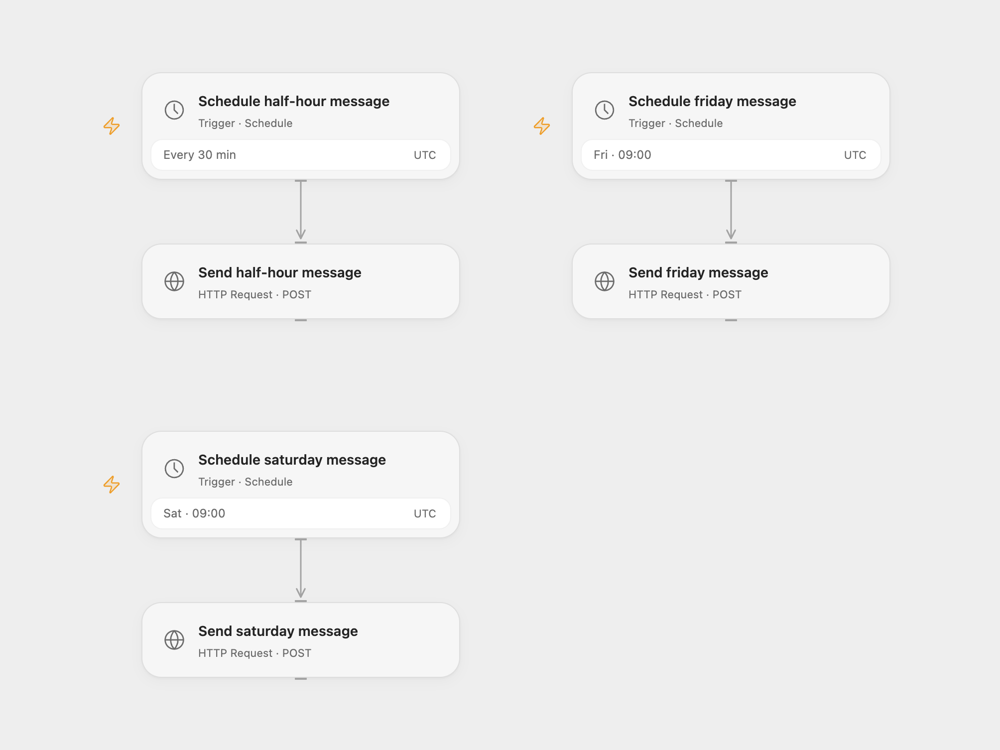

# Send Scheduled Discord Messages

Send three messages to a Discord webhook on separate schedules.

<picture>
  <source media="(prefers-color-scheme: dark)" srcset="preview-dark.png">
  
</picture>

[Open Flow JSON](templates/send-scheduled-discord-messages.openflow.json) · [n8n JSON](templates/send-scheduled-discord-messages.n8n.json)

## Setup and use

Set the secret Variable DISCORD_WEBHOOK to your Discord incoming webhook URL. Edit each message and replace YOUR_PUBLIC_IMAGE_URL in the half-hour message. Configure the timezone on the two weekly schedules; the supplied schedules use UTC. In n8n set each Discord node to your webhook URL, configure its timezone, and replace the image placeholder. Activate one format.

## Behavior

The source schedules the Wednesday-themed message on Saturday at 09:00, the Friday message on Friday at 09:00, and the good-night message every 30 minutes. These schedules are retained. If a send has an unknown result, the message may already have appeared in Discord; inspect the channel before retrying.

Inspiration &amp; credits

## Changes to the source

- Replace the source webhook URL and account-specific image URL with placeholders. Use UTC explicitly until you choose a timezone; Open Flow fires at the start of the minute while n8n chooses a second within it.

Adapted from [Discord scheduled messages](https://github.com/Zie619/n8n-workflows/blob/ae8cf6dc5b873cbb4f74587aa9180ed3a9f70682/workflows/Discord/0360_Discord_Cron_Automation_Scheduled.json) in [Zie619/n8n-workflows](https://github.com/Zie619/n8n-workflows). The source export does not identify a separate template author or license.

The collection’s [MIT notice](https://github.com/Zie619/n8n-workflows/blob/94007c1445d9258a7da116646b79473e7c7c3282/LICENSE) is pinned at a later revision. This is the collection notice at that revision; it does not establish a separate original template author's license. Our changes are listed above; see [repository licensing](../../README.md#licensing).

> MIT License
>
> Copyright (c) 2025 Zie619
>
> Permission is hereby granted, free of charge, to any person obtaining a copy
> of this software and associated documentation files (the "Software"), to deal
> in the Software without restriction, including without limitation the rights
> to use, copy, modify, merge, publish, distribute, sublicense, and/or sell
> copies of the Software, and to permit persons to whom the Software is
> furnished to do so, subject to the following conditions:
>
> The above copyright notice and this permission notice shall be included in all
> copies or substantial portions of the Software.
>
> THE SOFTWARE IS PROVIDED "AS IS", WITHOUT WARRANTY OF ANY KIND, EXPRESS OR
> IMPLIED, INCLUDING BUT NOT LIMITED TO THE WARRANTIES OF MERCHANTABILITY,
> FITNESS FOR A PARTICULAR PURPOSE AND NONINFRINGEMENT. IN NO EVENT SHALL THE
> AUTHORS OR COPYRIGHT HOLDERS BE LIABLE FOR ANY CLAIM, DAMAGES OR OTHER
> LIABILITY, WHETHER IN AN ACTION OF CONTRACT, TORT OR OTHERWISE, ARISING FROM,
> OUT OF OR IN CONNECTION WITH THE SOFTWARE OR THE USE OR OTHER DEALINGS IN THE
> SOFTWARE.

