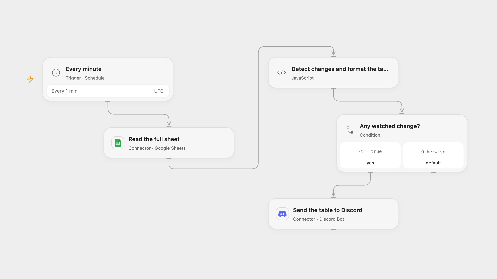

# Send Sheet Investment Updates to Discord

Watch investment security codes and send the complete sheet table to Discord when rows are added or codes change.

<picture>
  <source media="(prefers-color-scheme: dark)" srcset="preview-dark.png">
  
</picture>

[Open Flow JSON](templates/send-sheet-investment-updates-to-discord.openflow.json) · [n8n JSON](templates/send-sheet-investment-updates-to-discord.n8n.json)

## Setup

Connect Google Sheets and Discord. Set the spreadsheet ID and the full table range in **Read the full sheet**, and the channel ID in **Send the table to Discord**. Install the Discord bot with permission to post. The sheet must have unique Security Code, Price and Quantity headers. Keep workflow State persistent and avoid overlapping runs. In n8n configure the spreadsheet ID and complete range in **Read the full sheet** and connect Google Sheets; connect a Discord webhook credential in **Send the table to Discord**. Enable one format.

## Behavior

Every minute the workflow reads the complete configured range. The first successful poll saves the current security codes without sending. Later polls send one table containing all current rows when a row appears or a Security Code changes. Changes only to Price or Quantity do not trigger a message. The comparison uses row positions: deleting the final row alone does not trigger a message, while deleting an earlier row can trigger one when later Security Code values shift. Insertions and reordering can likewise change which positions are detected. The message contains Security Code, Price and Quantity. Newlines and backticks in cells are rendered safely. Tables longer than Discord's 2,000-character limit stop before saving the new snapshot or sending.

Open Flow saves the new snapshot before posting; n8n records its static data during the run. A failed or uncertain post may have succeeded and may not be repeated automatically. Inspect Discord and the sheet before resetting state or rerunning. Large tables must fit platform state and execution limits. n8n runs at a fixed second within each minute; Open Flow starts on the minute boundary.

Inspiration &amp; credits

## Changes to the source

- Read the whole table after detecting a change, as described in the source notes; the original code formats only trigger output. Replace the private sheet and webhook details.
- Compare the configured Security Code column directly. The fixed n8n trigger's any-update column indexing can compare the next column instead. Use a one-minute poll and explicit state for this comparison.
- Open Flow posts using a Discord bot; n8n uses a Discord webhook credential. Validate the table before advancing state or posting, and avoid unintended mentions.

Adapted from [Send Google Sheets data as a message to a Discord channel](https://github.com/Zie619/n8n-workflows/blob/ae8cf6dc5b873cbb4f74587aa9180ed3a9f70682/workflows/Googlesheets/0314_GoogleSheets_Discord_Create_Triggered.json) in [Zie619/n8n-workflows](https://github.com/Zie619/n8n-workflows). The matching [n8n community listing](https://n8n.io/workflows/1941-send-google-sheets-data-as-a-message-to-a-discord-channel/) credits n8n Team. No separate original template license is stated.

The collection’s [MIT notice](https://github.com/Zie619/n8n-workflows/blob/94007c1445d9258a7da116646b79473e7c7c3282/LICENSE) is pinned at a later revision. This is the collection notice at that revision; it does not establish a separate original template author's license. Our changes are listed above; see [repository licensing](../../README.md#licensing).

> MIT License
>
> Copyright (c) 2025 Zie619
>
> Permission is hereby granted, free of charge, to any person obtaining a copy
> of this software and associated documentation files (the "Software"), to deal
> in the Software without restriction, including without limitation the rights
> to use, copy, modify, merge, publish, distribute, sublicense, and/or sell
> copies of the Software, and to permit persons to whom the Software is
> furnished to do so, subject to the following conditions:
>
> The above copyright notice and this permission notice shall be included in all
> copies or substantial portions of the Software.
>
> THE SOFTWARE IS PROVIDED "AS IS", WITHOUT WARRANTY OF ANY KIND, EXPRESS OR
> IMPLIED, INCLUDING BUT NOT LIMITED TO THE WARRANTIES OF MERCHANTABILITY,
> FITNESS FOR A PARTICULAR PURPOSE AND NONINFRINGEMENT. IN NO EVENT SHALL THE
> AUTHORS OR COPYRIGHT HOLDERS BE LIABLE FOR ANY CLAIM, DAMAGES OR OTHER
> LIABILITY, WHETHER IN AN ACTION OF CONTRACT, TORT OR OTHERWISE, ARISING FROM,
> OUT OF OR IN CONNECTION WITH THE SOFTWARE OR THE USE OR OTHER DEALINGS IN THE
> SOFTWARE.

