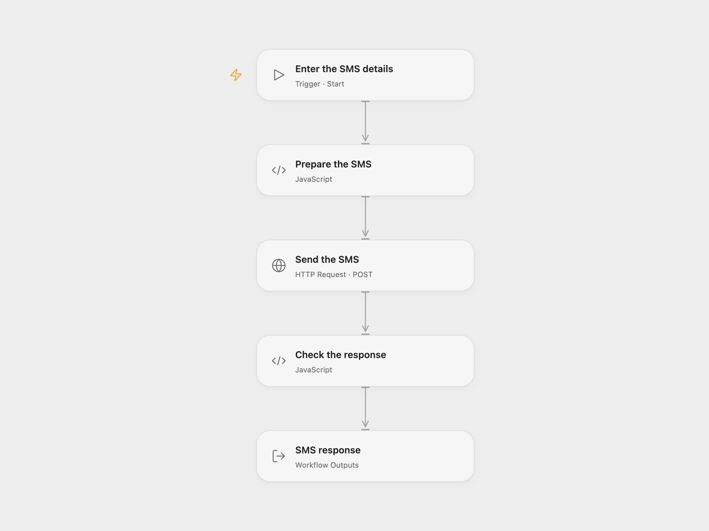

# Send an SMS with seven

Send an SMS to numbers, contacts or groups using seven.

<picture>
  <source media="(prefers-color-scheme: dark)" srcset="preview-dark.png">
  
</picture>

[Open Flow JSON](templates/send-sms-with-seven.openflow.json) · [n8n JSON](templates/send-sms-with-seven.n8n.json)

## Setup

In Open Flow create a secret Variable named `SEVEN_API_KEY` and bind it to **Send the SMS**. Run with recipient numbers, contact names or group names in `to`, separated by commas, and a message. The sender is optional. In n8n connect seven credentials and set the recipient, sender if needed, and message in **Sms77**. Use one format per send.

## Behavior

A manual run sends one SMS request. seven's success code `100` means the gateway accepted it; it does not guarantee delivery. Other response codes stop the workflow. A partial failure or uncertain request may already have sent messages to some recipients. Check seven's message statuses before retrying. Open Flow Code input and output are limited to 1 MiB; oversized responses stop the run.

Inspiration &amp; credits

## Changes to the source

- Open Flow uses seven's SMS API directly and accepts the SMS details as run inputs.

Adapted from [Sending an SMS using sms77](https://github.com/Zie619/n8n-workflows/blob/ae8cf6dc5b873cbb4f74587aa9180ed3a9f70682/workflows/Manual/1199_Manual_Sms77_Send_Triggered.json) in [Zie619/n8n-workflows](https://github.com/Zie619/n8n-workflows). The matching [n8n community listing](https://n8n.io/workflows/469-sending-an-sms-using-sms77/) credits tanaypant. The original template does not state a separate license.

The collection’s [MIT notice](https://github.com/Zie619/n8n-workflows/blob/94007c1445d9258a7da116646b79473e7c7c3282/LICENSE) is pinned at a later revision. This is the collection notice at that revision; it does not establish a separate original template author's license. Our changes are listed above; see [repository licensing](../../README.md#licensing).

> MIT License
>
> Copyright (c) 2025 Zie619
>
> Permission is hereby granted, free of charge, to any person obtaining a copy
> of this software and associated documentation files (the "Software"), to deal
> in the Software without restriction, including without limitation the rights
> to use, copy, modify, merge, publish, distribute, sublicense, and/or sell
> copies of the Software, and to permit persons to whom the Software is
> furnished to do so, subject to the following conditions:
>
> The above copyright notice and this permission notice shall be included in all
> copies or substantial portions of the Software.
>
> THE SOFTWARE IS PROVIDED "AS IS", WITHOUT WARRANTY OF ANY KIND, EXPRESS OR
> IMPLIED, INCLUDING BUT NOT LIMITED TO THE WARRANTIES OF MERCHANTABILITY,
> FITNESS FOR A PARTICULAR PURPOSE AND NONINFRINGEMENT. IN NO EVENT SHALL THE
> AUTHORS OR COPYRIGHT HOLDERS BE LIABLE FOR ANY CLAIM, DAMAGES OR OTHER
> LIABILITY, WHETHER IN AN ACTION OF CONTRACT, TORT OR OTHERWISE, ARISING FROM,
> OUT OF OR IN CONNECTION WITH THE SOFTWARE OR THE USE OR OTHER DEALINGS IN THE
> SOFTWARE.

