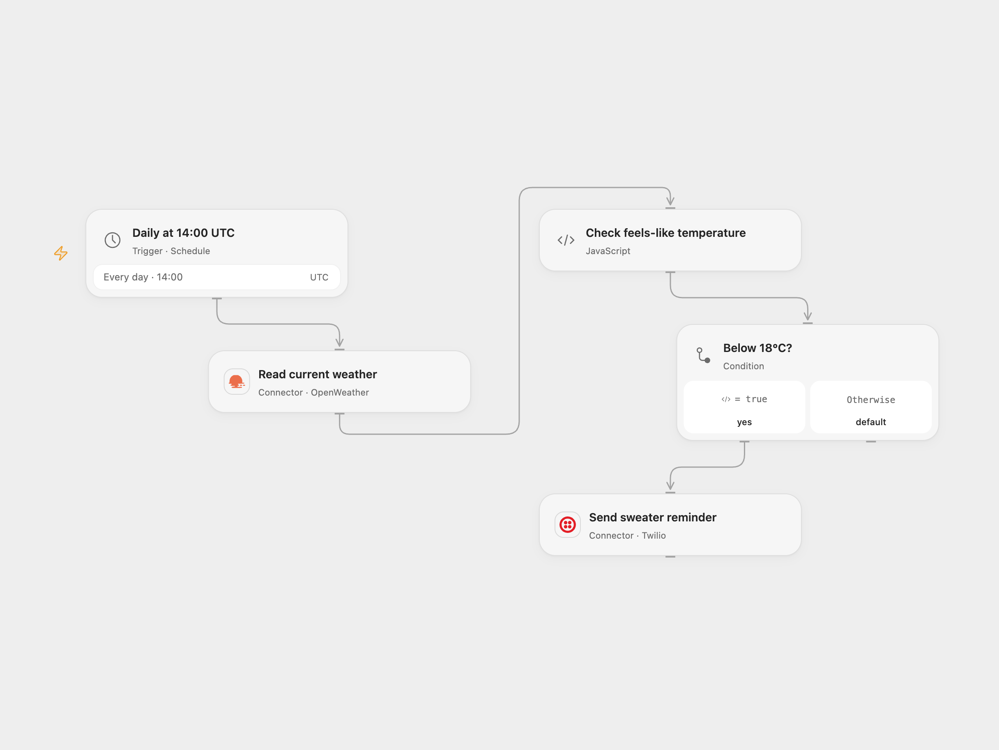

# Send a Sweater Weather SMS

Send an SMS when the current feels-like temperature is below 18°C.

<picture>
  <source media="(prefers-color-scheme: dark)" srcset="preview-dark.png">
  
</picture>

[Open Flow JSON](templates/send-sweater-weather-sms.openflow.json) · [n8n JSON](templates/send-sweater-weather-sms.n8n.json)

## Setup

Connect OpenWeather with a key for Current Weather Data 2.5. Set your city and country in **Read current weather**; the example is Berlin, Germany. Connect Twilio and set sender and recipient phone numbers in **Send sweater reminder**. In n8n, select OpenWeather and Twilio credentials, set the city in **OpenWeatherMap** and the numbers in **Twilio**. Enable one format.

## Behavior

At 14:00 UTC each day, read current metric weather and send the reminder when the feels-like temperature is strictly below 18°C. Exactly 18°C or above sends nothing. Missing or invalid weather data stops before sending. The source's daily trigger used the instance timezone; this version uses UTC. OpenWeather permissions and limits apply. A failed or uncertain SMS may already have been sent; inspect Twilio before replaying. Repeated cold days produce repeated messages.

Inspiration &amp; credits

## Changes to the source

- Make the daily schedule, metric units and strict threshold explicit; replace blank phone numbers with setup placeholders.
- Validate the weather response before evaluating the threshold.

Adapted from [Daily sweater weather SMS](https://github.com/Zie619/n8n-workflows/blob/ae8cf6dc5b873cbb4f74587aa9180ed3a9f70682/workflows/Openweathermap/1101_Openweathermap_Twilio_Automate_Scheduled.json) in [Zie619/n8n-workflows](https://github.com/Zie619/n8n-workflows). The source export does not identify a separate template author or license.

The collection’s [MIT notice](https://github.com/Zie619/n8n-workflows/blob/94007c1445d9258a7da116646b79473e7c7c3282/LICENSE) is pinned at a later revision. This is the collection notice at that revision; it does not establish a separate original template author's license. Our changes are listed above; see [repository licensing](../../README.md#licensing).

> MIT License
>
> Copyright (c) 2025 Zie619
>
> Permission is hereby granted, free of charge, to any person obtaining a copy
> of this software and associated documentation files (the "Software"), to deal
> in the Software without restriction, including without limitation the rights
> to use, copy, modify, merge, publish, distribute, sublicense, and/or sell
> copies of the Software, and to permit persons to whom the Software is
> furnished to do so, subject to the following conditions:
>
> The above copyright notice and this permission notice shall be included in all
> copies or substantial portions of the Software.
>
> THE SOFTWARE IS PROVIDED "AS IS", WITHOUT WARRANTY OF ANY KIND, EXPRESS OR
> IMPLIED, INCLUDING BUT NOT LIMITED TO THE WARRANTIES OF MERCHANTABILITY,
> FITNESS FOR A PARTICULAR PURPOSE AND NONINFRINGEMENT. IN NO EVENT SHALL THE
> AUTHORS OR COPYRIGHT HOLDERS BE LIABLE FOR ANY CLAIM, DAMAGES OR OTHER
> LIABILITY, WHETHER IN AN ACTION OF CONTRACT, TORT OR OTHERWISE, ARISING FROM,
> OUT OF OR IN CONNECTION WITH THE SOFTWARE OR THE USE OR OTHER DEALINGS IN THE
> SOFTWARE.

