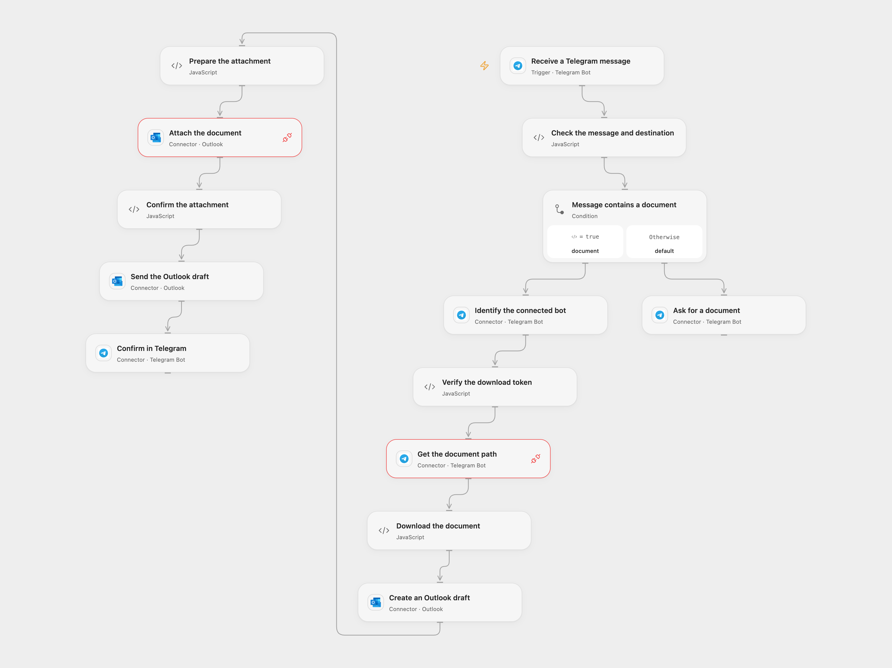

# Send Telegram Documents to Kindle

Email a Telegram document to a Kindle address and reply in the original chat.

<picture>
  <source media="(prefers-color-scheme: dark)" srcset="preview-dark.png">
  
</picture>

[Open Flow JSON](templates/send-telegram-documents-to-kindle.openflow.json) · [n8n JSON](templates/send-telegram-documents-to-kindle.n8n.json)

## Setup

Connect the same Telegram bot to **Receive a Telegram message**, **Identify the connected bot**, **Get the document path**, **Ask for a document**, and **Confirm in Telegram**. Create secret Variable TELEGRAM_DOCUMENT_BOT_TOKEN with the same bot token and bind it to **Verify the download token** and **Download the document**. Allow api.telegram.org HTTP capability and Telegram Provider API Request. Configure chat or user filters in the trigger so only intended senders can use the bot.

Set the Kindle email in **Check the message and destination**. Connect the same Outlook account to **Create an Outlook draft**, **Attach the document** and **Send the Outlook draft**, with Mail.ReadWrite and Mail.Send permissions. The Kindle address must accept mail from that Outlook sender and support the document type. In n8n connect Telegram and Outlook and replace the destination email in the Outlook node. Only one Telegram webhook may be active per bot; enable one format.

## Behavior

A message with a document downloads its complete bytes, sends the file as an email attachment, then replies to the original message. A message without a document receives a request to send a file. Open Flow checks that the download token matches the connected bot. Its webhook verifies the Telegram secret; the source n8n V1 trigger does not, so protect its callback URL.

Open Flow's file bytes and Base64 representation must fit the host's 1 MiB fetch and Code input/output limits. Oversized files fail rather than being truncated. Open Flow creates an Outlook draft, attaches the file and sends it; a failure can leave a draft or an already sent message. Check Outlook and Telegram before retrying an uncertain operation. The final Telegram reply means the mail service accepted sending, not that Kindle imported the document. Restrict access to runs, which can contain document contents.

Inspiration &amp; credits

## Changes to the source

- Replace the private Kindle address with configuration and make the bot download token explicit.
- Open Flow uses a draft and the Outlook Provider API to attach bytes before sending; n8n sends the original binary attachment directly.

Adapted from [send file to kindle through telegram bot](https://github.com/Zie619/n8n-workflows/blob/ae8cf6dc5b873cbb4f74587aa9180ed3a9f70682/workflows/Microsoftoutlook/1944_Microsoftoutlook_Telegram_Send_Triggered.json) in [Zie619/n8n-workflows](https://github.com/Zie619/n8n-workflows). The source export does not identify a separate template author or license.

The collection’s [MIT notice](https://github.com/Zie619/n8n-workflows/blob/94007c1445d9258a7da116646b79473e7c7c3282/LICENSE) is pinned at a later revision. This is the collection notice at that revision; it does not establish a separate original template author's license. Our changes are listed above; see [repository licensing](../../README.md#licensing).

> MIT License
>
> Copyright (c) 2025 Zie619
>
> Permission is hereby granted, free of charge, to any person obtaining a copy
> of this software and associated documentation files (the "Software"), to deal
> in the Software without restriction, including without limitation the rights
> to use, copy, modify, merge, publish, distribute, sublicense, and/or sell
> copies of the Software, and to permit persons to whom the Software is
> furnished to do so, subject to the following conditions:
>
> The above copyright notice and this permission notice shall be included in all
> copies or substantial portions of the Software.
>
> THE SOFTWARE IS PROVIDED "AS IS", WITHOUT WARRANTY OF ANY KIND, EXPRESS OR
> IMPLIED, INCLUDING BUT NOT LIMITED TO THE WARRANTIES OF MERCHANTABILITY,
> FITNESS FOR A PARTICULAR PURPOSE AND NONINFRINGEMENT. IN NO EVENT SHALL THE
> AUTHORS OR COPYRIGHT HOLDERS BE LIABLE FOR ANY CLAIM, DAMAGES OR OTHER
> LIABILITY, WHETHER IN AN ACTION OF CONTRACT, TORT OR OTHERWISE, ARISING FROM,
> OUT OF OR IN CONNECTION WITH THE SOFTWARE OR THE USE OR OTHER DEALINGS IN THE
> SOFTWARE.

