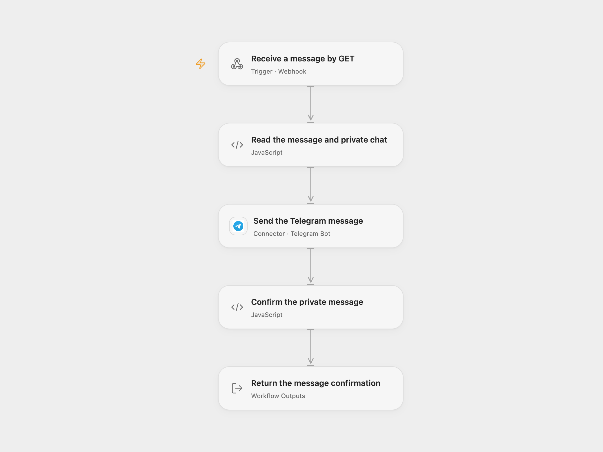

# Send a Telegram Message from a Webhook

Send a message to one configured Telegram private chat through a GET endpoint. After Telegram confirms the message, the endpoint returns the recipient’s first name and the original message text.

<picture>
  <source media="(prefers-color-scheme: dark)" srcset="preview-dark.png">
  
</picture>

[Open Flow JSON](templates/send-telegram-message-from-webhook.openflow.json) · [n8n JSON](templates/send-telegram-message-from-webhook.n8n.json)

## Setup

Connect your Telegram bot in **Send the Telegram message**. Replace **Chat ID** in **Read the message and private chat** with the recipient’s positive numeric private-chat ID. That recipient must have started a private conversation with the bot and allow it to send messages. The destination is configuration, not a query parameter.

Enable the workflow webhook and copy its URL. Each valid GET request sends one message using the configured bot. This workflow does not register a Telegram update webhook or download media.

In n8n, select **Telegram API** credentials on its send node and replace that node’s Chat ID. Keep GET, the last-node response mode, the `response` property and the plain-text content type. Activate one format for this endpoint.

## Use

Supply one URL-encoded `parameter` value:

```sh
curl --get --data-urlencode 'parameter=Hello from the workflow' 'YOUR_WEBHOOK_URL'
```

The message uses Telegram’s legacy **Markdown** mode, matching the source’s native default. Balanced Markdown can format the message; escape markup according to Telegram’s Markdown rules when literal punctuation is needed. Invalid Markdown can be rejected by Telegram. The workflow retains the original query text, including edge whitespace. Empty, repeated or non-text values fail before sending. The input is limited to 4096 characters as measured by the inspected Action contract; long messages are not split or truncated.

A successful request returns HTTP 200 with plain text:

```text
Sent message to Ada: "Hello from the workflow"
```

The name comes from Telegram’s returned private-chat first name. The quoted text is the original input, which may differ from Telegram’s rendered Markdown. No recipient name or message ID is invented. Missing message ID/date, a different recipient or missing first name fails after the send without claiming success.

The endpoint waits up to 60 seconds for the workflow result. Telegram errors, invalid receipts, cancellation or a response timeout can happen after a message was sent. Check the conversation before repeating such a request. Each replay can send another message; the workflow adds no retry, message history or deduplication.

The workflow result also retains the complete message returned by its platform: Open Flow keeps the Action’s normalized message fields, while n8n keeps the Telegram API envelope. Only the confirmation text is returned by HTTP. Message text and returned data must fit the inspected Open Flow host’s 1 MiB per-Code input/result budget; oversized data fails without truncation.

## Changes to the source

- Restore the GET → Telegram → confirmation sequence and replace the fixed chat ID with explicit setup.
- Validate one query value and a configured private recipient before sending.
- Keep the source’s Markdown behavior and original input in the confirmation, and verify the actual returned recipient/name.
- Make the GET method, selected last-node response and plain-text content type explicit.

<details>
<summary>Source and license</summary>

Adapted from [Telegram message API with a plain-text webhook confirmation](https://github.com/Zie619/n8n-workflows/blob/ae8cf6dc5b873cbb4f74587aa9180ed3a9f70682/workflows/Telegram/1065_Telegram_Webhook_Automation_Webhook.json) in [Zie619/n8n-workflows](https://github.com/Zie619/n8n-workflows). The source export does not identify a separate template author or license.

The collection’s [MIT notice](https://github.com/Zie619/n8n-workflows/blob/94007c1445d9258a7da116646b79473e7c7c3282/LICENSE) is pinned at a later revision. This is the collection notice at that revision; it does not establish a separate original template author's license. Our changes are listed above; see [repository licensing](../../README.md#licensing).

> MIT License
>
> Copyright (c) 2025 Zie619
>
> Permission is hereby granted, free of charge, to any person obtaining a copy
> of this software and associated documentation files (the "Software"), to deal
> in the Software without restriction, including without limitation the rights
> to use, copy, modify, merge, publish, distribute, sublicense, and/or sell
> copies of the Software, and to permit persons to whom the Software is
> furnished to do so, subject to the following conditions:
>
> The above copyright notice and this permission notice shall be included in all
> copies or substantial portions of the Software.
>
> THE SOFTWARE IS PROVIDED "AS IS", WITHOUT WARRANTY OF ANY KIND, EXPRESS OR
> IMPLIED, INCLUDING BUT NOT LIMITED TO THE WARRANTIES OF MERCHANTABILITY,
> FITNESS FOR A PARTICULAR PURPOSE AND NONINFRINGEMENT. IN NO EVENT SHALL THE
> AUTHORS OR COPYRIGHT HOLDERS BE LIABLE FOR ANY CLAIM, DAMAGES OR OTHER
> LIABILITY, WHETHER IN AN ACTION OF CONTRACT, TORT OR OTHERWISE, ARISING FROM,
> OUT OF OR IN CONNECTION WITH THE SOFTWARE OR THE USE OR OTHER DEALINGS IN THE
> SOFTWARE.

</details>
