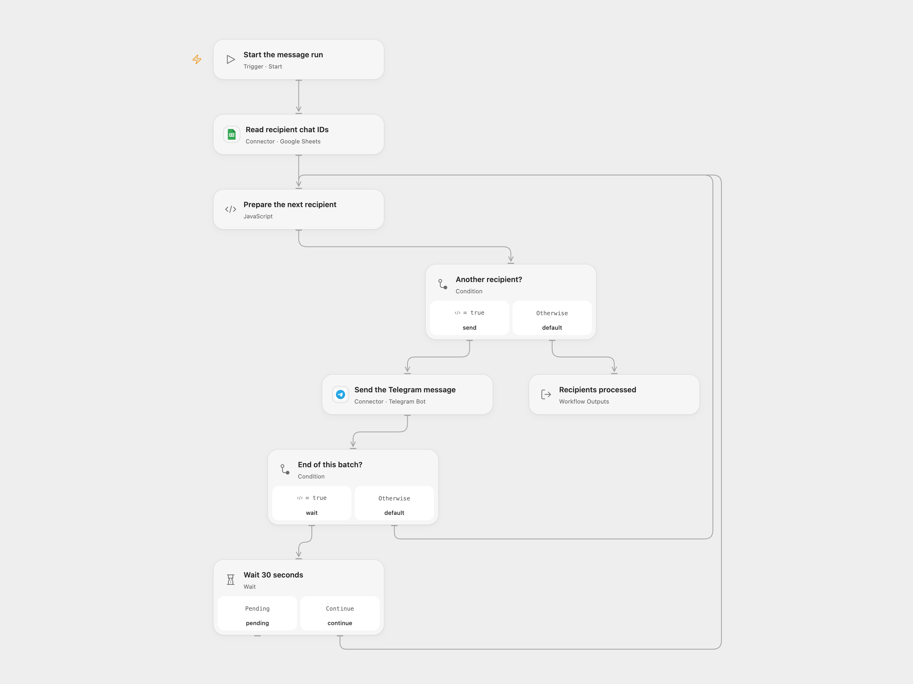

# Send Telegram Messages from a Sheet in Batches

Send a message to Telegram chat IDs listed in a Google Sheet, with a pause after each batch.

<picture>
  <source media="(prefers-color-scheme: dark)" srcset="preview-dark.png">
  
</picture>

[Open Flow JSON](templates/send-telegram-messages-from-sheet-in-batches.openflow.json) · [n8n JSON](templates/send-telegram-messages-from-sheet-in-batches.n8n.json)

## Setup

Connect Google Sheets and Telegram. Put the header `Chat ID` in column A and list one chat ID per row. Set the spreadsheet ID and adjust the default range `'Sheet1'!A:A` in **Read recipient chat IDs**. Store long numeric IDs as text. Set your message in **Send the Telegram message**. The bot must be able to message each chat.

In n8n, select the spreadsheet and sheet in **Google Sheets**, connect both services, and edit the message in **Telegram**. Run one format manually.

## Behavior

The workflow sends one message to each nonempty row in order and waits 30 seconds after every batch of up to 30 recipients. An empty list sends nothing. Repeated IDs receive repeated messages. The sheet is read once at the start. An invalid ID or failed send stops the run; earlier messages may already have arrived. An uncertain send may also have arrived, so check the chats before restarting. Messages use Telegram Markdown. The full sheet data must fit the Open Flow Code input limit.

Inspiration &amp; credits

## Changes to the source

- Configure the spreadsheet and replace the fixed greeting as needed. Open Flow sends each recipient sequentially while retaining the source batch size and pause.

Adapted from [Send Telegram messages from a spreadsheet](https://github.com/Zie619/n8n-workflows/blob/ae8cf6dc5b873cbb4f74587aa9180ed3a9f70682/workflows/Telegram/1127_Telegram_Wait_Automate_Triggered.json) in [Zie619/n8n-workflows](https://github.com/Zie619/n8n-workflows). The source export does not identify a separate template author or license.

The collection’s [MIT notice](https://github.com/Zie619/n8n-workflows/blob/94007c1445d9258a7da116646b79473e7c7c3282/LICENSE) is pinned at a later revision. This is the collection notice at that revision; it does not establish a separate original template author's license. Our changes are listed above; see [repository licensing](../../README.md#licensing).

> MIT License
>
> Copyright (c) 2025 Zie619
>
> Permission is hereby granted, free of charge, to any person obtaining a copy
> of this software and associated documentation files (the "Software"), to deal
> in the Software without restriction, including without limitation the rights
> to use, copy, modify, merge, publish, distribute, sublicense, and/or sell
> copies of the Software, and to permit persons to whom the Software is
> furnished to do so, subject to the following conditions:
>
> The above copyright notice and this permission notice shall be included in all
> copies or substantial portions of the Software.
>
> THE SOFTWARE IS PROVIDED "AS IS", WITHOUT WARRANTY OF ANY KIND, EXPRESS OR
> IMPLIED, INCLUDING BUT NOT LIMITED TO THE WARRANTIES OF MERCHANTABILITY,
> FITNESS FOR A PARTICULAR PURPOSE AND NONINFRINGEMENT. IN NO EVENT SHALL THE
> AUTHORS OR COPYRIGHT HOLDERS BE LIABLE FOR ANY CLAIM, DAMAGES OR OTHER
> LIABILITY, WHETHER IN AN ACTION OF CONTRACT, TORT OR OTHERWISE, ARISING FROM,
> OUT OF OR IN CONNECTION WITH THE SOFTWARE OR THE USE OR OTHER DEALINGS IN THE
> SOFTWARE.

