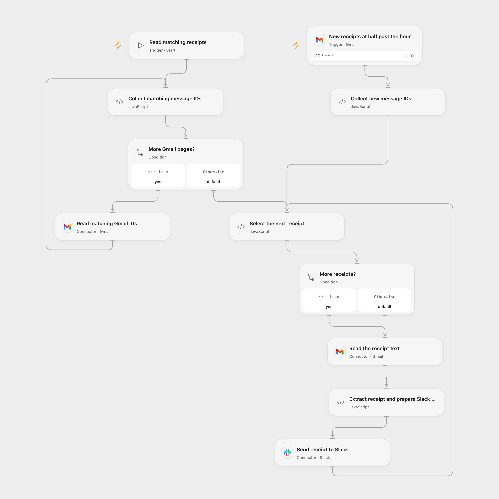

# Send Uber Eats Receipts to Slack

Extract food delivery receipt details from Gmail and send them to Slack with a Moze expense link.

<picture>
  <source media="(prefers-color-scheme: dark)" srcset="preview-dark.png">
  
</picture>

[Open Flow JSON](templates/send-ubereats-receipts-to-slack.openflow.json) · [n8n JSON](templates/send-ubereats-receipts-to-slack.n8n.json)

## Setup

Connect Gmail and Slack and select the same mailbox for the trigger and reads. Configure the Slack channel ID in **Send receipt to Slack** and the Gmail search on both **New receipts at half past the hour** and **Read matching Gmail IDs**. In n8n, connect Gmail and Slack and set the channel. The default filter and parser target a specific Traditional Chinese Uber Eats email format; test with your own receipts before use. Activate one format.

## Behavior

The Gmail trigger checks for new matching mail at minute 30 of each hour. Manual execution reads all matching historical messages and can send a notification for each, including messages already sent in earlier runs. Each matching plain-text receipt supplies amount, merchant, date and optional time. The Slack message includes a Moze 3 expense link with the example account, category and project; edit those values in **Extract receipt and prepare Slack message** or **Extract Price, Shop, Date, TIme** to match your app. The link is a custom app URL and requires a compatible Moze app and Slack client.

A receipt that does not match the expected format stops the run, so earlier messages may already have been sent. Failed or uncertain Slack sends may have succeeded; inspect the channel before retrying. No deduplication or automatic replay is added. Open Flow uses UTC for its schedule and processes Gmail events in batches of up to 100; n8n's poll schedule inherits its instance timezone and its version 1.2 trigger reads one Gmail list page per poll. Open Flow uses Gmail's normalized best-effort message text, which can differ from the original n8n text field.

Inspiration &amp; credits

## Changes to the source

- Replace the private Slack channel, encode the Moze link parameters, escape Slack text, and correct midnight conversion. Both formats validate receipt fields and construct the same message; n8n no longer appends its workflow link. Open Flow uses formal Gmail Actions for full historical pagination and individual message text reads.

Adapted from [Food delivery notifications and easy expense tracking](https://github.com/Zie619/n8n-workflows/blob/ae8cf6dc5b873cbb4f74587aa9180ed3a9f70682/workflows/Manual/1835_Manual_Slack_Automation_Triggered.json) in [Zie619/n8n-workflows](https://github.com/Zie619/n8n-workflows). The matching [n8n listing](https://n8n.io/workflows/2707-food-delivery-notifications-and-easy-expense-tracking/) credits darrell_tw. No separate original template license was found.

The collection’s [MIT notice](https://github.com/Zie619/n8n-workflows/blob/94007c1445d9258a7da116646b79473e7c7c3282/LICENSE) is pinned at a later revision. This is the collection notice at that revision; it does not establish a separate original template author's license. Our changes are listed above; see [repository licensing](../../README.md#licensing).

> MIT License
>
> Copyright (c) 2025 Zie619
>
> Permission is hereby granted, free of charge, to any person obtaining a copy
> of this software and associated documentation files (the "Software"), to deal
> in the Software without restriction, including without limitation the rights
> to use, copy, modify, merge, publish, distribute, sublicense, and/or sell
> copies of the Software, and to permit persons to whom the Software is
> furnished to do so, subject to the following conditions:
>
> The above copyright notice and this permission notice shall be included in all
> copies or substantial portions of the Software.
>
> THE SOFTWARE IS PROVIDED "AS IS", WITHOUT WARRANTY OF ANY KIND, EXPRESS OR
> IMPLIED, INCLUDING BUT NOT LIMITED TO THE WARRANTIES OF MERCHANTABILITY,
> FITNESS FOR A PARTICULAR PURPOSE AND NONINFRINGEMENT. IN NO EVENT SHALL THE
> AUTHORS OR COPYRIGHT HOLDERS BE LIABLE FOR ANY CLAIM, DAMAGES OR OTHER
> LIABILITY, WHETHER IN AN ACTION OF CONTRACT, TORT OR OTHERWISE, ARISING FROM,
> OUT OF OR IN CONNECTION WITH THE SOFTWARE OR THE USE OR OTHER DEALINGS IN THE
> SOFTWARE.

