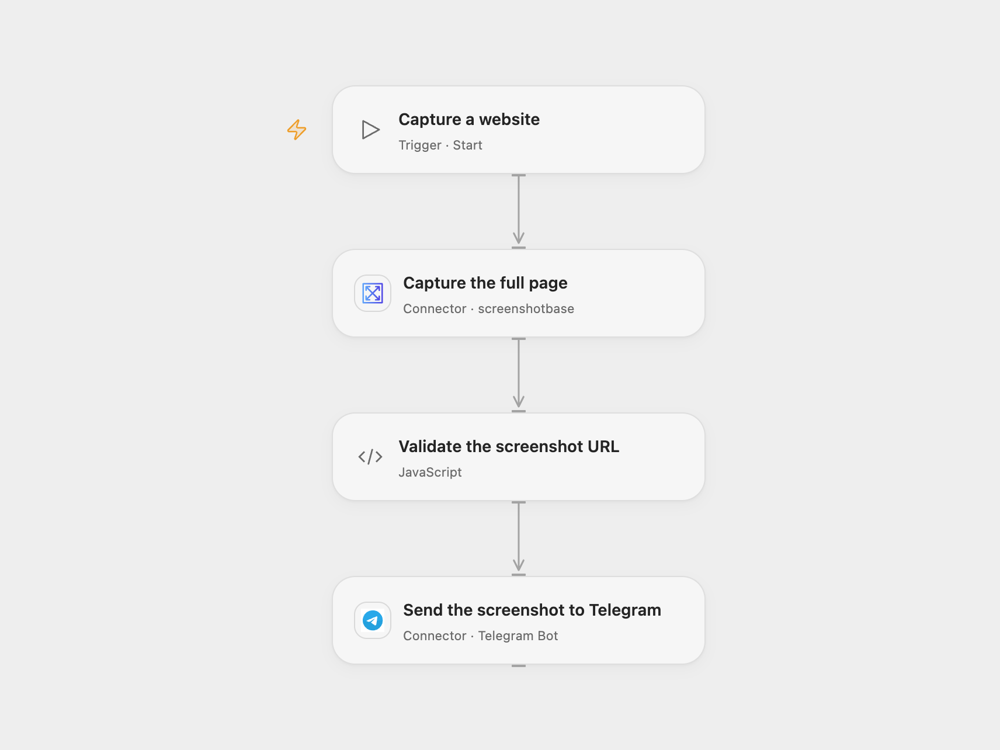

# Send a Website Screenshot to Telegram

Capture a full-page website screenshot and post the image to Telegram.

<picture>
  <source media="(prefers-color-scheme: dark)" srcset="preview-dark.png">
  
</picture>

[Open Flow JSON](templates/send-website-screenshot-to-telegram.openflow.json) · [n8n JSON](templates/send-website-screenshot-to-telegram.n8n.json)

## Setup

Connect Screenshotbase and Telegram. Set the website URL on **Capture the full page** and the chat ID on **Send the screenshot to Telegram**. In n8n, create a Header Auth credential with header apikey and your Screenshotbase API key, select it on **Capture the full page**, enter the website URL there, and connect Telegram and set its chat ID. Use a website you are authorized to capture. Run one format for each screenshot.

## Behavior

Each run asks Screenshotbase for a full-page PNG at a 1024-pixel viewport width and sends the hosted image URL to Telegram as a photo. Screenshotbase limits synchronous full-page captures to 20,000 CSS pixels in height. The workflow reads the PNG header and stops before sending if the screenshot is 20,000 pixels tall or more, its width is not 1024 pixels, or its dimensions cannot be verified. A complete image exactly 20,000 pixels tall is also rejected. The screenshot provider visits the website and stores a public image URL; Telegram fetches that image. The page URL and screenshot may contain sensitive information. Only capture pages and send images you are comfortable sharing with both services and anyone who obtains the image URL.

A failed capture, inaccessible image header, unsupported CDN host or invalid returned URL stops before sending. The header check requires a readable PNG from Screenshotbase’s cache.screenshotbase.com or cdn.screenshotbase.com. A failed or uncertain Telegram send may already have been delivered; inspect the chat before retrying. The image must meet Telegram photo limits and be accessible to Telegram.

Inspiration &amp; credits

## Changes to the source

- Replace uProc with the available Screenshotbase Action and its API in n8n. Both capture a full-page PNG with a 1024-pixel width; browser rendering, viewport interpretation, image hosting and retention can differ between services.
- Configure the Telegram destination and validate the returned URL before sending.

Adapted from [Create a screenshot of a website and send it to a Telegram channel](https://github.com/Zie619/n8n-workflows/blob/ae8cf6dc5b873cbb4f74587aa9180ed3a9f70682/workflows/Manual/0305_Manual_Telegram_Create_Triggered.json) in [Zie619/n8n-workflows](https://github.com/Zie619/n8n-workflows). The matching [n8n listing](https://n8n.io/workflows/858-create-a-website-screenshot-and-send-via-telegram-channel/) credits Harshil Agrawal. No separate original template license was found.

The collection’s [MIT notice](https://github.com/Zie619/n8n-workflows/blob/94007c1445d9258a7da116646b79473e7c7c3282/LICENSE) is pinned at a later revision. This is the collection notice at that revision; it does not establish a separate original template author's license. Our changes are listed above; see [repository licensing](../../README.md#licensing).

> MIT License
>
> Copyright (c) 2025 Zie619
>
> Permission is hereby granted, free of charge, to any person obtaining a copy
> of this software and associated documentation files (the "Software"), to deal
> in the Software without restriction, including without limitation the rights
> to use, copy, modify, merge, publish, distribute, sublicense, and/or sell
> copies of the Software, and to permit persons to whom the Software is
> furnished to do so, subject to the following conditions:
>
> The above copyright notice and this permission notice shall be included in all
> copies or substantial portions of the Software.
>
> THE SOFTWARE IS PROVIDED "AS IS", WITHOUT WARRANTY OF ANY KIND, EXPRESS OR
> IMPLIED, INCLUDING BUT NOT LIMITED TO THE WARRANTIES OF MERCHANTABILITY,
> FITNESS FOR A PARTICULAR PURPOSE AND NONINFRINGEMENT. IN NO EVENT SHALL THE
> AUTHORS OR COPYRIGHT HOLDERS BE LIABLE FOR ANY CLAIM, DAMAGES OR OTHER
> LIABILITY, WHETHER IN AN ACTION OF CONTRACT, TORT OR OTHERWISE, ARISING FROM,
> OUT OF OR IN CONNECTION WITH THE SOFTWARE OR THE USE OR OTHER DEALINGS IN THE
> SOFTWARE.

