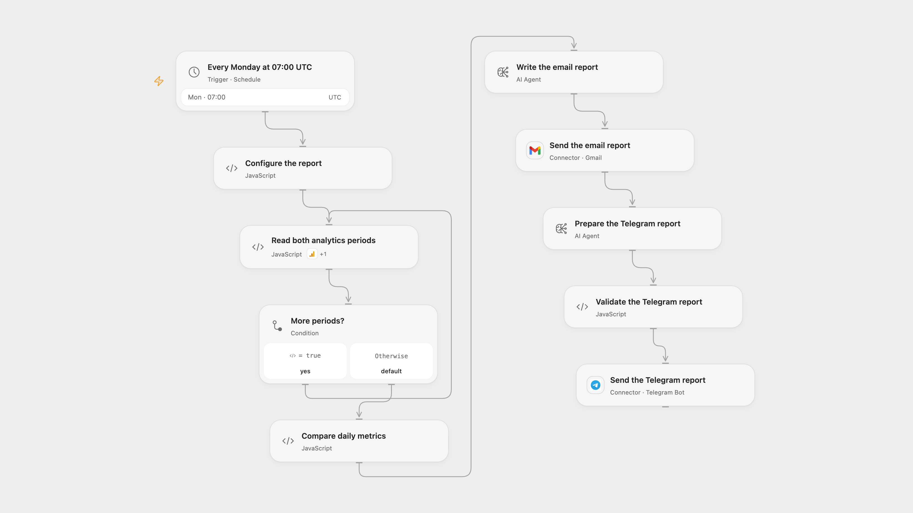

# Send Weekly Analytics Comparison to Email and Telegram

Compare weekly Google Analytics metrics with the same dates in the previous year and send an AI-written report.

<picture>
  <source media="(prefers-color-scheme: dark)" srcset="preview-dark.png">
  
</picture>

[Open Flow JSON](templates/send-weekly-analytics-comparison-to-email-and-telegram.openflow.json) · [n8n JSON](templates/send-weekly-analytics-comparison-to-email-and-telegram.n8n.json)

## Setup

Connect Google Analytics, Gmail and Telegram. Set the property ID, report email and Telegram chat ID in **Configure the report**. Configure the two model services; the email Agent can use its isolated JavaScript computation tool. In n8n connect Google Analytics OAuth, OpenAI, an SMTP account and Telegram, then set the property ID in **Configure the report**, and the sender, recipient and chat ID in the send nodes. Activate one format.

## Behavior

Each Monday at 07:00 UTC, two daily Google Analytics reports compare the seven UTC date labels ending yesterday with corresponding dates in the previous year. Analytics interprets dates in the property timezone; revenue uses the property reporting currency. If the recent end date is February 29 and the previous year has no February 29, the prior end date becomes March 1 and the prior period still spans seven dates. Page views, daily user totals, sessions, purchases and revenue are summed; sessions per user, session duration and revenue per purchase are averages of daily values. Daily users summed across days may count the same person more than once. A zero previous value has no percentage change. The model writes an HTML email and then a plain-text Telegram report; check AI output before relying on it. Limit access to reports and execution history.

Email is sent before Telegram. A later model or Telegram failure can leave the email delivered. A failed or uncertain send may already have succeeded; inspect the destination before retrying. n8n triggers at a fixed second within the scheduled minute; Open Flow triggers at the minute boundary.

Inspiration &amp; credits

## Changes to the source

- Replace private accounts, property and chat values. Set UTC explicitly, use two seven-date windows ending yesterday, and fill the source's missing user metric and date dimension.
- Open Flow calculates differences before model formatting and uses Gmail and an Agent with optional isolated computation; n8n retains SMTP and its native model/Calculator nodes for the comparison. Both format and send Telegram after email.

Adapted from [Google Analytics: Weekly Report](https://github.com/Zie619/n8n-workflows/blob/ae8cf6dc5b873cbb4f74587aa9180ed3a9f70682/workflows/Telegram/1392_Telegram_Googleanalytics_Automation_Scheduled.json) in [Zie619/n8n-workflows](https://github.com/Zie619/n8n-workflows). The source note credits [Friedemann Schütz](https://www.linkedin.com/in/friedemann-schuetz). The original template does not state a separate license.

The collection’s [MIT notice](https://github.com/Zie619/n8n-workflows/blob/94007c1445d9258a7da116646b79473e7c7c3282/LICENSE) is pinned at a later revision. This is the collection notice at that revision; it does not establish a separate original template author's license. Our changes are listed above; see [repository licensing](../../README.md#licensing).

> MIT License
>
> Copyright (c) 2025 Zie619
>
> Permission is hereby granted, free of charge, to any person obtaining a copy
> of this software and associated documentation files (the "Software"), to deal
> in the Software without restriction, including without limitation the rights
> to use, copy, modify, merge, publish, distribute, sublicense, and/or sell
> copies of the Software, and to permit persons to whom the Software is
> furnished to do so, subject to the following conditions:
>
> The above copyright notice and this permission notice shall be included in all
> copies or substantial portions of the Software.
>
> THE SOFTWARE IS PROVIDED "AS IS", WITHOUT WARRANTY OF ANY KIND, EXPRESS OR
> IMPLIED, INCLUDING BUT NOT LIMITED TO THE WARRANTIES OF MERCHANTABILITY,
> FITNESS FOR A PARTICULAR PURPOSE AND NONINFRINGEMENT. IN NO EVENT SHALL THE
> AUTHORS OR COPYRIGHT HOLDERS BE LIABLE FOR ANY CLAIM, DAMAGES OR OTHER
> LIABILITY, WHETHER IN AN ACTION OF CONTRACT, TORT OR OTHERWISE, ARISING FROM,
> OUT OF OR IN CONNECTION WITH THE SOFTWARE OR THE USE OR OTHER DEALINGS IN THE
> SOFTWARE.

