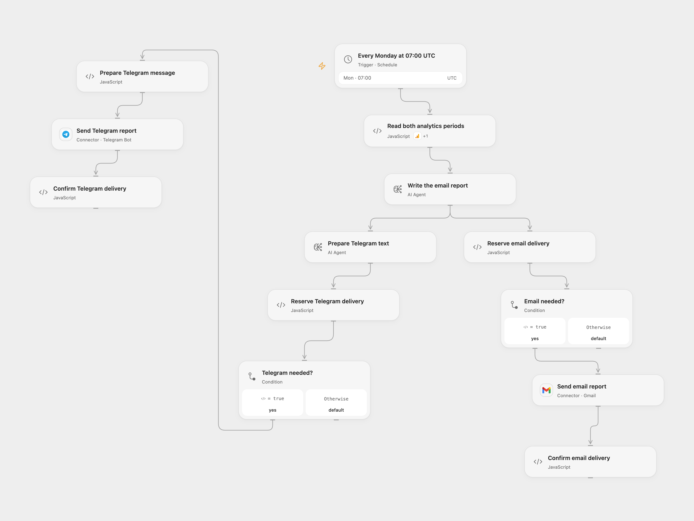

# Send Weekly GA4 Report by Email and Telegram

Compare daily GA4 metrics with the same dates a year earlier and send a weekly report.

<picture>
  <source media="(prefers-color-scheme: dark)" srcset="preview-dark.png">
  
</picture>

[Open Flow JSON](templates/send-weekly-ga4-report-by-email-and-telegram.openflow.json) · [n8n JSON](templates/send-weekly-ga4-report-by-email-and-telegram.n8n.json)

## Setup

Connect Google Analytics, Gmail and Telegram; configure the property ID, recipient and chat ID. Enable persistent State and configure AI models. In n8n configure GA4, OpenAI, SMTP and Telegram, set the property ID, sender, recipient and chat ID, and configure a Data Table with item_key and status text columns in both channel checkpoints. Use one format.

## Behavior

Every Monday at 07:00 UTC the report compares the date seven days before the run through the run date, inclusive, against the same range one year earlier. Google Analytics interprets dates in its property timezone. Daily counts are summed, while daily ratios are averaged; summed daily users can count the same person more than once. Revenue uses the property currency. The AI report is sent as HTML email and converted to plain text for Telegram.

Each channel is reserved separately before sending. If delivery is uncertain, inspect the destination and pending State or Data Table record before resolving it manually; prevent overlapping runs for the same date.

Inspiration &amp; credits

Adapted from [Google Analytics: Weekly Report](https://github.com/enescingoz/awesome-n8n-templates/blob/827110332c21cbe000ab13f6d292d5adb1f1f8db/AI_Research_RAG_and_Data_Analysis/Create%20a%20Google%20Analytics%20Data%20Report%20with%20AI%20and%20sent%20it%20to%20E-Mail%20and%20Telegram.json) in [enescingoz/awesome-n8n-templates](https://github.com/enescingoz/awesome-n8n-templates).

Source collection notice: © 2024–2026 Enes Cingoz, [CC BY 4.0](https://github.com/enescingoz/awesome-n8n-templates/blob/827110332c21cbe000ab13f6d292d5adb1f1f8db/LICENSE). The source export does not identify a separate template author or license. See [repository licensing](../../README.md#licensing) for the scope of OOMOL contributions and third-party material.

