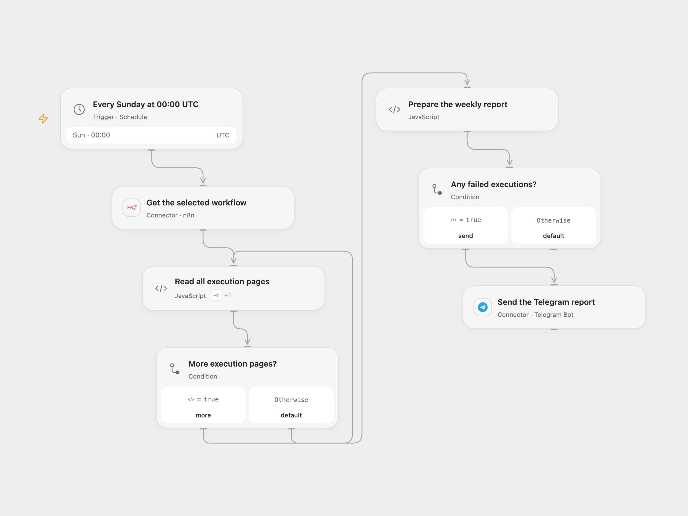

# Send a Weekly Workflow Failure Report

Send a weekly Telegram report of failed executions for one n8n workflow.

<picture>
  <source media="(prefers-color-scheme: dark)" srcset="preview-dark.png">
  
</picture>

[Open Flow JSON](templates/send-weekly-workflow-failure-report.openflow.json) · [n8n JSON](templates/send-weekly-workflow-failure-report.n8n.json)

## Setup

Connect n8n and Telegram. Set the n8n workflow ID in **Get the selected workflow** and set a Telegram chat ID in **Prepare the weekly report**. In n8n, select the workflow in **Get all previous executions** and set its name and the chat ID in **Prepare the weekly report**; connect Telegram. Activate one format. Both schedules start at Sunday 00:00 UTC; adjust them to suit your reporting week.

## Behavior

The workflow reads the selected n8n workflow's execution history and sends one Telegram message listing executions that started in the past seven days and have status `error` or `crashed`. Waiting, running and successful executions are excluded. No matches send nothing. Execution history depends on the n8n instance's retention and API access. Open Flow uses the scheduled occurrence as the end of the seven-day window; n8n uses its actual execution time, so delayed runs can differ. Open Flow keeps the read pages in the run and is subject to its execution limits. A report longer than 4,096 characters stops rather than silently truncating. A lost Telegram response may still mean a message was delivered; inspect the chat before replaying.

Inspiration &amp; credits

## Changes to the source

- Use an explicit Sunday UTC schedule and filter for error and crashed execution status to match the source’s failure-report goal. The source inherited the instance time zone and used an every-seven-days interval.
- Replace the unconfigured chat and workflow selection; include the execution ID and timestamp as plain text rather than links with incomplete URLs.

Adapted from [Weekly failures report](https://github.com/Zie619/n8n-workflows/blob/ae8cf6dc5b873cbb4f74587aa9180ed3a9f70682/workflows/Telegram/0465_Telegram_Filter_Send_Scheduled.json) in [Zie619/n8n-workflows](https://github.com/Zie619/n8n-workflows). The source export does not identify a separate template author or license.

The collection’s [MIT notice](https://github.com/Zie619/n8n-workflows/blob/94007c1445d9258a7da116646b79473e7c7c3282/LICENSE) is pinned at a later revision. This is the collection notice at that revision; it does not establish a separate original template author's license. Our changes are listed above; see [repository licensing](../../README.md#licensing).

> MIT License
>
> Copyright (c) 2025 Zie619
>
> Permission is hereby granted, free of charge, to any person obtaining a copy
> of this software and associated documentation files (the "Software"), to deal
> in the Software without restriction, including without limitation the rights
> to use, copy, modify, merge, publish, distribute, sublicense, and/or sell
> copies of the Software, and to permit persons to whom the Software is
> furnished to do so, subject to the following conditions:
>
> The above copyright notice and this permission notice shall be included in all
> copies or substantial portions of the Software.
>
> THE SOFTWARE IS PROVIDED "AS IS", WITHOUT WARRANTY OF ANY KIND, EXPRESS OR
> IMPLIED, INCLUDING BUT NOT LIMITED TO THE WARRANTIES OF MERCHANTABILITY,
> FITNESS FOR A PARTICULAR PURPOSE AND NONINFRINGEMENT. IN NO EVENT SHALL THE
> AUTHORS OR COPYRIGHT HOLDERS BE LIABLE FOR ANY CLAIM, DAMAGES OR OTHER
> LIABILITY, WHETHER IN AN ACTION OF CONTRACT, TORT OR OTHERWISE, ARISING FROM,
> OUT OF OR IN CONNECTION WITH THE SOFTWARE OR THE USE OR OTHER DEALINGS IN THE
> SOFTWARE.

